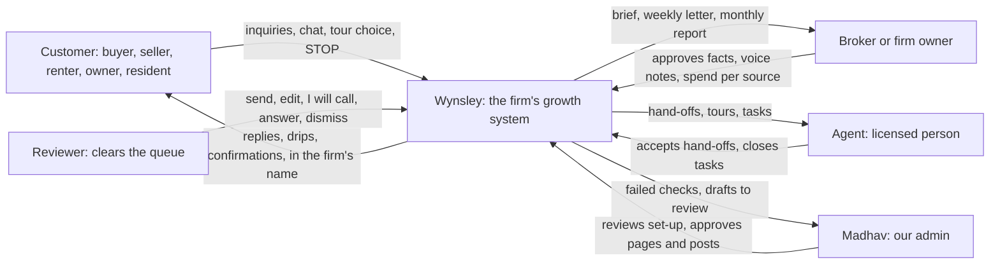
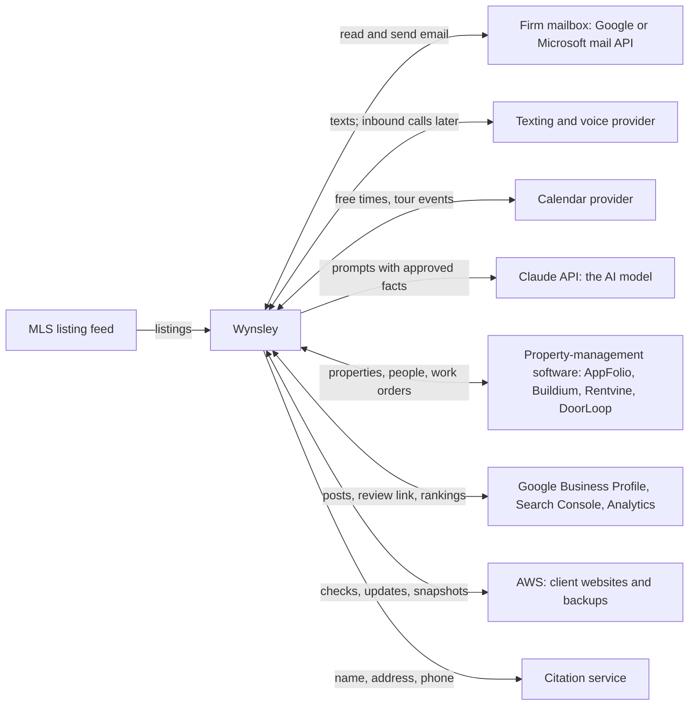
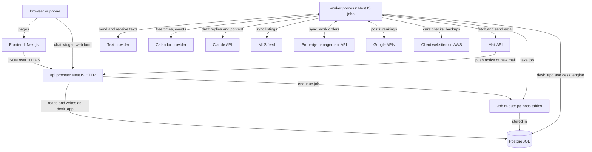
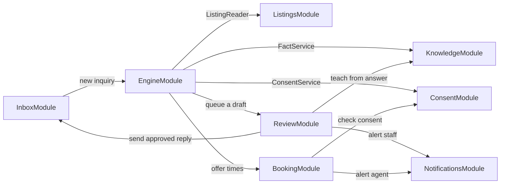
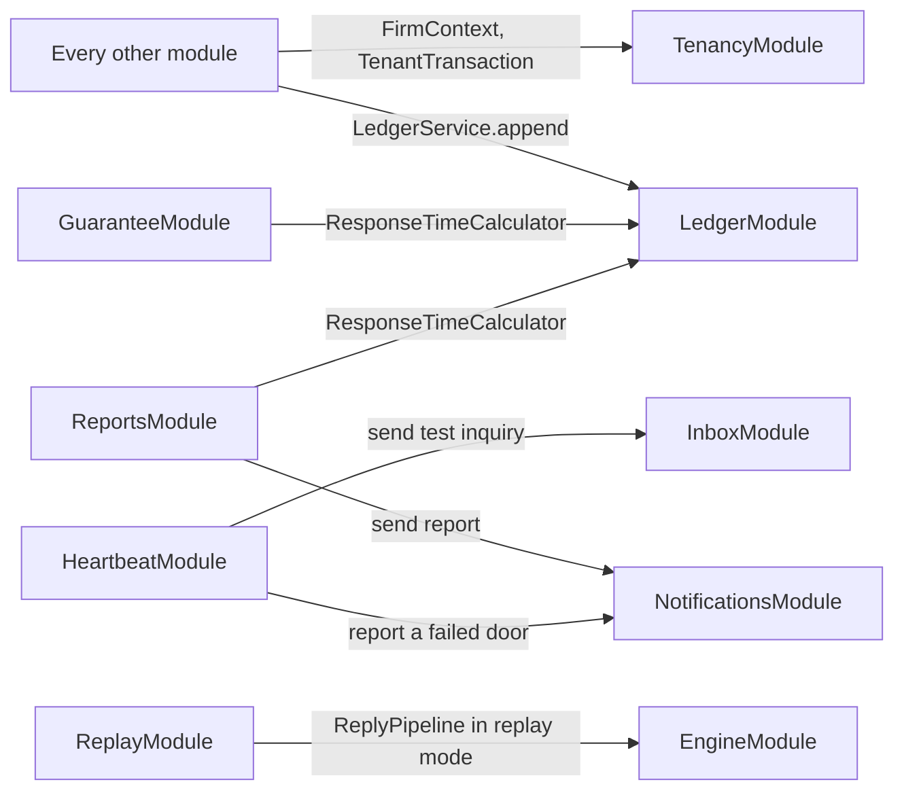
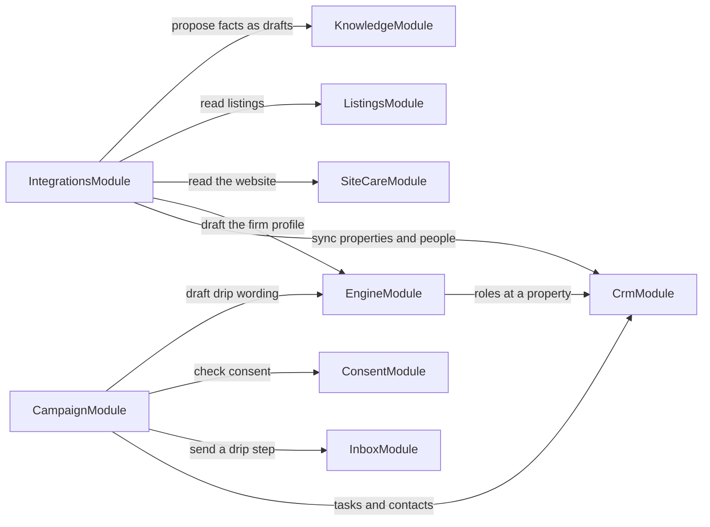
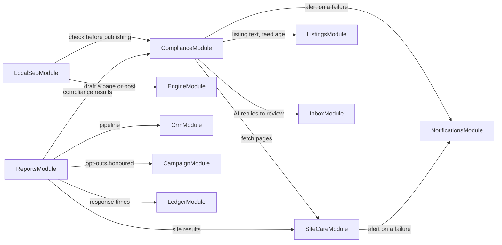
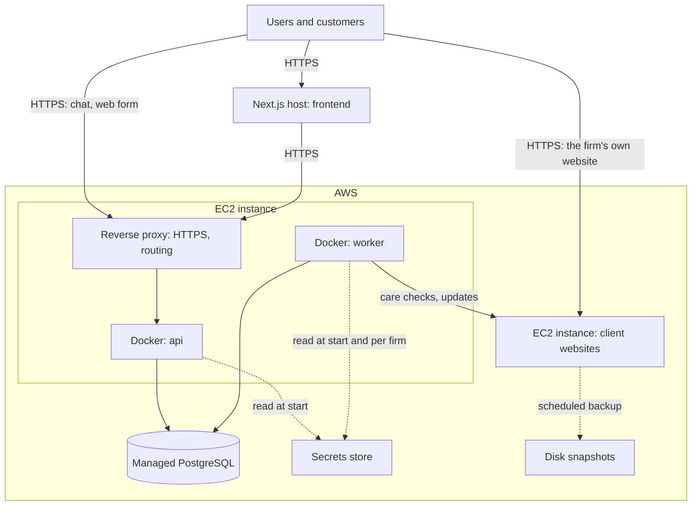

# 01. High-level design

This document shows the whole of Wynsley from the outside in: who uses it, which outside services it talks to, the processes it runs as, how its backend modules depend on each other, and where it is deployed. It then follows one inquiry through the system, explains how firms are kept apart, and records the main design decisions, the scaling path and the open risks. It covers the company's whole first offer, of which the AI desk is one module.

## 1. Summary

Wynsley is a growth partner with its own software inside, for small US brokerages that sell, rent and manage homes (roughly 5 to 50 agents), starting in South Florida. It begins as done-for-you monthly plans run mostly by software and AI, and grows into the platform these firms run on. It is the technology layer between the brokerage, its agents, its landlords and their customers. It is never a party to a deal: everything customer-facing happens in the brokerage's name and under its license.

The first offer has six modules:

1.  **Website care** (`SiteCareModule`): hosting, security updates, backups, uptime and speed checks, small content edits, and the listing search and listing pages, built on the same per-firm MLS copy the desk syncs, with the MLS display rules checked nightly.
2.  **Local SEO** (`LocalSeoModule`): area landing pages, Google Business Profile (GBP) posts and review links, citations (the firm's name, address and phone listed on directories) and a ranking report. AI drafts; Madhav, our admin, approves.
3.  **CRM and lead automation** (`CrmModule` and `CampaignModule`): one record per person across buying, selling, renting and owning; the pipeline; routing; instant reply; drip email and text messages (a short series of follow-ups sent on a schedule); pipeline reports.
4.  **AI assistants**, the desk (`InboxModule`, `EngineModule`, `ReviewModule`, `BookingModule`): for every inquiry it captures the message, answers in under a minute from facts the firm has approved, qualifies the person, books a tour, hands off to a licensed person, and records every step in a ledger (an append-only log that cannot be edited). Anything the AI is unsure about waits in a human review queue. An AI voice receptionist for inbound calls is an optional add-on.
5.  **Monthly dashboard and compliance** (`ReportsModule` and `ComplianceModule`): leads, cost per lead and response times from the ledger; accessibility, MLS display, brokerage-name and fair-housing checks.
6.  **Rentals: our PMS, in stages** (`RentalsModule`, `PaymentsModule` and `IntegrationsModule`): connects to the firm's property-management software where it has one; then our own rentals tools (units, leases, repairs and owner updates) and online rent through Stripe into the broker's trust account. It answers leasing and owner questions, and it never holds rent money. Changed on 23 Nov: see [the update](06-update-23-nov.md).

Every firm feels custom through data, not code: a firm profile (areas, services, routing, tone of voice), settings copied from a shared starting template for its firm type, its own custom fields, and an AI that writes only from the firm's own approved facts.

Many firms share one system. This is called **multi-tenancy**: each firm is a **tenant**, and one tenant's data must never mix with another's.

The backend is a **modular monolith**: one codebase, deployed as one service, but split into strict modules that only talk through declared interfaces. It runs as two processes from the same code: `api` (answers HTTP requests) and `worker` (runs background jobs).

### Goals for the first offer

The desk (V1), unchanged:

- Capture inquiries from each firm's own mailbox and web form.
- Send a first reply within 60 seconds for 95% of inquiries. Email and chat replies go out at any hour; a text reply waits for the texting window: 8 a.m.–8 p.m. in the recipient's local time, which a firm may narrow but never widen.
- Answer only from approved facts and public listing fields, and show the source of every fact stated.
- Say it is an AI in the first message; keep "Talk to a person" always available.
- Send no text message without recorded consent.
- Route hard cases to a review queue the broker clears from a phone.
- Book tours on an agent's calendar and hand off with a clock.
- Keep a ledger that can prove what happened, and produce the morning brief, weekly letter, seller log and owner note from it.
- Run a Replay (a firm's past inquiries pushed through the engine) as the sales demo.
- Use one meaning of "after hours" everywhere (Replay report, weekly letter, customer chat): the inquiry arrived outside the firm's office hours, which each firm sets as weekly opening times in its own time zone.
- Support a silent week (the engine drafts but never sends) before going live.

The rest of the offer:

- Keep one record per person across every role they hold at every property, filled from every email, text and call so nobody types data in.
- Run drips that stop the moment a person replies, opts out or closes, and never send without recorded consent.
- Check each firm's website for uptime, speed, security updates and backups, and alert at once on a failure.
- Draft area pages and GBP posts from approved facts, and publish nothing without a person's approval.
- Build and test each site to WCAG 2.2 AA (the middle level of the web accessibility guidelines), with automated scans and a person's review; check MLS display rules, the brokerage name beside every point of contact, and fair-housing wording; keep every result.
- Sync properties, owners and tenants from the firm's property-management software, and deep-link to its own payment page.
- Send a monthly report with leads, cost per lead, reply times, the pipeline, site health, compliance results and opt-outs honoured.
- Set a new firm up in about an hour: AI reads its website and listings and drafts its profile and settings; Madhav reviews them; the broker approves every fact.

### Non-goals for the first offer

- Paid ads, landlord acquisition funnels, agent recruiting, resident newsletters, building microsites, social and video content, and reputation management beyond GBP review links. These are later add-ons at most.
- Holding or moving rent money. Rent is paid through the firm's own property-management software.
- Outbound AI calls. Inbound AI voice is an optional add-on through the `ChannelAdapter` interface.
- A separate CRM, codebase or custom code per client.
- Being a party to a deal, or presenting the AI as a licensed agent.
- Our own resident or owner portal: residents and owners use the portal in the firm's property-management software.
- WhatsApp, a workflow builder, a billing portal, developer or SDK pages.
- Text-message and chat channels are designed for (the `ChannelAdapter` interface) but ship after the mailbox and web form.
- Splitting the backend into separate services.

## 2. System context

A **system context diagram** shows the system as one box, with the people who use it and the outside systems it depends on. It is drawn in two parts: the people, then the outside services.

**How to read this.** Each box on the left is a kind of person; the right box is the whole product. Customers only ever hear from the firm: every reply and drip goes out in the brokerage's name. The broker approves what the AI may say; Madhav reviews set-up and approves public pages and posts.

**How to read this.** These are the services we rent rather than build. Arrows show what flows and in which direction. The customer never sees them directly: email and texts come from the firm's own mailbox and number, and rent is paid inside the firm's own property-management software.

## 3. Containers

A **container** here means a separately running piece: an app, a process or a data store (not only a Docker container).

**How to read this.** The frontend only talks to the `api` process. The `api` process answers quickly and pushes slow work onto the job queue; the `worker` process does that slow work, including every call to an outside service: drips, website checks, property syncs and posts all run as jobs. The queue lives inside PostgreSQL, so there is only one data store to run.

## 4. Backend module map

A **module** is a NestJS unit that groups related classes and exports only what other modules may use. An **interface** is a contract (method names and types) with no code behind it.

**How to read this.** An arrow means "may call". This is the reply path: the inbox hands an inquiry to the engine, the engine asks other modules for facts, listings and consent, and either replies or puts the draft in the review queue.

**How to read this.** These are the supporting modules. "Every other module" stands for the remaining modules: each one may write to the ledger and every module runs its database work inside a `TenantTransaction`. The ledger and tenancy modules call no one.

The rest of the first offer adds six modules and extends `ReportsModule`. The next two diagrams show who they may call.

**How to read this.** This is the record, the drips and the connections. `IntegrationsModule` sits at the top: it connects the firm's systems, syncs them into the CRM and runs AI onboarding, and no module calls it. `CrmModule` calls no growth module; it keeps the record current by listening to the ledger.

**How to read this.** This is the website, local SEO, compliance and the monthly report. `ReportsModule` and `LocalSeoModule` call others and are called by no one. `ComplianceModule` reads what it checks (pages, listing text, AI replies) through other modules' exported readers, never their tables.

### The dependency rule

1.  Modules talk only through what another module exports: an interface or a service. No module imports another module's repositories, entities or internal classes.
2.  Nothing depends on the engine's internals. Other modules see only `ReplyPipeline` and `ContentDraftService`; the `ReplyStep`s, `ReplyRule`s and `LlmClient` stay private to `EngineModule`.
3.  Every module may write to the ledger through `LedgerService.append`, and only that way.
4.  `TenancyModule` and `LedgerModule` depend on nothing else. They sit at the bottom.
5.  No cycles. If two modules seem to need each other, one of them publishes a ledger event or a job instead of calling. `CrmModule` and `CampaignModule` use this: they listen to ledger events (`inquiry.received`, `message.received`, `tour.booked`, `deal.stage_changed`), so a reply or a closed deal reaches them without a call.
6.  No module asks another for credentials. Every adapter reads its firm's secret through `SecretStore` by the reference name that `integration.secret_ref` records.

## 5. Deployment

**How to read this.** A **reverse proxy** is a small server that receives all HTTPS traffic and forwards it to the right container. Both containers run the same image with a different start command. The database is managed, meaning AWS handles backups and patches. Client websites run on their own instance, so a busy site cannot slow the desk; the worker checks and updates them, and scheduled disk snapshots back them up. Dotted lines are reads of secrets and backups, not live traffic.

### Environments

| Environment | Where | Data | Outside services |
|----|----|----|----|
| Local | A developer laptop with Docker Compose: PostgreSQL, `api`, `worker`, frontend dev server | Seed data for two test firms | Fakes by default (`FixedClock`, a fake `LlmClient`, `ChannelAdapter`, `PropertyManagementAdapter`, `PageFetcher` and `SecretStore`); real sandbox keys only when testing an adapter |
| Staging | Its own small EC2 instance and its own managed database | Seed data plus a test firm with a test mailbox | Real services, test accounts, a separate Claude API key |
| Production | EC2 plus managed PostgreSQL as above | Real firms | Real services, each firm's own mailbox and number |

Each environment has its own database, secrets and keys. Nothing is shared between them.

## 6. Data flow for one inquiry

1.  A customer emails the firm's listing address. The mail API notifies the `api` process.
2.  The `api` process checks the notice, finds the firm from the mailbox address, and enqueues an `ingest` job keyed on the email's own message ID. It returns at once.
3.  The `worker` takes the job. `EmailChannelAdapter.receive` fetches the email. `InquiryIngestService`, inside a `TenantTransaction` that sets `app.firm_id`, finds or creates the `Contact` and `Conversation`, tags the conversation with its lead source (for example `zillow` for a portal email), stores the `Message`, and appends `inquiry.received` to the ledger. If the same email already exists, it stops here.
4.  It enqueues a `reply` job. The worker runs `ReplyPipeline` on a connection using the `desk_engine` role:
    - `ClassifyIntentStep` works out what the person wants.
    - `RetrieveFactsStep` loads approved facts and the public listing view.
    - `DraftReplyStep` asks `LlmClient` for a reply that cites only those facts.
    - `RuleCheckStep` runs every `ReplyRule`: consent, sending hours (a text outside the texting window, 8 a.m.–8 p.m. in the recipient's local time, waits until it opens; email and chat are never held), fair housing, every fact has a source, AI disclosure in the first message.
    - `DecideStep` returns a `ReplyDecision`: send now, queue for review, or (silent week) keep as a draft.
5.  The draft `Message` and its `MessageSource` rows are written, with `draft.created` in the ledger.
6.  If the decision is send, `EmailChannelAdapter.send` sends from the firm's own mailbox, the message becomes `sent`, and `reply.sent` is appended. The response time is the gap between `inquiry.received` and the first `reply.sent`.
7.  If the decision is review, a `ReviewItem` is opened and `NotificationsModule` tells the reviewer. The reviewer answers 1, 2 or 3; `ReplyCodeParser` and the matching `ReviewResolutionHandler` finish the job. A Question item is answered (typed or spoken) and an FYI item is dismissed through the same path, by `AnswerHandler` and `DismissHandler`.
8.  When the customer picks a tour time, `TourService` books it through `CalendarProvider`, and `HandoffService` offers the conversation to an agent with a deadline. Each step lands in the ledger.
9.  `CrmLedgerSubscriber` hears `inquiry.received` and `tour.booked` and keeps the person's record current: their role at the property (for example `buyer_interest`) and their `Deal`, routed to an agent by `RoutingService`. `CampaignModule` may enroll them in a drip, which stops if they reply or opt out.
10. Next morning, `MorningBriefGenerator` and `GuaranteeService` read the ledger to report what happened. At month end, `MonthlyReportGenerator` reads the same ledger.

## 7. Multi-tenancy

Every table except `firm` and `firm_template` has a `firm_id` column. `firm_template` is the one global table: it holds the shared starting templates by firm type, both firm roles may read it, and only the schema owner (the role that runs migrations) may change it. Three layers keep one firm's data apart:

1.  **The firm setting on the connection.** `FirmGuard` works out the firm from the signed-in user (or, for incoming mail, from the mailbox address) and puts it in `FirmContext`. `TenantTransaction` opens each database transaction with `set_config('app.firm_id', <firm>, true)`. The `true` means the setting ends with the transaction, so it cannot leak to the next request that borrows the same connection.
2.  **Row-level security (RLS).** RLS is a PostgreSQL feature that filters rows by a rule on every query. Every tenant table has the rule `firm_id = current_firm_id()`, which reads `app.firm_id`. It is forced, so it also applies to the table owner. With no firm set, every query sees zero rows. Foreign keys include `firm_id`, so a row cannot point at another firm's row even by mistake.
3.  **Two database roles.** `desk_app` is used by the `api` and `worker`; it cannot update or delete the ledger or the website and compliance check results, and it can only read the starting templates. `desk_engine` is used only while `ReplyPipeline` runs; it can read public data and approved facts and insert drafts, sources and ledger events. It reads listings only through the `listing_for_engine` view, and has no access to the `listing` table or to `listing_private`. (The view is owned by a third role, `desk_listing_reader`, that never connects; row-level security applies to it, so the view still shows only the current firm's rows.)

The tested schema proves these rules: firm A reads zero rows of firm B, cannot update B's rows, cannot insert a row tagged with B, the engine role is refused on `listing` and `listing_private`, and through the view the engine sees none of another firm's listings. The same isolation is tested on each of the 17 new tenant tables, and a check confirms that 41 of the 42 tables have forced row-level security, the global `firm_template` being the one exception.

## 8. Quality targets

| Target | How the design meets it |
|----|----|
| First reply within 60 seconds for 95% of inquiries; email and chat reply at any hour, a text reply waits for the texting window (8 a.m.–8 p.m. in the recipient's local time; a firm may narrow it, never widen it) | Mail arrives by push notice, not polling. The `api` only enqueues; the `worker` picks jobs within seconds. The engine makes one main model call with a tight prompt. `ResponseTimeCalculator` measures it from the ledger, and `GuaranteeService` checks it daily. |
| The ledger is never edited or deleted | `desk_app` has no UPDATE, DELETE or TRUNCATE on `event`, and database triggers reject them for every role. `LedgerService` only has `append`. |
| No cross-firm reads or writes, enforced in the database | Forced RLS on `app.firm_id`, composite firm foreign keys, and a per-transaction setting. Application bugs cannot bypass it. |
| Ingestion is idempotent | Every inbound message is keyed by its channel's own ID (for email, the message ID header) stored in `message.external_id`. A partial unique index on `message (firm_id, external_id)` makes this a database rule: the same ID cannot be stored twice in one firm, even if two deliveries race. The ingest job uses the same key, so a repeated notice is dropped by the queue and a repeated fetch finds the existing row. |
| Outside calls are retried with back-off; a failed step never loses an inquiry | Each outside call runs in its own pg-boss job with retry and exponential back-off. The inquiry is saved before any reply work starts. After the last retry the job opens a `ReviewItem` so a person sees it. |
| The engine reads only what it needs | The engine runs as `desk_engine`, reads listings only through `listing_for_engine` (no grant on the `listing` table, so it never sees removed listings or feeds not licensed for answering) and facts through `approved_fact`, and has no grant on `listing_private`. Of the new data it reads only who holds which role at a property, and the starting templates; it has no grant on deals, drips, spend, check results, content or integrations. |
| A drip stops in the same transaction that records an opt-out | A database trigger stops every active enrollment of that person on that channel when their consent is revoked, and another refuses to start or restart one without active consent. A reply stops a drip through `CampaignLedgerSubscriber`. |
| Nothing the AI drafts goes out without a person; every fact it states was approved by the broker | Pages, posts and drips cannot leave draft without an approval time (database checks). `ContentDraftService` writes only from `approved_fact` and public listing fields, and a message can cite only an approved fact version. |
| Website and compliance check results are never edited | Like the ledger: triggers reject UPDATE, DELETE and TRUNCATE on `site_check` and `compliance_check`, and `desk_app` has no such permission. A person's review is a new row. |
| No secret is stored in the database | `integration` holds only `secret_ref`, a name such as `secrets/<firm>/<system>`; database checks reject a value shaped like a key there, and any setting whose name suggests a secret. `SecretStore` reads the value at the moment of use. |
| The property-management sync is idempotent | Each property is matched on its own id in the firm's software (`property.pms_property_ref`, unique per firm), so a repeated sync updates the same row. |
| Monthly numbers are never typed by hand | `MonthlyReportGenerator` reads the ledger (`ResponseTimeCalculator`), the pipeline, stored check results, enrollments and the spend the firm entered; cost per lead is shown only for sources with spend. |

## 9. Security and privacy

- **Consent.** `ConsentService` records how and when consent was given, per contact and channel kind. `ConsentRule` blocks any text message without active consent. Revocation (for example, a STOP reply) takes effect at once and is logged. Even with consent, `SendingHoursRule` sends texts only inside the texting window: 8 a.m.–8 p.m. in the recipient's local time (the contact's time zone, or the firm's when unknown). A firm may narrow the window but never widen it; database checks enforce both bounds, and the database function `is_in_text_window` gives every sender the same answer.
- **Private listing fields.** Owner names, lockbox locations and showing instructions are split into `listing_private` when listings are synced. A database check rejects them inside the public record. The engine role cannot read them, so they can never reach the AI model.
- **Least privilege.** Each role and each module gets only what it needs: two database roles (the engine reads listings only through a view), module exports limited to interfaces, and mailbox access limited to the scopes needed to read and send.
- **Secrets.** API keys and mailbox tokens live in the secrets store, never in the code, the image or the database. A firm's `integration` row holds only the secret's name (`secret_ref`); `SecretStore` reads the value when the `worker` needs it and keeps it in memory only.
- **Audit trail.** Every step is a ledger event with who did it (`ai`, `user`, `contact` or `system`). The receipt screen is built from these events.
- **Logs.** Logs hold IDs and event types, never message bodies, names, emails or phone numbers.
- **AI disclosure.** A database trigger rejects a first AI message that does not say it is an AI.
- **One stop list.** A STOP reply, an unsubscribe link or a written request revokes consent, and the database stops that person's drips on that channel in the same transaction. From 25 Nov 2026 (FCC 26-67), one opt-out from a marketing call or text stops all marketing calls and texts from that sender, so for a marketing opt-out the app revokes every channel. Opt-outs must already be honoured within 10 business days; here it happens in the same transaction. The attorney confirms the reading.
- **The brokerage's name everywhere.** The firm's registered name (in `firm.profile`) sits beside every phone number, form and chat button, in email footers, text signatures and AI greetings. `BrokerageNameChecker` checks pages and drafts for it.
- **Fair housing.** `FairHousingRule` checks every reply before it is sent; `FairHousingChecker` reviews sent AI replies and listing text afterwards, and its results are kept.
- **Rent money.** The system never receives or moves rent or deposits. Reminders deep-link to the payment page in the firm's own property-management software.
- **Onboarding guardrail.** The step that reads a firm's public website never sees its mailbox, and client mail is never used to train models.

## 10. Key design decisions

| Decision | Alternatives considered | Why this choice |
|----|----|----|
| Modular monolith | Microservices from day one | One founder, one deployment, one database. Module boundaries give most of the benefit without network calls between services. **Split trigger:** a module needs to scale or deploy on a different schedule (likely the engine or the inbox), or a separate team owns it. Because modules already talk through interfaces, a split replaces an in-process call with a network call. |
| NestJS | Express alone; Fastify alone; Python with FastAPI | TypeScript on both ends; built-in modules and dependency injection fit the strict module plan; mature support for guards, jobs and testing. |
| PostgreSQL with row-level security | A database per firm; a schema per firm; filtering only in application code | One database is cheap to run. RLS puts the firm rule in the database, so a forgotten `WHERE` cannot leak data. The rule is already tested. |
| Job queue in PostgreSQL (pg-boss) | Redis with BullMQ; Amazon SQS | No extra infrastructure in V1. A job can be enqueued in the same transaction as the data it relates to, so either both are saved or neither. |
| Each firm's own mailbox and number | One shared sending domain and number for all firms | Replies come from the firm customers already know, which helps trust and email delivery, and keeps the firm owning its conversations. One firm's sending problems cannot hurt another's. |
| No stored AI index of listing text | Store embeddings (number vectors) of listing text for search | Listings change and dropped ones must be removed within 12 hours (BeachesMLS rule 20.2.5); a copy in an index would drift and could hold private text. Facts per firm are few enough to load directly, and listings are looked up by ID or address. |
| One MLS sync for the desk and the website | A second sync or feed for each firm's website | One sync, two uses: each firm's listing search and listing pages read the same per-firm copy the desk syncs. One copy means one purge and one `listing.purged` record per removed listing, so removal within BeachesMLS's 12 hours is provable in one place for both. The site reads the copy through its own view (to build), gated on website (IDX) display and never on `answer_inquiries`, so turning on the website never turns on AI answers. |
| One multi-tenant system; firms differ by data | A CRM or codebase per client; custom code for a client | Every client request becomes a setting, a field, a template or a rule. Settings are copied from a shared template by firm type, so a later template change never surprises an existing firm. |
| Build the record, the rules and the reports; connect the pipes | Build on the client's CRM; build our own texting, hosting or property software | The record, consent ledger, checks and reports are what make us the firm's system of record. Mail, texting, hosting, Google, the MLS feed and property software are regulated or commodity pipes, reached through adapters. |
| Check results are append-only | Update one row per check | The monthly report and any dispute need the history: when a check failed, who reviewed it, when it passed again. |
| Never hold rent money | Collect rent and pass it on | Florida treats entrusted funds and money transmission as regulated. Deep links to the firm's own payment page keep us out of it. |

## 11. Scaling path

| Scale | What changes |
|----|----|
| 10 firms | Nothing structural. One EC2 instance, one `worker`, a small managed database, one instance for client websites. Add monitoring of job wait time and first-reply time. Anonymous benchmarks across firms become possible; they need a reporting role that sees only totals, never rows. |
| 100 firms | Run several `worker` containers; pg-boss shares jobs safely between them. Move to a larger database with a read replica for reports. Add a connection pooler in transaction mode. Check query plans on the ledger and conversation tables; add indexes. Put the `api` behind a load balancer on two instances. Spread client websites over several instances. |
| 1,000 firms | Split the ledger table by month. Consider moving the job queue to a dedicated queue service if it loads the database. Split the engine into its own service if its load or release pace differs from the rest. Consider grouping firms across more than one database. |

## 12. Risks and open questions

- **Speed at real volume has not been tested.** Only small seed data has been run.
- **Removing one person's data.** The ledger cannot be edited, so a redaction procedure is needed for privacy requests and firm offboarding.
- **12-hour purge of removed listings** (BeachesMLS rule 20.2.5) needs a scheduled job; the database records `removed_at` but does not run the purge. Until that job is built, this is an open risk. It must delete removed listings within 12 hours, inside the 48 hours the BeachesMLS data agreement allows for data that drops out of the feed (paragraph 3), and write `listing.purged` to the ledger, so compliance is provable. By our own rule, the 12 hours also cover the listing page, the site's cache and CDN, and the sitemap.
- **The website has no listing view yet.** `listing_for_engine`, the only listing view, returns only feeds whose `allowed_uses` include `answer_inquiries`, the AI use still waiting on BeachesMLS's written OK. The site needs its own view, to build like the purge job: public listing columns only, removed listings hidden, gated on website (IDX) display and never on `answer_inquiries`, so turning on the website never turns on AI answers.
- **A feed that stays down.** On `FeedUnavailableError` listings stay as they were, so a long outage would leave the site showing listings older than 12 hours. What the site does before 12 hours pass is still open.
- **A stopped sync.** The nightly MLS display check alone would notice a stopped sync up to a day late, past the 12-hour deadline. A failed hourly run needs its own alert.
- **Feed route and rate limits.** BeachesMLS publishes no route or rate limits, and the platform behind its feed is not confirmed: Spark is likely, Trestle possible. Spark allows 1,500 requests per 5 minutes per IDX key and asks for polling at least hourly and a full key check at least daily; Trestle allows 7,200 queries an hour. An hourly sync that checks the full active-listing list fits either. The route stays a written question for BeachesMLS, and `SparkListingAdapter` is an assumption until it is confirmed.
- **Rentals not in the MLS.** Still open: where a firm's own rentals that are not in the MLS come from on its website. Likely the property software, to confirm per firm.
- **Listings when a firm leaves.** The data agreement ends 30 days after notice, or at once when the firm tells us we are no longer its Consultant (paragraph 19). No clause gives the display a grace period, so the listing search and listing pages come down then. The MLS data and anything derived from it are deleted, except the firm's own listings (paragraph 20), and within five days it is returned or destroyed and an officer certifies that in writing (paragraph 18). Still open: what replaces those pages, and how that certificate is produced; the ledger can prove the purge.
- **Guarantee terms** are modelled as a daily percentage with a flat credit; the real commercial terms are not confirmed.
- **Private MLS fields** must be extended for each new MLS.
- **Texting window and the guarantee.** The texting window is 8 a.m.–8 p.m. in the recipient's local time; a firm may narrow it, never widen it. A contact's time zone comes from their address or phone area code; when it is unknown, the firm's is used, which can be wrong for a caller from another state. Whether Florida's 8-to-8 limit covers texts at all is for the attorney. How the response-time guarantee treats a text held until the window opens is not yet decided.
- **Texts sent from the review queue.** The texting-window check runs inside the reply pipeline. A text that a person approves, edits or answers from the review queue does not pass through that check yet. This must be closed before texting goes live; V1 starts with email and web forms, so it does not bite on day one.
- **Server database not yet used.** The schema and its checks have run on PGlite (PostgreSQL compiled to run inside Node), not yet on a server PostgreSQL.
- **Model outages.** If the Claude API is down, replies wait in the queue and the first-reply target is missed; the fallback is to queue for review and alert staff.
- **Mailbox access.** Some firms' IT rules may block granting mailbox access. Reading a client's Gmail needs Google's yearly security assessment, so Replay starts from an export or forwarding instead of reading the inbox.
- **Single EC2 instance** is a single point of failure until the 100-firm step; so is the one instance for client websites.
- **Approval gates set the pilot's order.** Google's Business Profile API needs a profile verified for about 60 days; texting needs registration under the brokerage's tax ID; the MLS must say in writing that AI may answer from listings; a Florida attorney must sign off pricing, wording and the AI's limits. Website listings are already covered by the BeachesMLS data agreement: showing them is its IDX use, paragraph 5 limits display to the domains written on its signature page and Exhibit A, and paragraph 2 lets the firm sublicense its rights to us, as its Consultant, to provide services for it. Two onboarding steps remain for each firm: list its website domains on Exhibit A, marked IDX, and tell BeachesMLS the firm intends to display IDX listings, giving BeachesMLS direct access to monitor the display (rule 20.2.1).
- **Property-software access depends on the firm's plan.** Some vendors open their API only on higher plans or by application, so the adapter a firm can use depends on its software and plan.
- **Benchmarks across firms are not designed yet.** Row-level security blocks cross-firm reads by design; a reporting role that sees only totals is needed first.
- **Checks have limits.** An automated accessibility scan catches only part of the issues, so a person reviews a sample; the fair-housing review is a sample too, not a guarantee.
