# 02. Low-level design

## Summary

This document shows the inside of the Wynsley backend: the domain classes (one per database table), the service classes in each module and the interfaces they implement, the life cycle of each record that has a status, and the design patterns that tie them together. It then fixes the contracts of the most important methods, lists the REST endpoints (the desk's screen by screen, then the rest of the first offer area by area), and shows where every file lives in `backend/src`. Every class name comes from the shared design skeleton, and every attribute matches a column in `docs/database/schema.sql`. The first offer adds six modules (CRM, campaigns, website care, local SEO, compliance, integrations) and extends the reports.

A few terms used throughout:

- **Class diagram**: a picture of classes (boxes) and how they relate (lines).
- **Aggregate root**: the one class in a group that outside code loads and saves; the other classes in the group are reached only through it. Marked `<<AggregateRoot>>`.
- **Interface**: a list of methods with no code; a class that provides the code "realises" the interface.
- **Repository**: a class that loads and saves one aggregate to the database, so services never write SQL directly.
- **Ledger**: the append-only `event` table. In code each row is a `LedgerEvent`.
- **Tenant**: one customer firm. Every call runs inside a database transaction with `app.firm_id` set to that firm, so row-level security (database rules that hide other firms' rows) applies.

Types in the diagrams are TypeScript-style: `uuid` and `Date` are strings and timestamps in code, `Json` is a parsed JSON object, `T[]` is a list, and `Promise~T~` (drawn as `Promise<T>`) means the method is asynchronous and returns a `T`.

### How Mermaid draws UML class notation

| Line in the code | Drawn as | Meaning here |
|----|----|----|
| `A --> B` | solid line, open arrow | Association: A refers to or uses B. |
| `A o-- B` | hollow diamond at A | Aggregation: A groups B, but B can exist on its own. |
| `A *-- B` | filled diamond at A | Composition: B is part of A and is deleted with A. |
| `A <|-- B` | hollow triangle at A, solid line | Inheritance: B is a kind of A (B extends A). |
| `A <|.. B` | hollow triangle at A, dashed line | Interface realisation: B implements interface A. |
| `A ..> B` | dashed line, open arrow | Dependency: A calls B but does not keep it as data. |
| `A "1" --> "0..*" B` | numbers near each end | Multiplicity: how many of each side take part (`1`, `0..1`, `0..*`, `1..*`). |

------------------------------------------------------------------------

## 1. Domain model

The domain classes are plain TypeScript classes that hold one row each and protect their own rules (for example, a `Handoff` cannot be accepted after it expires). The diagrams are split by area; a class drawn in a second diagram with no attributes is a reference to the full box elsewhere.

### 1.1 Firm, users, contacts, consent, channels

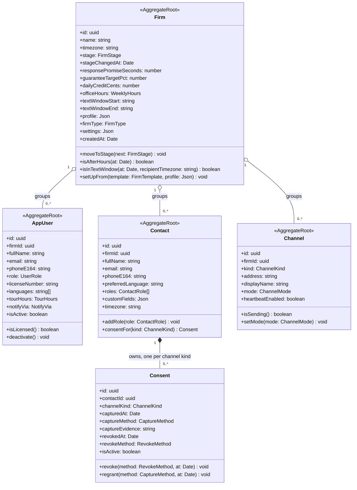

How to read this: a `Firm` groups its staff, contacts and channels (hollow diamonds), but each of those is loaded and saved on its own, so each is an aggregate root. `Consent` lives inside `Contact` (filled diamond): it is deleted with the contact and changed only through it. `stage` is one of replay, shadow, live, paused, closed; `mode` is live, shadow or off. `stageChangedAt` is set by a database trigger whenever `stage` changes, and `moveToStage` also appends `firm.stage_changed` to the ledger. `tourHours` is the person's weekly tour availability (day keys `mon` to `sun`, each a list of start and end times in the firm's time zone); empty means the person is not offered for tours. `officeHours` has the same shape and holds the firm's opening times; a missing day means closed (default Monday to Friday, 09:00 to 18:00). `isAfterHours` is true when a time falls outside those hours, and it is the one meaning of "after hours" used by Replay, the weekly letter and the customer chat (the database function `is_after_hours` gives the same answer). `textWindowStart` and `textWindowEnd` (`"HH:MM"`, default 08:00 and 20:00) are the texting window, read in the recipient's local time: the contact's `timezone` (from their address or phone area code), or the firm's when it is unknown. A firm may narrow the window but never widen it past 8 a.m.–8 p.m.; the database enforces both bounds, and `isInTextWindow` gives the same answer as the database function `is_in_text_window`. `notifyVia` is `email` or `sms`: how this staff member is told something needs them. `profile` holds what the AI writes from: the brokerage's registered name, areas, services, routing and tone of voice. `setUpFrom` copies a shared `FirmTemplate`'s settings into `settings` and records `firmType`; the founder reviews the drafted profile before it is saved. `customFields` on `Contact` holds the values of the firm's own fields (section 1.6).

### 1.2 Conversation, message, message source, review item, tour, hand-off

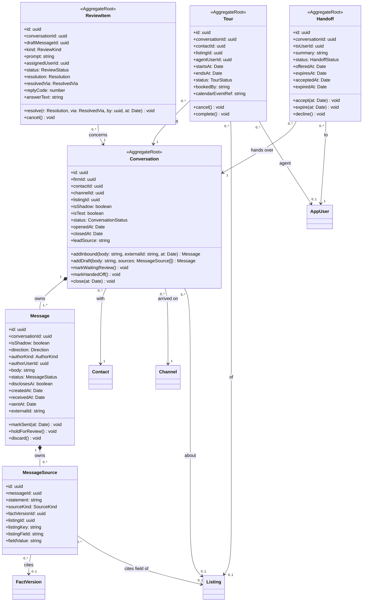

How to read this: a `Conversation` owns its `Message`s, and each `Message` owns the `MessageSource` rows that say where each stated fact came from (filled diamonds). Review items, tours and hand-offs are separate aggregates that only point at a conversation, because each has its own life cycle and its own screen. A source cites either a fact version or a listing field, never both. A `ReviewItem`'s `kind` decides which `resolution` it may end with: a `review` ends with approve, edit or take_over, a `question` only with answer, an `fyi` only with dismiss. `answerText` holds a typed answer to a question (a spoken answer uses the voice note instead). `leadSource` is the source the inquiry was tagged with when it arrived (for example `website`, `zillow`, `referral`); cost per lead counts inquiries by it.

### 1.3 Knowledge: fact, fact version, voice note, building

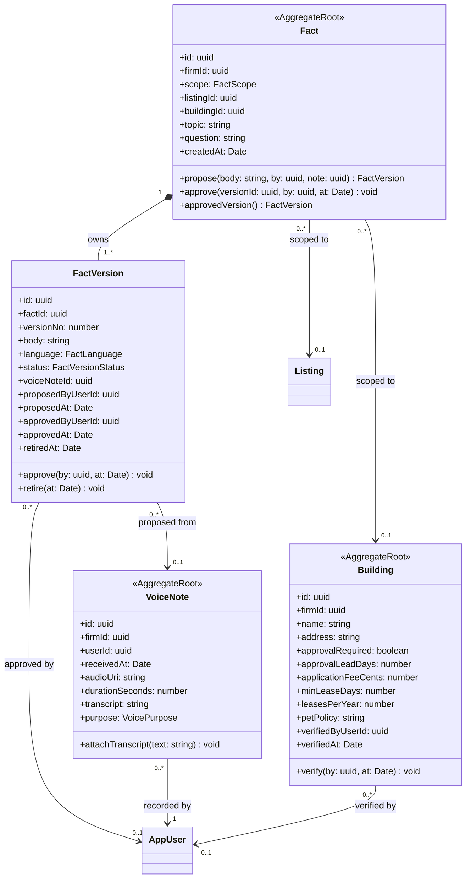

How to read this: a `Fact` is a topic (for example `pet_policy`) scoped to the whole firm, one listing or one building; its wording lives in numbered `FactVersion`s that are created and approved only through the fact. `question` is the customer question the fact answers; each version's `language` is `en` or `es` (default `en`). At most one version is approved at a time in each language, so `approve` retires the old one in that language in the same call. A voice note can propose a version but never approves one. Facts drafted by AI onboarding arrive the same way, as draft versions: approval by the broker is the only path for any fact the AI will state to customers.

### 1.4 Listings: MLS source, listing, private listing fields

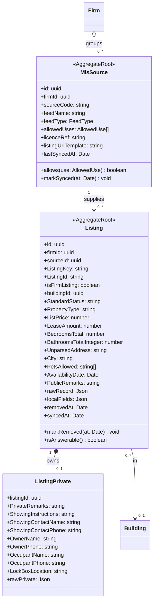

How to read this: each `Listing` comes from one `MlsSource` and keeps the standard RESO field names exactly as the feed uses them (only the main fields are drawn; the table has a few more, such as `LivingArea` and `AssociationFee`). Private fields sit in `ListingPrivate`, owned by the listing and deleted with it; the answering engine's database role cannot read that table at all, and it reads `listing` itself only through the `listing_for_engine` view (it has no permission on the table). Deleting a source removes its listings in one statement (a database cascade), which is why the line from source to listing is an association with a cascade rule rather than an in-code composition. `listingUrlTemplate` is the link pattern for a listing's public page; when set it contains `{ListingId}` or `{ListingKey}`, which are filled in per listing.

### 1.5 Proof and sales: ledger event, guarantee day, report, heartbeat check, replay

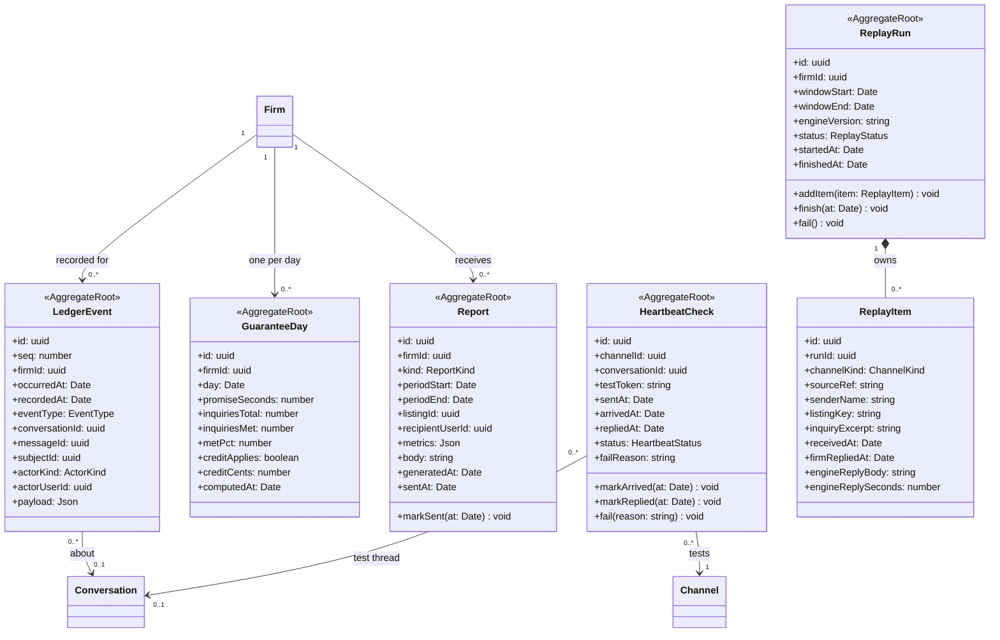

How to read this: `LedgerEvent` has no methods that change it, because the ledger is never edited; `messageId` and `subjectId` are plain ids with no link so an event survives what it describes. A `ReplayRun` owns its items. `GuaranteeDay` and `Report` are written once by their jobs; `Report.kind` uses the table values morning_brief, weekly_scorecard, seller_log, owner_note and monthly_report. `ReplayItem.senderName` is who asked, as shown on the original message; the sender's address is deliberately not stored.

### 1.6 CRM: property, roles, deal, task, custom field

The CRM (customer relationship management: the record of every person and every piece of business) keeps one record per person across buying, selling, renting and owning.

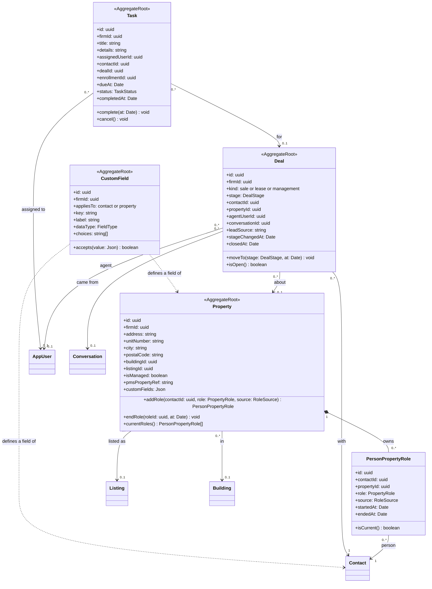

How to read this: a `Property` is a real home or unit, and it outlives its listings (a listing row is purged within 12 hours of leaving the feed; the property and its people stay). Each `PersonPropertyRole` says who is what there: `owner`, `tenant`, `landlord`, `seller`, `buyer_interest` or `renter_interest`, with where we learned it (`inquiry`, `pms_sync`, `onboarding`, `manual`) and when it ended, so one person can be a renter at one address and an owner at another. A `Deal` has a `kind` (sale, lease or management) and a `stage` (section 3.6); `closedAt` is set exactly when it is won or lost. `CustomField` defines the firm's own fields; their values live in `customFields` on `Contact` and `Property`, and the database rejects a key the firm has not defined or a value of the wrong type.

### 1.7 Campaigns: sequence, step, enrollment

A **drip** is a short series of messages sent on a schedule. Here it is a `Sequence` of steps, and an `Enrollment` is one person working through it.

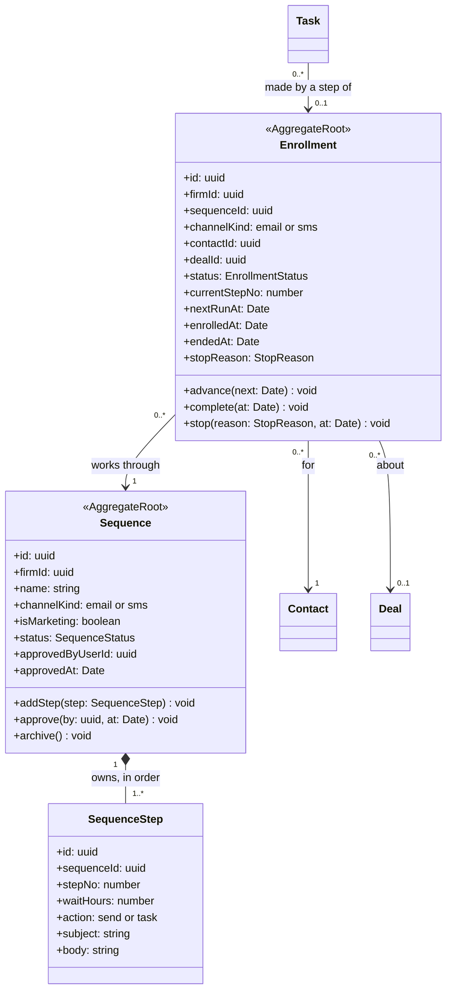

How to read this: a `Sequence` owns its numbered steps; each step either sends a message on the sequence's channel or creates a `Task` for a person. Nothing sends until a person approves the wording (`approvedAt`). An `Enrollment` copies its sequence's `channelKind`, and the database makes the two match, so the consent that governs it is never in doubt. It can be active only while the person's consent for that channel is active: revoking consent stops it in the same transaction, with `stopReason` `consent_revoked`.

### 1.8 Website care and compliance: site, site check, compliance check

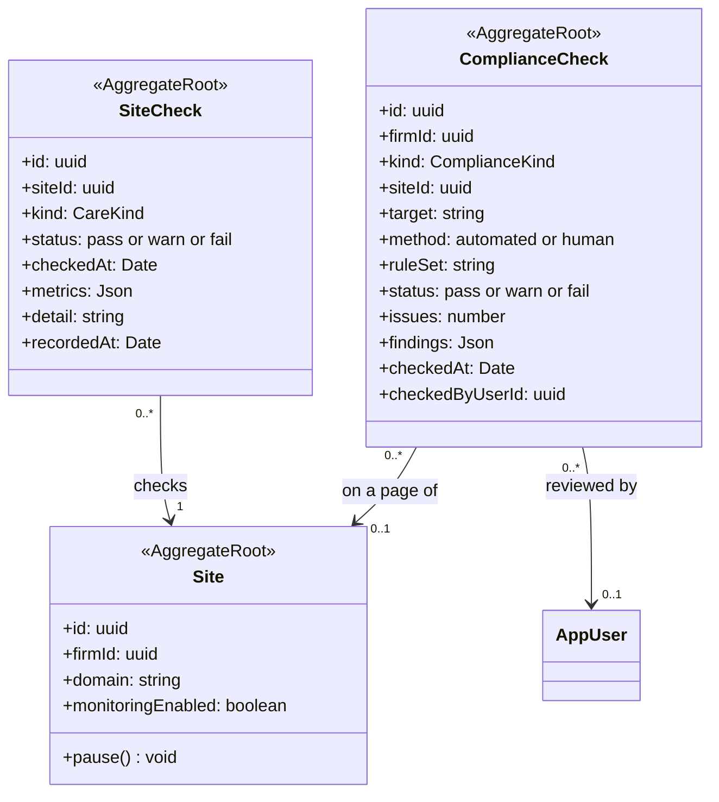

How to read this: `SiteCheck` and `ComplianceCheck` have no methods that change them, because results are append-only like the ledger: a later check, or a person's review, adds a new row. A site check's `kind` is uptime, speed, security or backup; a warn or fail must say why in `detail`. A compliance check's `kind` is `accessibility`, `idx_display` (MLS display rules), `brokerage_name` or `fair_housing` (AI replies and listing text reviewed for discriminatory wording); a `human` review names the person, and a pass has no issues.

### 1.9 Local SEO: area page, Google profile, post, ranking snapshot

Local SEO (search engine optimisation for nearby searches) helps the firm show up when people search its areas.

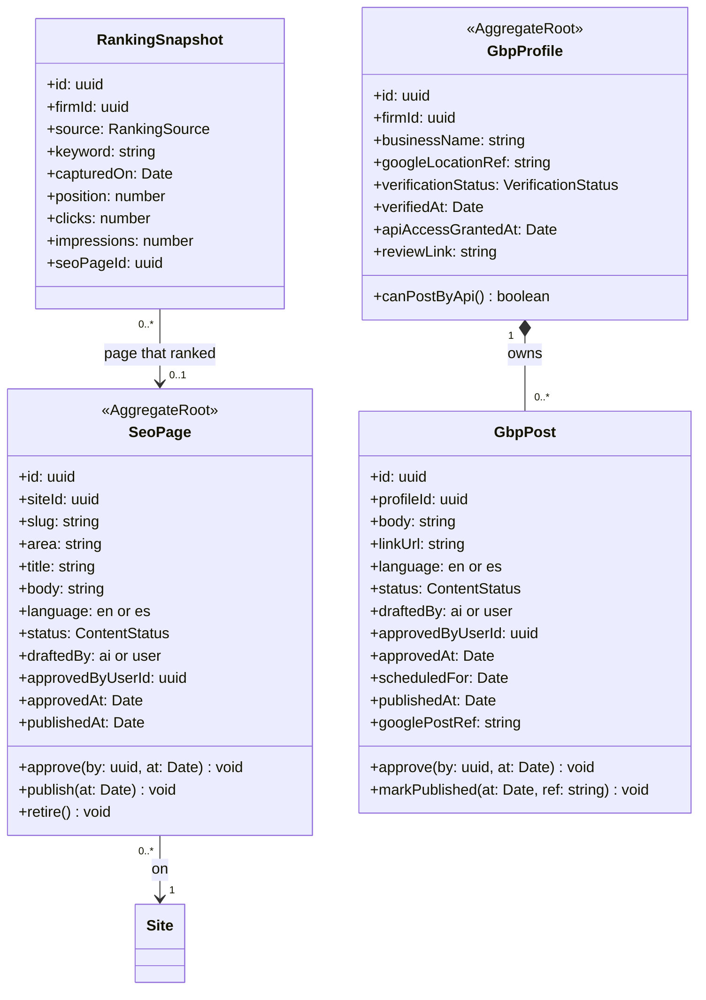

How to read this: an area page and a GBP post share one life cycle (`ContentStatus`: draft, approved, published, retired); nothing leaves draft without `approvedAt`, and Madhav approves. Approval checks wording for publishing; any fact in the text must already be an approved fact version. Until Google grants API access to a profile (`apiAccessGrantedAt`, possible about 60 days after `verifiedAt`), posts are made by hand and `googlePostRef` stays empty. A `RankingSnapshot` is one keyword's average position on one day from one source.

### 1.10 Set-up, integrations and spend: firm template, integration, lead source spend

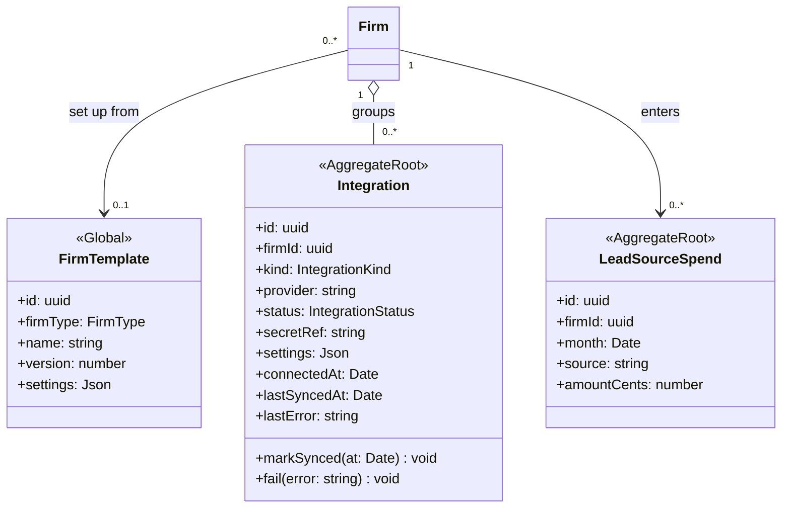

How to read this: `FirmTemplate` is marked `<<Global>>` because it belongs to no firm: one shared starting configuration per firm type (`sells`, `sells_rents`, `sells_rents_manages`) that every firm role may read and only the schema owner may change. Setting a firm up copies its settings onto the firm row (section 1.1), so a later template change never alters an existing firm. An `Integration` holds a reference to a secret (`secretRef`, such as `secrets/<firm>/<system>`), never the secret. `LeadSourceSpend` is what the firm spent on one lead source in one month; the monthly report divides it by that month's inquiries from the source.

------------------------------------------------------------------------

## 2. Service layer

Services are NestJS providers: classes that the framework creates once and hands to whoever asks for them in a constructor (dependency injection). Each diagram shows one module. Interfaces are marked `<<interface>>`; dashed triangles are realisations; dashed open arrows are "calls".

### 2.1 InboxModule

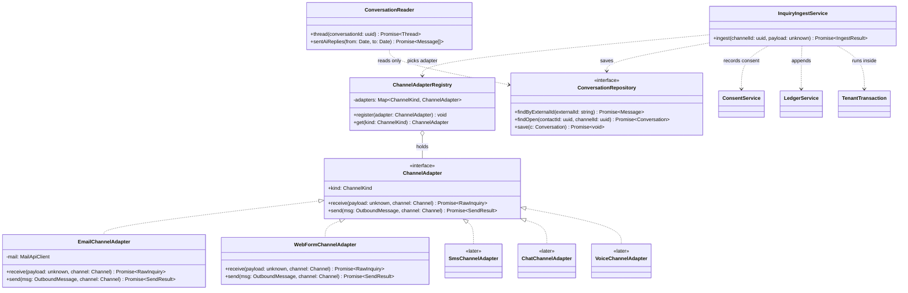

How to read this: every door (mailbox, web form, later text, chat and inbound calls) is wrapped by one `ChannelAdapter` that turns the outside format into a `RawInquiry` and back. The registry finds the right adapter by channel kind, so `InquiryIngestService` never mentions email or forms by name. Adding SMS in a later version means adding one class and registering it; `VoiceChannelAdapter` answers inbound calls only, never places one. `InquiryIngestService` also tags each conversation with its lead source. `ConversationReader` is the read-only door other modules use, for example the fair-housing review of sent AI replies.

### 2.2 EngineModule: the pipeline

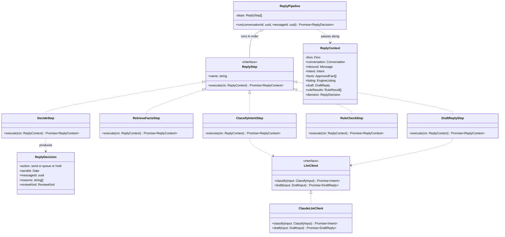

How to read this: `ReplyPipeline` passes one `ReplyContext` through five steps in a fixed order; each step reads what earlier steps filled in and adds its own part. Only two steps call the AI model, and only through the `LlmClient` interface, so tests can use a fake model. `RetrieveFactsStep` reads only the `approved_fact` and `listing_for_engine` views, through the `desk_engine` database role.

### 2.3 EngineModule: the rules

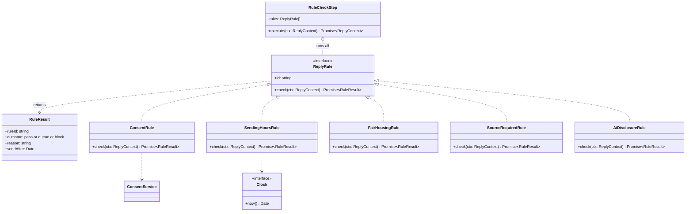

How to read this: each rule is a small class with one `check` method and one job: consent for the channel, the firm's sending hours, fair-housing wording, a source for every statement, and the AI disclosure in the first message. `SendingHoursRule` reads the texting window (`firm.text_window_start` to `text_window_end`, 8 a.m.–8 p.m. at most) in the recipient's local time: the contact's time zone, or the firm's when unknown. A text reply outside it passes with `sendAfter` set to the next opening, so it waits; an email or chat reply always passes. `RuleCheckStep` runs all of them and keeps every result; any `block` stops sending, any `queue` sends the draft to review. Adding a rule is adding one class.

### 2.4 ListingsModule

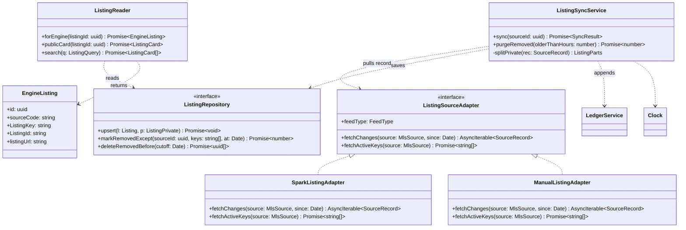

How to read this: a `ListingSourceAdapter` turns one kind of feed (a RESO Web API reseller such as Spark, or a manual upload) into standard records. `ListingSyncService` splits each record into the public `Listing` and the `ListingPrivate` part before saving, so private keys never reach the public row. `ListingReader` is the only way other modules read listings, and its `forEngine` method uses the engine view that has no private fields. It returns an `EngineListing` (one row of `listing_for_engine`; only a few of its public fields are drawn) whose `listingUrl` is the source's link template filled in for this listing, or empty when the source has no template. The engine uses `listingUrl` when it must link to the full listing page, for example when asked about another broker's listing; with no link it gives none.

### 2.5 ReviewModule

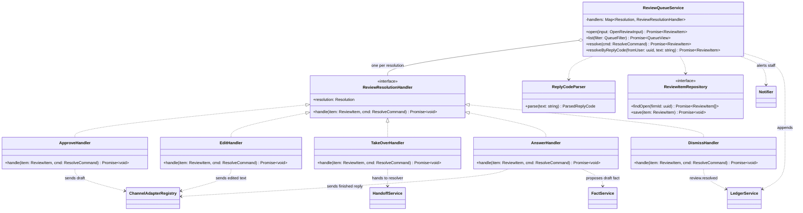

How to read this: the five resolutions map to five handler classes, chosen by the resolution value. A Review uses the three broker actions (1 Send, 2 Edit, 3 I'll call); a Question is answered, typed or spoken, by `AnswerHandler`, which saves the answer on the item, finishes the waiting reply with it and proposes it as a draft fact version (the broker still approves that fact on the fact sheet); an FYI is dismissed by `DismissHandler`, which only marks the item resolved and writes the ledger event. A text reply of "1", "2 new wording" or "3" goes through `ReplyCodeParser` first and then down the same path as a tap in the web app, so both ways behave the same.

### 2.6 BookingModule

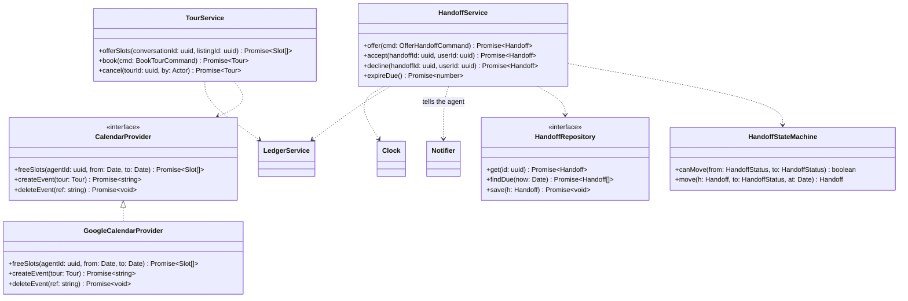

How to read this: `TourService` asks the calendar for free slots and books one; the calendar is behind `CalendarProvider` so another calendar can be added later. `HandoffService` never changes a hand-off's status by itself; it asks `HandoffStateMachine`, which holds the only list of allowed moves.

### 2.7 ReportsModule

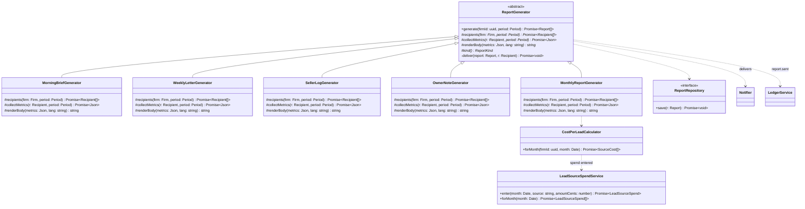

How to read this: `generate` is the template method: it is written once in the abstract class and always runs the same steps (find recipients, collect numbers, write the text, save, deliver, record `report.sent`). Each subclass fills in only the abstract steps (shown in italics; `#` means protected, visible only to subclasses). `WeeklyLetterGenerator` writes rows of kind `weekly_scorecard`; the seller log goes to the listing agent and the owner note to the property manager, who forward them. `MonthlyReportGenerator` writes `monthly_report`: leads by channel and source, reply times, the pipeline, site health, compliance results and opt-outs honoured. `CostPerLeadCalculator` divides the spend the firm entered for a source by that month's inquiries from it, and returns a line only for sources with spend.

### 2.8 NotificationsModule

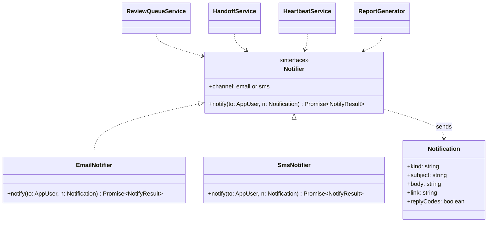

How to read this: anything that must reach a staff member (a review waiting, a hand-off offered, a door that failed its test, a report) goes through `Notifier`. Which notifier is used is chosen from the staff member's `app_user.notify_via` (`email` gives `EmailNotifier`, `sms` gives `SmsNotifier`); the text-message notifier lets the broker answer review items with a reply code from a phone.

### 2.9 EngineModule: drafting content

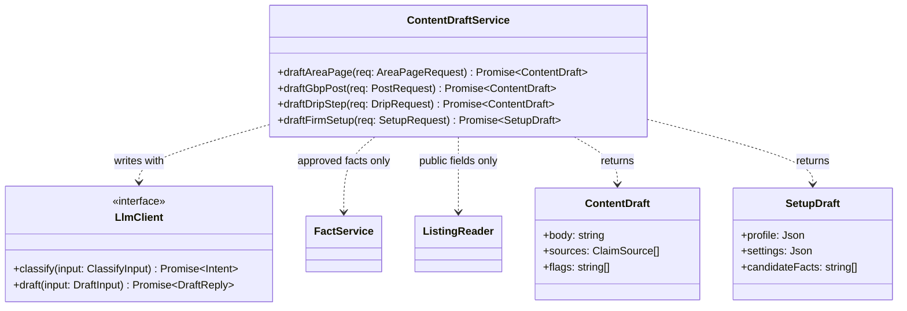

How to read this: `ContentDraftService` is the second thing `EngineModule` exports, beside `ReplyPipeline`; `LlmClient` stays private. It writes everything else the AI drafts (area pages, GBP posts, drip wording and the firm's set-up) from the firm's profile, its approved facts and public listing fields only, and returns a draft with a source for each claim. It never publishes or sends. `candidateFacts` from a set-up draft become draft fact versions that the broker approves.

### 2.10 CrmModule

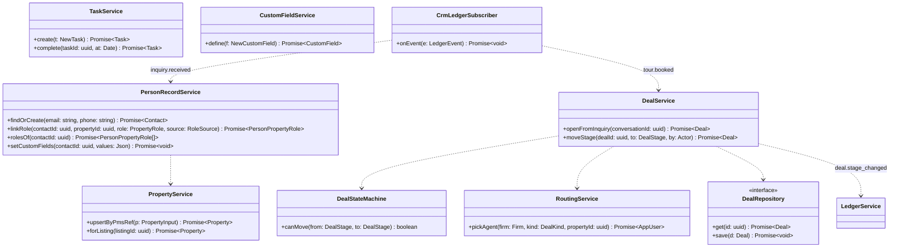

How to read this: nobody types data into the CRM. `CrmLedgerSubscriber` hears ledger events after each commit and keeps the record current: a new inquiry links the person to the property as `buyer_interest` or `renter_interest` and opens a `Deal`; a booked tour moves the deal to `touring`. `RoutingService` picks the agent from the firm's routing rules in `firm.profile`. `DealService` changes a stage only through `DealStateMachine` and appends `deal.stage_changed` each time. `CustomFieldService` defines fields; the database checks every value written against them.

### 2.11 CampaignModule

```mermaid
classDiagram
  class SequenceService {
    +draft(s: NewSequence) Promise~Sequence~
    +approve(sequenceId: uuid, by: uuid) Promise~Sequence~
    +archive(sequenceId: uuid) Promise~Sequence~
  }
  class EnrollmentService {
    +enroll(contactId: uuid, sequenceId: uuid, dealId: uuid) Promise~Enrollment~
    +stop(enrollmentId: uuid, reason: StopReason) Promise~Enrollment~
    +stopAllFor(contactId: uuid, reason: StopReason) Promise~number~
  }
  class EnrollmentStateMachine {
    +canMove(from: EnrollmentStatus, to: EnrollmentStatus) boolean
  }
  class DripRunner {
    +runDue(now: Date) Promise~number~
  }
  class CampaignLedgerSubscriber {
    +onEvent(e: LedgerEvent) Promise~void~
  }
  class EnrollmentRepository {
    <<interface>>
    +findDue(now: Date) Promise~Enrollment[]~
    +save(e: Enrollment) Promise~void~
  }
  class ChannelAdapterRegistry
  class ConsentService
  class TaskService
  class ContentDraftService
  class LedgerService
  class Clock
  SequenceService ..> ContentDraftService : drafts wording
  EnrollmentService ..> EnrollmentStateMachine
  EnrollmentService ..> EnrollmentRepository
  DripRunner ..> EnrollmentRepository : due steps
  DripRunner ..> ConsentService : still active?
  DripRunner ..> ChannelAdapterRegistry : sends
  DripRunner ..> TaskService : task steps
  DripRunner ..> LedgerService : enrollment.message_sent
  DripRunner ..> Clock : texting window
  CampaignLedgerSubscriber ..> EnrollmentService : reply or closed deal
```

How to read this: `DripRunner` is a worker job that sends every due step through the same channel adapters as replies, in the brokerage's name, holding texts until the texting window opens in the recipient's local time; a `task` step becomes a `Task` for the agent. Three things stop a drip: the database, the moment consent for its channel is revoked (a STOP, an unsubscribe link); `CampaignLedgerSubscriber`, when the person replies (`message.received`) or their deal is won or lost (`deal.stage_changed`); or a person, by hand. Every stop appends `enrollment.stopped` with its reason.

### 2.12 SiteCareModule

```mermaid
classDiagram
  class SiteService {
    +add(domain: string) Promise~Site~
    +setMonitoring(siteId: uuid, on: boolean) Promise~Site~
  }
  class CareRunner {
    -checks: CareCheck[]
    +runDue(now: Date) Promise~number~
  }
  class CareCheck {
    <<interface>>
    +kind: CareKind
    +run(site: Site) Promise~CheckResult~
  }
  class UptimeCheck {
    +run(site: Site) Promise~CheckResult~
  }
  class SpeedCheck {
    +run(site: Site) Promise~CheckResult~
  }
  class SecurityCheck {
    +run(site: Site) Promise~CheckResult~
  }
  class BackupCheck {
    +run(site: Site) Promise~CheckResult~
  }
  class HostingProvider {
    <<interface>>
    +latestSnapshot(site: Site) Promise~Snapshot~
    +pendingUpdates(site: Site) Promise~number~
  }
  class AwsHostingProvider
  class PageFetcher {
    <<interface>>
    +fetch(url: string) Promise~Page~
  }
  class HttpPageFetcher
  class SiteCheckRepository {
    <<interface>>
    +add(c: SiteCheck) Promise~void~
  }
  class Notifier
  class LedgerService
  CareCheck <|.. UptimeCheck
  CareCheck <|.. SpeedCheck
  CareCheck <|.. SecurityCheck
  CareCheck <|.. BackupCheck
  HostingProvider <|.. AwsHostingProvider
  PageFetcher <|.. HttpPageFetcher
  CareRunner o-- CareCheck : runs each kind
  UptimeCheck ..> PageFetcher
  SecurityCheck ..> HostingProvider
  BackupCheck ..> HostingProvider
  CareRunner ..> SiteCheckRepository : adds results
  CareRunner ..> Notifier : on a failure
  CareRunner ..> LedgerService : site.check_failed
```

How to read this: `CareRunner` runs each kind of check through the `CareCheck` interface, so adding a check is adding one class. `SiteCheckRepository` has only `add`: results are append-only. `HostingProvider` hides AWS (disk snapshots for backups, patching for security updates), and `PageFetcher` reads a public page; `ComplianceModule` and onboarding reuse it. A failure is retried once, then written, alerted and appended to the ledger.

### 2.13 LocalSeoModule

```mermaid
classDiagram
  class AreaPageService {
    +draft(area: string, lang: string) Promise~SeoPage~
    +approve(pageId: uuid, by: uuid) Promise~SeoPage~
    +publish(pageId: uuid) Promise~SeoPage~
  }
  class GbpPostService {
    +draft(topic: string) Promise~GbpPost~
    +approve(postId: uuid, by: uuid) Promise~GbpPost~
    +publish(postId: uuid) Promise~GbpPost~
  }
  class ReviewLinkService {
    +requestReview(dealId: uuid) Promise~void~
  }
  class RankingService {
    +capture(day: Date) Promise~number~
  }
  class BusinessProfileClient {
    <<interface>>
    +createPost(p: GbpPost) Promise~string~
    +location(ref: string) Promise~LocationInfo~
  }
  class GoogleBusinessProfileClient
  class SearchConsoleClient {
    <<interface>>
    +queries(site: Site, day: Date) Promise~QueryStat[]~
  }
  class GoogleSearchConsoleClient
  class CitationClient {
    <<interface>>
    +submit(nap: NapRecord) Promise~string~
    +status() Promise~CitationStatus~
  }
  class ContentDraftService
  class ComplianceService
  class LedgerService
  BusinessProfileClient <|.. GoogleBusinessProfileClient
  SearchConsoleClient <|.. GoogleSearchConsoleClient
  AreaPageService ..> ContentDraftService : drafts
  GbpPostService ..> ContentDraftService : drafts
  AreaPageService ..> ComplianceService : checks before publishing
  GbpPostService ..> ComplianceService : checks before publishing
  GbpPostService ..> BusinessProfileClient : posts once API access is granted
  RankingService ..> SearchConsoleClient
  RankingService ..> CitationClient : citation status
  AreaPageService ..> LedgerService : seo.page_published
  GbpPostService ..> LedgerService : gbp.post_published
```

How to read this: AI drafts and Madhav approves; `publish` refuses anything not approved, and the database refuses it too. Before publishing, `ComplianceService` checks the final text for the brokerage name and fair-housing wording. Posts go out through `BusinessProfileClient` only once Google has granted API access; until then Madhav posts by hand as a manager of the profile. `ReviewLinkService` sends a neutral review request with the profile's link after a closed deal, never an incentive. `CitationClient` keeps the firm's name, address and phone (a `NapRecord`) right on directories.

### 2.14 ComplianceModule

```mermaid
classDiagram
  class ComplianceService {
    -checkers: Map~ComplianceKind, ComplianceChecker~
    +runScheduled(firmId: uuid) Promise~number~
    +checkDraft(kind: ComplianceKind, text: string) Promise~ComplianceResult~
    +recordReview(r: HumanReview) Promise~ComplianceCheck~
  }
  class ComplianceChecker {
    <<interface>>
    +kind: ComplianceKind
    +check(target: CheckTarget) Promise~ComplianceResult~
  }
  class AccessibilityChecker {
    +check(target: CheckTarget) Promise~ComplianceResult~
  }
  class IdxDisplayChecker {
    +check(target: CheckTarget) Promise~ComplianceResult~
  }
  class BrokerageNameChecker {
    +check(target: CheckTarget) Promise~ComplianceResult~
  }
  class FairHousingChecker {
    +check(target: CheckTarget) Promise~ComplianceResult~
  }
  class ComplianceCheckRepository {
    <<interface>>
    +add(c: ComplianceCheck) Promise~void~
  }
  class PageFetcher
  class ListingReader
  class ConversationReader
  class Notifier
  class LedgerService
  ComplianceChecker <|.. AccessibilityChecker
  ComplianceChecker <|.. IdxDisplayChecker
  ComplianceChecker <|.. BrokerageNameChecker
  ComplianceChecker <|.. FairHousingChecker
  ComplianceService o-- ComplianceChecker : one per kind
  ComplianceService ..> ComplianceCheckRepository : adds results
  ComplianceService ..> Notifier : on a failure
  ComplianceService ..> LedgerService : compliance.check_failed
  AccessibilityChecker ..> PageFetcher
  IdxDisplayChecker ..> PageFetcher
  IdxDisplayChecker ..> ListingReader : feed age
  BrokerageNameChecker ..> PageFetcher
  FairHousingChecker ..> ConversationReader : sent AI replies
  FairHousingChecker ..> ListingReader : listing text
```

How to read this: each checker is a strategy for one `kind`. `AccessibilityChecker` scans pages against WCAG 2.2 AA; an automated scan finds only part of the issues, so `recordReview` adds a person's review as its own signed row. `IdxDisplayChecker` looks for the MLS disclaimer, logo and listing attribution and a feed younger than 12 hours. `BrokerageNameChecker` looks for the registered name beside every phone number, form and chat button. `FairHousingChecker` reviews sent AI replies and listing text for discriminatory wording, after the fact; `FairHousingRule` already checks each reply before it is sent.

### 2.15 IntegrationsModule

```mermaid
classDiagram
  class IntegrationService {
    +connect(kind: IntegrationKind, provider: string, secret: SecretInput) Promise~Integration~
    +disconnect(integrationId: uuid) Promise~Integration~
    +status() Promise~Integration[]~
  }
  class PropertyManagementAdapter {
    <<interface>>
    +provider: string
    +changesSince(since: Date) AsyncIterable~PmsRecord~
    +createWorkOrder(req: WorkOrderRequest) Promise~string~
    +paymentLink(tenancyRef: string) Promise~string~
  }
  class AppFolioAdapter
  class BuildiumAdapter
  class RentvineAdapter
  class DoorLoopAdapter
  class PmsAdapterRegistry {
    +get(provider: string) PropertyManagementAdapter
  }
  class PmsSyncService {
    +sync(integrationId: uuid) Promise~SyncResult~
  }
  class OnboardingService {
    +draftSetup(website: string, firmType: FirmType) Promise~SetupDraft~
    +applySetup(draft: SetupDraft, reviewedBy: uuid) Promise~void~
  }
  class SecretStore {
    <<interface>>
    +get(ref: string) Promise~string~
    +put(ref: string, value: string) Promise~void~
  }
  class PersonRecordService
  class PropertyService
  class ContentDraftService
  class PageFetcher
  class ListingReader
  class FactService
  PropertyManagementAdapter <|.. AppFolioAdapter
  PropertyManagementAdapter <|.. BuildiumAdapter
  PropertyManagementAdapter <|.. RentvineAdapter
  PropertyManagementAdapter <|.. DoorLoopAdapter
  PmsAdapterRegistry o-- PropertyManagementAdapter : holds
  PmsSyncService ..> PmsAdapterRegistry : picks adapter
  PmsSyncService ..> PropertyService : upserts properties
  PmsSyncService ..> PersonRecordService : owners and tenants
  IntegrationService ..> SecretStore : stores the secret
  PropertyManagementAdapter ..> SecretStore : reads its key
  OnboardingService ..> PageFetcher : reads the website
  OnboardingService ..> ListingReader : reads listings
  OnboardingService ..> ContentDraftService : drafts profile and settings
  OnboardingService ..> FactService : proposes draft facts
```

How to read this: one `PropertyManagementAdapter` per vendor turns its API into one shape, chosen by `PmsAdapterRegistry`; adding a vendor is one class. `PmsSyncService` puts properties, owners and tenants into the CRM, and the adapter's `paymentLink` sends residents to the vendor's own payment page: we never touch rent. `IntegrationService` writes a secret to `SecretStore` and keeps only its name. `OnboardingService` drafts a firm's set-up; the founder reviews it, and its facts go to the broker as drafts.

------------------------------------------------------------------------

## 3. State diagrams

A state diagram shows the values a status column can take and which moves between them are allowed. Values are exactly those in the `CHECK` constraints of `schema.sql`.

### 3.1 Conversation status

```mermaid
stateDiagram-v2
  [*] --> open : first inbound message
  open --> waiting_review : review item opened
  waiting_review --> open : review resolved by send, edit or answer
  open --> handed_off : hand-off accepted
  waiting_review --> handed_off : take over
  handed_off --> closed : agent closes
  open --> closed : no reply needed or idle timeout
  closed --> open : customer writes again
  closed --> [*]
```

How to read this: a conversation starts `open` when the first message arrives. It waits in `waiting_review` while a person decides, and becomes `handed_off` once a licensed person has it. A new message on a closed thread re-opens it rather than starting a new conversation.

### 3.2 Message status

```mermaid
stateDiagram-v2
  [*] --> received : inbound
  received --> [*]
  [*] --> draft : outbound, written by engine or person
  draft --> sent : rules pass and channel is live
  draft --> pending_review : a rule asks for review
  draft --> not_sent : silent week or a rule blocks
  pending_review --> sent : approved, edited or answered
  pending_review --> discarded : taken over or replaced
  sent --> [*]
  not_sent --> [*]
  discarded --> [*]
```

How to read this: inbound messages are `received` and never change. Outbound messages start as `draft`; `not_sent` means the reply was written and kept for the receipt but deliberately not delivered, which is how silent-week drafts are stored (the database refuses `sent` on a shadow message). When the broker edits a draft, the original becomes `discarded` and the edited text is saved as a new message that is `sent`. A text reply written outside the texting window (in the recipient's local time) stays `draft` until the window opens and is then sent.

### 3.3 Hand-off status

```mermaid
stateDiagram-v2
  [*] --> offered : HandoffService.offer
  offered --> accepted : agent accepts before expires_at
  offered --> declined : agent declines
  offered --> expired : clock passes expires_at
  accepted --> [*]
  declined --> [*]
  expired --> [*]
```

How to read this: a hand-off is a timed offer to one person. Once it is accepted, declined or expired it never changes again; offering to the next person creates a new hand-off row, so the receipt shows every attempt and how long each took.

### 3.4 Fact-version status

```mermaid
stateDiagram-v2
  [*] --> draft : proposed by voice note or typing
  draft --> approved : broker approves
  draft --> [*] : discarded, row deleted
  approved --> retired : a newer version is approved, or retired by hand
  retired --> [*]
```

How to read this: only an `approved` version can be cited in a message, and a fact has at most one approved version per language at a time. Approving a new version retires the previous one in the same transaction. A draft that is discarded is deleted; the ledger keeps the `fact.proposed` event as its history.

### 3.5 Review-item status

```mermaid
stateDiagram-v2
  [*] --> open : review.opened
  open --> resolved : approve, edit, take over, answer or dismiss
  open --> cancelled : became pointless before anyone acted
  resolved --> [*]
  cancelled --> [*]
```

How to read this: an item stays `open` until a person acts. `resolved` always records how (approve, edit or take over for a Review, answer for a Question, dismiss for an FYI), who did it, when, and by what means (reply code, web app, voice note). `cancelled` means only that the item became pointless before anyone acted, for example the customer withdrew the question or the conversation closed.

### 3.6 Deal stage

```mermaid
stateDiagram-v2
  [*] --> new : inquiry, or entered by hand
  new --> qualified : needs and timing known
  qualified --> touring : tour or walk-through booked
  touring --> offer : offer, application or proposal
  offer --> under_contract : terms agreed
  offer --> touring : falls through, keep looking
  under_contract --> won : closed or signed
  new --> lost
  qualified --> lost
  touring --> lost
  offer --> lost
  under_contract --> lost : falls through
  won --> [*]
  lost --> [*]
```

How to read this: one list of stages serves every kind of deal, and a firm may relabel them in its settings. For a lease, `offer` is the application and `won` the signed lease; for management, `touring` is the walk-through, `offer` the proposal and `won` the signed agreement. Any open deal can be lost. `DealStateMachine` holds these moves; the database checks the stage list and sets `closedAt` exactly when a deal is won or lost.

### 3.7 Enrollment status

```mermaid
stateDiagram-v2
  [*] --> active : enrolled, consent active, sequence approved
  active --> active : step done, next step scheduled
  active --> completed : last step done
  active --> stopped : reply, consent revoked, deal closed, bounce or by hand
  completed --> [*]
  stopped --> [*]
```

How to read this: an enrollment starts `active` only if the person's consent for its channel is active and its sequence is approved; the database refuses it otherwise. It stays `active` while steps run, and ends `completed` or `stopped`, with the reason kept. A stopped drip is never restarted: enrolling the person again later creates a new row, and needs active consent again.

------------------------------------------------------------------------

## 4. Design patterns

| Pattern | Where it is used | Problem it solves here |
|----|----|----|
| Adapter | `ChannelAdapter` (`EmailChannelAdapter`, `WebFormChannelAdapter`), `ListingSourceAdapter` (`SparkListingAdapter`, `ManualListingAdapter`), `CalendarProvider` (`GoogleCalendarProvider`), `LlmClient` (`ClaudeLlmClient`), `PropertyManagementAdapter` (`AppFolioAdapter`, `BuildiumAdapter`, `RentvineAdapter`, `DoorLoopAdapter`), `HostingProvider` (`AwsHostingProvider`), `PageFetcher` (`HttpPageFetcher`), `BusinessProfileClient`, `SearchConsoleClient`, `CitationClient`, `SecretStore` (`AwsSecretStore`) | Each outside service speaks its own format. An adapter turns it into one shape the rest of the code knows, so a new mailbox type, MLS feed, calendar, AI model or property-management vendor is one new class. |
| Strategy | `ReplyRule` and its five rules; `ReviewResolutionHandler` (`ApproveHandler`, `EditHandler`, `TakeOverHandler`, `AnswerHandler`, `DismissHandler`); `CareCheck` (`UptimeCheck`, `SpeedCheck`, `SecurityCheck`, `BackupCheck`); `ComplianceChecker` (`AccessibilityChecker`, `IdxDisplayChecker`, `BrokerageNameChecker`, `FairHousingChecker`) | The checks and the five review resolutions vary independently. Each is a swappable object chosen at run time instead of a long `if` chain. |
| Pipeline (Chain of Responsibility) | `ReplyPipeline` with `ClassifyIntentStep`, `RetrieveFactsStep`, `DraftReplyStep`, `RuleCheckStep`, `DecideStep` | Writing a reply has fixed stages. Each stage is small and testable alone, and a stage can stop the chain (for example, a blocked rule). |
| Template Method | `ReportGenerator.generate` with `MorningBriefGenerator`, `WeeklyLetterGenerator`, `SellerLogGenerator`, `OwnerNoteGenerator`, `MonthlyReportGenerator` | All reports follow the same steps (save, deliver, record in the ledger). Writing that once avoids five copies that drift apart. |
| State | `HandoffStateMachine`, `DealStateMachine`, `EnrollmentStateMachine`; status methods on `Conversation`, `FactVersion`, `ReviewItem`, `Message`, `SeoPage`, `GbpPost` | Only some status moves are legal. Keeping the allowed moves in one place stops code from, say, accepting an expired hand-off or restarting a stopped drip. |
| Repository | `ConversationRepository`, `FactRepository`, `ListingRepository`, `ReviewItemRepository`, `HandoffRepository`, `ReportRepository`, `DealRepository`, `EnrollmentRepository`, `SiteCheckRepository`, `ComplianceCheckRepository`, with PostgreSQL implementations | Services work with domain objects, not SQL. Tests can use in-memory repositories. The two check repositories offer only `add`, matching the append-only tables. |
| Registry (Factory) | `ChannelAdapterRegistry`, `PmsAdapterRegistry` | Picks the right adapter from the channel kind or the vendor, so callers never name a concrete adapter. |
| Observer | `LedgerService.append` notifies subscribers after commit (for example `GuaranteeService`, the notifiers, report counters, `CrmLedgerSubscriber`, `CampaignLedgerSubscriber`) | Modules react to what happened without calling each other directly, and the ledger stays the single record of truth. A reply stops a drip and a booked tour moves a deal this way. |
| Dependency Injection | NestJS providers in every module; `Clock` (`SystemClock`, `FixedClock`) | Classes receive what they need in their constructor, so tests can pass fakes such as a fixed clock or a fake AI model. |

------------------------------------------------------------------------

## 5. Key method contracts

A contract states what a method needs, what it gives back, how it fails, and what it writes to the ledger. Every method below runs inside a `TenantTransaction` (a database transaction that has set `app.firm_id`), so all its reads and writes are limited to one firm.

### 5.1 `InquiryIngestService.ingest(channelId, payload): Promise<IngestResult>`

|  |  |
|----|----|
| Input | `channelId` of a channel the current firm owns; `payload` is the raw webhook body or fetched mail item. |
| Steps | Get the adapter from `ChannelAdapterRegistry`; `adapter.receive` returns a `RawInquiry` with `externalId`. If a message with the same `externalId` already exists in the firm, return it unchanged. Otherwise find or create the `Contact` by email or phone, find the open `Conversation` or open one (shadow if the channel mode is `shadow`, test if the token matches a heartbeat), add the inbound `Message`, record consent if the form box was ticked, then queue a `reply` job. |
| Output | `IngestResult { conversationId, messageId, isNew: boolean, isDuplicate: boolean }`. |
| Errors | `ChannelNotFoundError` (unknown or other firm's channel), `ChannelOffError` (mode `off`; payload stored for audit only), `AdapterParseError` (payload unreadable; job retried with back-off, then sent to the failed-jobs list, never dropped). |
| Ledger | `inquiry.received` for a new conversation, `message.received` for a later message in an existing one, `consent.granted` when consent was captured. Duplicates write nothing. |
| Notes | Idempotency is a database rule: the partial unique index `message_external_id_uq` on `message (firm_id, external_id)` (only where `external_id` is set) allows one message per channel id per firm. The lookup is only a fast path. If two deliveries race past it, the second insert fails with a unique violation; the service rolls back, loads the existing message and returns it with `isDuplicate: true`. No advisory lock is used. |

### 5.2 `ReplyPipeline.run(conversationId, messageId): Promise<ReplyDecision>`

|  |  |
|----|----|
| Input | The conversation and the inbound message to answer. Runs in the worker as the `desk_engine` role. |
| Steps | The five steps in order. `DecideStep` saves the outbound `Message` with its `MessageSource`s, then either sends it through the channel adapter, opens a review item, or stores it as `not_sent`. A text reply that `SendingHoursRule` passed with a `sendAfter` time is sent by a job scheduled for that time (the opening of the texting window in the recipient's local time); email and chat replies are sent at once. |
| Output | `ReplyDecision { action: send, queue or hold, sendAt, messageId, reasons, reviewKind }`; `sendAt` is set only for a text held until the texting window opens. |
| Errors | `LlmUnavailableError` and `LlmTimeoutError`: retried with back-off; if the 60-second budget is close, the pipeline opens a review item instead of failing silently. `RuleBlockedError` is not thrown; a block is a normal `hold` decision with its reasons. A database refusal (missing AI disclosure, unapproved fact cited) is a bug and fails the job loudly. |
| Ledger | `draft.created` always; then `reply.sent` (sent), or `review.opened` (queued). A silent-week draft writes only `draft.created`. |

### 5.3 `ReviewQueueService.resolve(cmd): Promise<ReviewItem>`

This one method also serves answering a Question and dismissing an FYI: `POST /review-items/:id/answer` and `POST /review-items/:id/dismiss` call it with resolution `answer` or `dismiss`.

|  |  |
|----|----|
| Input | `ResolveCommand { reviewItemId, resolution: approve, edit, take_over, answer or dismiss, via: reply_code, web_app or voice_note, userId, editedBody?, answerText?, voiceNoteId? }`. |
| Steps | Load the item, check it is `open` and that the resolution fits its kind (review: approve, edit or take_over; question: answer; fyi: dismiss), run the matching `ReviewResolutionHandler`, mark the item `resolved` with who and when, with `reply_code` 1, 2 or 3 when resolved by code (approve, edit and take_over only), and set the conversation status. `AnswerHandler` saves `answer_text` (or the voice note), finishes and sends the waiting reply, and proposes the answer as a draft fact version. `DismissHandler` does nothing more. |
| Output | The resolved `ReviewItem`. |
| Errors | `ReviewNotFoundError`, `ReviewAlreadyClosedError` (second tap or late reply code), `ResolutionNotAllowedError` (resolution does not fit the item's kind), `EditBodyRequiredError` (edit without text), `AnswerRequiredError` (answer with neither text nor voice note), `ReplyCodeInvalidError` (from `resolveByReplyCode`). |
| Ledger | `review.resolved` for every resolution, with the resolution in its payload; plus `reply.sent` for approve, edit and answer; plus `fact.proposed` for answer; plus `handoff.offered` and `handoff.accepted` for take over (the resolver accepts at once). Dismiss writes only `review.resolved`. |

### 5.4 `HandoffService.offer(cmd)` and `HandoffService.accept(handoffId, userId)`

|  | `offer` | `accept` |
|----|----|----|
| Input | `OfferHandoffCommand { conversationId, toUserId, summary, ttlMinutes }` | The hand-off id and the user accepting it. |
| Steps | Check the user is active and licensed; check the summary is at most 600 characters; save with `expires_at = now + ttl`; notify the user; schedule an expiry job. | Ask `HandoffStateMachine` to move `offered` to `accepted`; set the conversation to `handed_off`. |
| Output | The new `Handoff` with status `offered`. | The `Handoff` with status `accepted`. |
| Errors | `UserNotEligibleError`, `SummaryTooLongError`, `ConversationClosedError`. | `HandoffNotFoundError`, `NotOfferedToYouError`, `HandoffExpiredError` (past `expires_at`), `IllegalTransitionError` (already accepted, declined or expired). |
| Ledger | `handoff.offered` | `handoff.accepted`. The expiry job writes `handoff.expired`. |

### 5.5 `LedgerService.append(event): Promise<LedgerEvent>`

|  |  |
|----|----|
| Input | `NewLedgerEvent { eventType, occurredAt, actorKind, actorUserId?, conversationId?, messageId?, subjectId?, payload }`. The firm id is taken from the transaction, never from the caller. |
| Steps | Insert one row into `event` in the caller's transaction, so the event and the change it describes commit together or not at all. After commit, notify subscribers. |
| Output | The stored `LedgerEvent` with its `seq` number. |
| Errors | `UnknownEventTypeError` (not in the closed list), `NoTenantError` (no `app.firm_id` set). There is no update or delete method; the database rejects both even if attempted. |
| Ledger | It is the only writer of the ledger. |

### 5.6 `ListingSyncService.sync(sourceId): Promise<SyncResult>`

|  |  |
|----|----|
| Input | An `MlsSource` id of the current firm. Runs on a schedule in the worker, every hour. |
| Steps | Pick the adapter by `feedType`; read changes since `lastSyncedAt`; for each record, split off private keys into `ListingPrivate`, normalise rent into `LeaseAmount`, upsert by `(source_id, ListingKey)`; then mark listings missing from the active key list as removed; update `lastSyncedAt`. The active key list comes from `ListingSourceAdapter.fetchActiveKeys` on every run, so a dropped listing disappears on the next run, and its page on the firm's website then says the listing is no longer available. |
| Output | `SyncResult { upserted, removed, failed, startedAt, finishedAt }`. |
| Errors | `SourceNotFoundError`; `FeedUnavailableError` (retried with back-off; listings stay as they were); `PrivateFieldLeakError` (the database rejected a record holding a private key; that record is skipped and reported, the rest continue). If the feed stays down, the site would show listings older than 12 hours. What it does before then, and an alert for a failed hourly run, are still open. |
| Ledger | None for ordinary upserts. `purgeRemoved` writes `listing.purged` for each listing deleted within 12 hours of removal (BeachesMLS rule 20.2.5). Those 12 hours are BeachesMLS's deadline, not our schedule. |

### 5.7 `EnrollmentService.enroll(contactId, sequenceId, dealId)` and how a drip stops

|  |  |
|----|----|
| Input | A contact and an approved sequence of the current firm; optionally the deal it is about. |
| Steps | Check the sequence is `active`; check the contact has active consent for the sequence's channel through `ConsentService`; save the enrollment with the sequence's `channel_kind` and `next_run_at` set to now plus step 1's wait. `DripRunner` then sends each due step and schedules the next. A drip stops when consent for its channel is revoked (a database trigger, in the same transaction), when the person replies or their deal is won or lost (`CampaignLedgerSubscriber`), on a bounce, or by hand. |
| Output | The `Enrollment`, status `active`. |
| Errors | `ConsentMissingError` and `SequenceNotActiveError` (the database refuses both even if the check is skipped), `AlreadyEnrolledError` (one active enrollment per person per sequence), `ChannelMismatchError` (the channel must be the sequence's). |
| Ledger | Nothing on enrolling. `enrollment.message_sent` for each message sent; `enrollment.stopped` for every stop, with its reason in the payload. |

### 5.8 `CareRunner.runDue(now)`

|  |  |
|----|----|
| Input | The time. A scheduled worker job: uptime often, speed, security and backups daily. |
| Steps | Find sites with monitoring on and a check due; run each `CareCheck`; add one `site_check` row per result, never updating an old one. On a failure, retry once; if it still fails, add the row with its reason, append `site.check_failed` and notify the admin. |
| Output | The number of checks run. |
| Errors | A check that cannot run (for example AWS does not answer) is recorded as `warn` with the reason, never skipped silently. A database refusal (an attempt to update a result) is a bug and fails the job loudly. |
| Ledger | `site.check_failed` for each failure. Passing results stay in `site_check` only. |

### 5.9 `AreaPageService.publish(pageId)` (and `GbpPostService.publish`)

|  |  |
|----|----|
| Input | An area page (or post) of the current firm. |
| Steps | Check it is `approved`; run `ComplianceService.checkDraft` for `brokerage_name` and `fair_housing` on the final text; if both pass, publish it on the firm's site, or post it through `BusinessProfileClient` once the profile has API access (otherwise Madhav posts it by hand and marks it published); set `published_at`. |
| Output | The page or post, status `published`. |
| Errors | `NotApprovedError` (the database refuses it too), `ComplianceFailedError` (with the findings; it stays approved and unpublished), `PublishFailedError` (retried with back-off). |
| Ledger | `seo.page_published` or `gbp.post_published`; `compliance.check_failed` if a check fails. |

### 5.10 `PmsSyncService.sync(integrationId)`

|  |  |
|----|----|
| Input | A connected `property_management` integration of the current firm. Runs on a schedule in the worker. |
| Steps | Pick the adapter by provider from `PmsAdapterRegistry`; read changes since `last_synced_at` (the adapter reads its key through `SecretStore`); upsert each property on `pms_property_ref`; find or create its owner and tenant contacts and their roles (source `pms_sync`); set `last_synced_at`. Rent is never read or moved: payment questions get the adapter's `paymentLink`. |
| Output | `SyncResult { properties, people, roles, startedAt, finishedAt }`. |
| Errors | `IntegrationNotConnectedError`; `PmsUnavailableError` (retried with back-off; the record stays as it was); `PmsAuthError` (status `error`, `last_error` set, the admin is told; a person must reconnect). |
| Ledger | None. The sync's state lives on the `integration` row. |

### 5.11 `OnboardingService.draftSetup(website, firmType)` and `applySetup(draft, reviewedBy)`

|  | `draftSetup` | `applySetup` |
|----|----|----|
| Input | The firm's website and its firm type. | The draft as the founder reviewed and edited it, and the founder's user id. |
| Steps | Read the `firm_template` for the type; read the public pages through `PageFetcher` and the firm's listings through `ListingReader`; ask `ContentDraftService.draftFirmSetup` for the profile, settings and candidate facts. Nothing is written to the firm. | Check the user is an `admin`; write `firm.profile`, `firm.firm_type` and `firm.settings` (the template's settings with the founder's edits); create the custom fields and draft sequences the settings name; propose each candidate fact as a draft fact version through `FactService`. |
| Output | A `SetupDraft` for the one review screen. | The set-up firm. |
| Errors | `WebsiteUnreadableError` (the founder fills the profile by hand). | `NotAdminError`, `DraftStaleError` (the firm changed after the draft was made). |
| Ledger | None. | `fact.proposed` for each draft fact. The broker's approvals later write `fact.approved`, the same path as every other fact. |

------------------------------------------------------------------------

## 6. REST API outline

All paths start with `/api/v1`. Staff calls carry a session token; `FirmGuard` reads the firm from it and sets `app.firm_id`. Roles come from `app_user.role`: owner, admin, agent, reviewer. "Staff" means any of the four. "Customer" means an anonymous website visitor holding a chat session token. "Signed link" means a time-limited token in the URL that opens one record without logging in.

### Screen 1. Landing page

| Method | Path | Purpose | Who may call |
|----|----|----|----|
| POST | `/public/replay-requests` | Ask for a Replay (name, firm, email, phone) | Anyone, rate-limited |
| POST | `/public/call-requests` | Ask for a call | Anyone, rate-limited |

### Screen 2. Replay report

| Method | Path | Purpose | Who may call |
|----|----|----|----|
| POST | `/replay-runs` | Start a run over a 30 to 90 day window | Admin |
| GET | `/replay-runs/:id` | Run header and headline numbers | Owner, admin, or signed link |
| GET | `/replay-runs/:id/items?filter=all,never_answered,after_hours` | One row per past inquiry, with who asked (`sender_name`); `after_hours` keeps inquiries that arrived outside the firm's office hours (`is_after_hours`) | Owner, admin, or signed link |
| GET | `/replay-runs/:id/items/:itemId` | The draft we would have sent | Owner, admin, or signed link |
| POST | `/firm/stage` | Start a silent week (stage `shadow`) | Owner |

### Screen 3. The queue

| Method | Path | Purpose | Who may call |
|----|----|----|----|
| GET | `/review-items?status=open` | Counts by kind and the open items | Owner, reviewer, agent (own items) |
| GET | `/review-items/:id` | One item with draft and sources | Owner, reviewer, assigned agent |
| POST | `/review-items/:id/resolve` | 1 Send, 2 Edit, 3 I'll call | Owner, reviewer, assigned agent |
| POST | `/review-items/:id/answer` | Answer a Question, typed (`answer_text`) or spoken (`voice_note_id`), through `AnswerHandler` | Owner, reviewer, assigned agent |
| POST | `/review-items/:id/dismiss` | Dismiss an FYI through `DismissHandler`; the item becomes resolved with resolution `dismiss` | Owner, reviewer, assigned agent |
| POST | `/voice-notes` | Upload a voice note to teach or to answer an item | Staff |
| POST | `/inbound/notify-reply` | Reply code sent by text or email from a phone | Notification provider webhook, signed |

### Screen 4. Conversation and receipt

| Method | Path | Purpose | Who may call |
|----|----|----|----|
| GET | `/conversations?status=` | List conversations | Staff |
| GET | `/conversations/:id` | Thread with listing and contact cards | Staff |
| GET | `/conversations/:id/receipt` | Consent, disclosure, sources, timeline, guarantee result | Staff |
| POST | `/conversations/:id/receipt-links` | Create a shareable receipt page | Owner, agent on the conversation |
| GET | `/public/receipts/:token` | The shared receipt page | Signed link |
| POST | `/conversations/:id/handoffs/:handoffId/accept` | Accept a hand-off | The user it was offered to |
| POST | `/conversations/:id/handoffs/:handoffId/decline` | Decline a hand-off | The user it was offered to |
| POST | `/conversations/:id/close` | Close the conversation | Owner, agent holding it |

### Screen 5. Morning brief and weekly letter

| Method | Path | Purpose | Who may call |
|----|----|----|----|
| GET | `/reports?kind=&from=&to=` | Reports already sent | Owner, admin; agents see their own |
| GET | `/reports/:id` | One report, printable | Recipient, owner, or signed link |
| POST | `/reports/:kind/preview` | Generate without sending | Owner, admin |

These messages are produced by scheduled jobs in the worker, not by API calls.

### Screen 6. Customer chat

| Method | Path | Purpose | Who may call |
|----|----|----|----|
| POST | `/public/chat/sessions` | Start a chat on a firm's site, returns a chat token and the greeting (the after-hours message when the firm is outside its office hours) | Customer |
| POST | `/public/chat/sessions/:id/messages` | Send a message | Customer with chat token |
| GET | `/public/chat/sessions/:id/messages?after=` | Poll for replies | Customer with chat token |
| GET | `/public/chat/sessions/:id/tour-slots` | Three offered times | Customer with chat token |
| POST | `/public/chat/sessions/:id/tours` | Book a slot or ask for another time | Customer with chat token |
| POST | `/public/chat/sessions/:id/contact` | Name, phone or email, and the text consent box | Customer with chat token |
| POST | `/public/chat/sessions/:id/talk-to-person` | Ask for a person now | Customer with chat token |
| POST | `/public/forms/:channelId` | Web form submission | Anyone, rate-limited |
| POST | `/webhooks/mail/:provider` | New-mail notice from the firm's mailbox | Mail provider, signed |

In V1 the chat widget is shown on the site but its channel kind is `chat`, which SHARED lists as a later adapter; these endpoints are listed so the screen has a contract, and are built when `ChatChannelAdapter` is.

### Screen 7. Fact sheet

| Method | Path | Purpose | Who may call |
|----|----|----|----|
| GET | `/facts?topic=&scope=` | Facts grouped by topic with their question and current version (body, language) | Staff |
| POST | `/facts` | Propose a new fact by typing | Owner, admin, agent |
| POST | `/facts/:id/versions` | Propose new wording | Owner, admin, agent |
| POST | `/facts/:id/versions/:versionId/approve` | Approve a version | Owner, admin |
| POST | `/facts/:id/versions/:versionId/retire` | Retire an approved version | Owner, admin |
| DELETE | `/facts/:id/versions/:versionId` | Discard a draft | Owner, admin |
| GET | `/buildings` | The building book | Staff |
| POST | `/buildings`, PATCH `/buildings/:id` | Add or edit a building | Owner, admin |
| POST | `/buildings/:id/verify` | Mark verified today | Owner, admin |

### Screen 8. Set-up and health

| Method | Path | Purpose | Who may call |
|----|----|----|----|
| GET | `/channels` | Doors with status and last daily test | Owner, admin |
| POST | `/channels`, PATCH `/channels/:id` | Connect a door or change its mode | Owner, admin |
| POST | `/channels/:id/heartbeat` | Run the daily test now | Owner, admin |
| GET | `/mls-sources` | Listing source, last sync, own versus other listings, and the listing page link template (`listing_url_template`) | Owner, admin |
| POST | `/mls-sources/:id/sync` | Sync now | Admin |
| GET | `/users`, POST `/users`, PATCH `/users/:id` | Team: name, role, languages, tour hours (`app_user.tour_hours`), how each is notified (`notify_via`: email or sms) | Owner, admin |
| GET | `/firm`, PATCH `/firm` | Mode (stage), when it last changed (`firm.stage_changed_at`), the promised reply time, office hours (`office_hours`) and texting window (`text_window_start`, `text_window_end`; inside 08:00–20:00, read in each recipient's local time) | Owner; admin may read |

### The rest of the first offer, area by area

These areas are not among the desk's eight screens; their screens are still to be designed. Each table gives the contract the screens will use.

**CRM**

| Method | Path | Purpose | Who may call |
|----|----|----|----|
| GET | `/contacts/:id/record` | One person's record: roles at each property, deals, tasks, drips, consent, custom fields | Staff |
| PATCH | `/contacts/:id/custom-fields` | Set the firm's own fields; the database checks each value against `custom_field` | Staff |
| GET | `/properties`, `/properties/:id` | Properties with their people and roles | Staff |
| POST | `/properties`, `/properties/:id/roles` | Add a property; link a person to it in a role | Owner, admin, agent |
| GET | `/deals?kind=&stage=&agent=` | The pipeline | Owner, admin; agents see their own |
| POST | `/deals`, PATCH `/deals/:id` | Add a deal by hand; change its stage, agent or property | Owner, admin, the deal's agent |
| GET | `/tasks?assigned=me` | Open tasks | Staff |
| POST | `/tasks`, `/tasks/:id/complete` | Add or finish a task | Staff |
| GET | `/custom-fields`, POST `/custom-fields` | The firm's own fields | Owner, admin |

**Campaigns**

| Method | Path | Purpose | Who may call |
|----|----|----|----|
| GET | `/sequences`, POST `/sequences`, PATCH `/sequences/:id` | Drips and their steps; the AI may draft the wording | Owner, admin |
| POST | `/sequences/:id/approve` | Approve the wording, so the drip may start | Owner, admin |
| POST | `/enrollments` | Enroll a person; refused without active consent for the channel | Owner, admin, agent |
| POST | `/enrollments/:id/stop` | Stop a drip by hand | Owner, admin, agent |
| GET | `/public/unsubscribe/:token` | One-click unsubscribe from drip email: revokes email consent, which stops the drips | Signed link |

**Website care**

| Method | Path | Purpose | Who may call |
|----|----|----|----|
| GET | `/sites`, `/sites/:id/checks?kind=&from=` | Sites and their check results | Owner, admin |
| POST | `/sites`, `/sites/:id/checks/run` | Add a site; run its checks now | Admin |

**Local SEO**

| Method | Path | Purpose | Who may call |
|----|----|----|----|
| GET | `/seo-pages`, `/gbp-posts` | Area pages and posts with their status | Owner, admin |
| POST | `/seo-pages`, `/gbp-posts` | Ask the AI for a draft | Admin |
| POST | `/seo-pages/:id/approve`, `/gbp-posts/:id/approve` | Approve a draft for publishing | Admin (Madhav) |
| POST | `/seo-pages/:id/publish`, `/gbp-posts/:id/publish` | Publish after the compliance checks pass | Admin |
| GET | `/rankings?from=&to=` | The ranking report | Owner, admin |

**Compliance**

| Method | Path | Purpose | Who may call |
|----|----|----|----|
| GET | `/compliance-checks?kind=&status=` | Results, newest first, including fair housing | Owner, admin |
| POST | `/compliance-checks/:id/reviews` | Add a person's review; a new row, the original stays | Admin, reviewer |

**Integrations, rentals and set-up**

| Method | Path | Purpose | Who may call |
|----|----|----|----|
| GET | `/integrations` | Connections and their status; never the secret | Owner, admin |
| POST | `/integrations` | Connect a system; the secret goes straight to the secrets store | Owner, admin |
| POST | `/integrations/:id/sync` | Sync now | Admin |
| GET | `/firm-templates` | The shared starting templates by firm type | Admin |
| POST | `/onboarding/drafts` | Start AI onboarding from the firm's website and listings | Admin |
| POST | `/onboarding/drafts/:id/apply` | Save the reviewed profile and settings; propose the facts as drafts | Admin (the founder) |
| GET | `/public/residents/:token/pay` | Send a resident to the payment page in the firm's own property software | Signed link |

**Monthly report and spend**

| Method | Path | Purpose | Who may call |
|----|----|----|----|
| GET | `/reports?kind=monthly_report` | Monthly reports already sent (the same endpoint as screen 5) | Owner, admin |
| GET | `/lead-source-spend?month=`, PUT `/lead-source-spend` | Spend per source for a month, entered by the firm; feeds cost per lead | Owner, admin |

------------------------------------------------------------------------

## 7. Folder layout of `backend/src`

``` code
backend/src/
  main.api.ts                      entry for the api process (HTTP)
  main.worker.ts                   entry for the worker process (pg-boss jobs)
  app.module.ts
  common/
    clock/clock.ts                 interface Clock
    clock/system-clock.ts          SystemClock
    clock/fixed-clock.ts           FixedClock (tests)
    secrets/secret-store.ts        interface SecretStore
    secrets/aws-secret-store.ts    AwsSecretStore (reads secrets/<firm>/<system>)
    errors/                        DomainError and the error classes in section 5
    types/                         shared enums: ChannelKind, MessageStatus, EventType, DealStage ...
  tenancy/
    tenancy.module.ts
    firm-context.ts                FirmContext
    firm.guard.ts                  FirmGuard
    tenant-transaction.ts          TenantTransaction (sets app.firm_id)
  domain/                          one file per domain class, no framework imports
    firm.ts  app-user.ts  contact.ts  consent.ts  channel.ts
    conversation.ts  message.ts  message-source.ts
    review-item.ts  tour.ts  handoff.ts
    mls-source.ts  listing.ts  listing-private.ts  building.ts
    fact.ts  fact-version.ts  voice-note.ts
    ledger-event.ts  heartbeat-check.ts  replay-run.ts  replay-item.ts
    guarantee-day.ts  report.ts
    firm-template.ts  custom-field.ts  property.ts  person-property-role.ts
    deal.ts  lead-source-spend.ts  sequence.ts  sequence-step.ts  enrollment.ts  task.ts
    site.ts  site-check.ts  seo-page.ts  gbp-profile.ts  gbp-post.ts  ranking-snapshot.ts
    compliance-check.ts  integration.ts
  inbox/
    inbox.module.ts
    channel-adapter.ts             interface ChannelAdapter
    adapters/email-channel.adapter.ts
    adapters/web-form-channel.adapter.ts
    adapters/sms-channel.adapter.ts      (later)
    adapters/chat-channel.adapter.ts     (later)
    adapters/voice-channel.adapter.ts    (later; inbound calls only)
    channel-adapter.registry.ts
    inquiry-ingest.service.ts
    conversation-reader.ts         read-only threads for receipts and compliance reviews
    inbox.controller.ts            webhooks and public form endpoint
    conversation.repository.ts     interface ConversationRepository
    pg-conversation.repository.ts
  engine/
    engine.module.ts
    reply-pipeline.ts
    reply-context.ts  reply-decision.ts
    steps/reply-step.ts            interface ReplyStep
    steps/classify-intent.step.ts  steps/retrieve-facts.step.ts
    steps/draft-reply.step.ts      steps/rule-check.step.ts  steps/decide.step.ts
    rules/reply-rule.ts            interface ReplyRule
    rules/consent.rule.ts  rules/sending-hours.rule.ts  rules/fair-housing.rule.ts
    rules/source-required.rule.ts  rules/ai-disclosure.rule.ts
    llm/llm-client.ts              interface LlmClient
    llm/claude-llm-client.ts
    content/content-draft.service.ts   ContentDraftService (exported beside ReplyPipeline)
    reply.job.ts                   worker job that calls ReplyPipeline.run
  knowledge/
    knowledge.module.ts
    fact.service.ts  building-book.service.ts  voice-note.service.ts
    transcriber.ts                 interface Transcriber
    fact.repository.ts  pg-fact.repository.ts
    knowledge.controller.ts
  listings/
    listings.module.ts
    listing-source.adapter.ts      interface ListingSourceAdapter
    adapters/spark-listing.adapter.ts  adapters/manual-listing.adapter.ts
    listing-sync.service.ts  listing-reader.ts
    listing.repository.ts  pg-listing.repository.ts
    listing-sync.job.ts  listing-purge.job.ts
  review/
    review.module.ts
    review-queue.service.ts  reply-code.parser.ts
    handlers/review-resolution.handler.ts   interface ReviewResolutionHandler
    handlers/approve.handler.ts  handlers/edit.handler.ts  handlers/take-over.handler.ts
    handlers/answer.handler.ts   handlers/dismiss.handler.ts
    review-item.repository.ts  pg-review-item.repository.ts
    review.controller.ts
  booking/
    booking.module.ts
    tour.service.ts
    calendar/calendar-provider.ts  calendar/google-calendar.provider.ts
    handoff.service.ts  handoff.state-machine.ts
    handoff.repository.ts  pg-handoff.repository.ts
    handoff-expiry.job.ts
    booking.controller.ts
  consent/
    consent.module.ts  consent.service.ts
  ledger/
    ledger.module.ts  ledger.service.ts  response-time.calculator.ts
  reports/
    reports.module.ts
    report-generator.ts            abstract class ReportGenerator
    generators/morning-brief.generator.ts  generators/weekly-letter.generator.ts
    generators/seller-log.generator.ts     generators/owner-note.generator.ts
    generators/monthly-report.generator.ts
    cost-per-lead.calculator.ts  lead-source-spend.service.ts
    report.repository.ts  pg-report.repository.ts
    reports.job.ts  reports.controller.ts
  heartbeat/
    heartbeat.module.ts  heartbeat.service.ts  heartbeat.job.ts
  replay/
    replay.module.ts  replay.service.ts  replay.controller.ts
  guarantee/
    guarantee.module.ts  guarantee.service.ts  guarantee.job.ts
  notifications/
    notifications.module.ts
    notifier.ts                    interface Notifier
    email.notifier.ts  sms.notifier.ts
  crm/
    crm.module.ts
    person-record.service.ts  property.service.ts
    deal.service.ts  deal.state-machine.ts  routing.service.ts
    task.service.ts  custom-field.service.ts
    crm-ledger.subscriber.ts       keeps the record current from ledger events
    deal.repository.ts  pg-deal.repository.ts  property.repository.ts  pg-property.repository.ts
    crm.controller.ts
  campaigns/
    campaigns.module.ts
    sequence.service.ts  enrollment.service.ts  enrollment.state-machine.ts
    drip-runner.ts  drip.job.ts  campaign-ledger.subscriber.ts
    enrollment.repository.ts  pg-enrollment.repository.ts
    campaigns.controller.ts
  site-care/
    site-care.module.ts
    site.service.ts  care-runner.ts  care.job.ts
    checks/care-check.ts           interface CareCheck
    checks/uptime.check.ts  checks/speed.check.ts  checks/security.check.ts  checks/backup.check.ts
    hosting/hosting-provider.ts    interface HostingProvider
    hosting/aws-hosting.provider.ts
    pages/page-fetcher.ts          interface PageFetcher
    pages/http-page-fetcher.ts
    site-check.repository.ts  pg-site-check.repository.ts   add only, never update
    site-care.controller.ts
  local-seo/
    local-seo.module.ts
    area-page.service.ts  gbp-post.service.ts  review-link.service.ts  ranking.service.ts
    google/business-profile.client.ts  google/google-business-profile.client.ts
    google/search-console.client.ts  google/google-search-console.client.ts
    citations/citation.client.ts   interface CitationClient
    ranking.job.ts  local-seo.controller.ts
  compliance/
    compliance.module.ts  compliance.service.ts  compliance.job.ts
    checkers/compliance-checker.ts interface ComplianceChecker
    checkers/accessibility.checker.ts  checkers/idx-display.checker.ts
    checkers/brokerage-name.checker.ts  checkers/fair-housing.checker.ts
    compliance-check.repository.ts  pg-compliance-check.repository.ts   add only
    compliance.controller.ts
  integrations/
    integrations.module.ts  integration.service.ts  integrations.controller.ts
    pms/property-management.adapter.ts   interface PropertyManagementAdapter
    pms/appfolio.adapter.ts  pms/buildium.adapter.ts  pms/rentvine.adapter.ts  pms/doorloop.adapter.ts
    pms/pms-adapter.registry.ts
    pms-sync.service.ts  pms-sync.job.ts
    onboarding/onboarding.service.ts  onboarding/onboarding.controller.ts
backend/test/
  unit/                            mirrors src/: one *.spec.ts per class, fakes for every interface
  integration/                     *.int-spec.ts against a real PostgreSQL with schema.sql loaded
  e2e/                             *.e2e-spec.ts calling the REST API
  fakes/                           FakeLlmClient, FakeChannelAdapter, FakeCalendarProvider, FakePropertyManagementAdapter,
                                   FakePageFetcher, FakeSecretStore, FixedClock setup
```

How to read this: each module folder holds its NestJS module file, its interfaces at the top level, and the implementations in a sub-folder named after the interface. Domain classes sit in one framework-free `domain/` folder so they can be unit-tested with no database. Unit tests live in `backend/test/unit` in the same shape as `src`, so the test for `src/engine/rules/consent.rule.ts` is `test/unit/engine/rules/consent.rule.spec.ts`.
