# 03. Sequence diagrams

This document shows, step by step, how the parts of Wynsley talk to each other in seventeen everyday flows. Flows 1 to 11 are the AI desk: answering an inquiry, sending a hard case to a person, teaching by voice note, booking and handing off, consent, the daily heartbeat, Replay, the silent week, listing sync, reports, and a request from the web app. Flows 12 to 17 are the rest of the first offer: a website check that fails, publishing an area page or Google post, a drip that stops on opt-out, the monthly report, a property-management sync, and AI onboarding. Every participant is a real class or outside service from the shared design, and every ledger event named here is one the database accepts.

## How these diagrams work

A **sequence diagram** reads top to bottom as time passes. Each box along the top is a **participant** (a class, a person or an outside service), and each arrow is a call or a message between two of them. A solid arrow is a call; a dashed arrow is the answer coming back.

A few more terms used below:

- **Activation bar**: the thin rectangle on a participant's line. It shows the participant is busy with a long step.
- **`alt` block**: "one of these happens", like an if/else.
- **`opt` block**: "this happens only if the condition is true".
- **`par` block**: "these happen at the same time".
- **`loop` block**: "this repeats".
- **Ledger**: the `event` table. It is append-only, which means rows can be added but never changed or removed. `LedgerService.append` is the only way the code writes to it.
- **pg-boss**: the job queue. A **job** is a piece of work saved in PostgreSQL and picked up by the `worker` process, so work survives a restart.
- **Row-level security (RLS)**: a database rule that hides every row whose `firm_id` does not match the firm set on the connection.

Database access always runs inside a `TenantTransaction`, which sets `app.firm_id` first. To keep the diagrams small, that step is drawn only in flow 11, where it is the subject.

------------------------------------------------------------------------

## Flow 1. An inquiry arrives by email and a reply goes out in under a minute

A buyer emails the firm's own mailbox about a listing. The mail service tells our `EmailChannelAdapter`, which hands the message to `InquiryIngestService`. The service first runs an **idempotency check**: it looks for a message with the same external id (the mail service's own message id), so the same email arriving twice creates only one message. It then stores the contact, conversation and inbound message, writes two ledger events and puts a reply job on the queue. The worker runs the `ReplyPipeline`: `ClassifyIntentStep` works out what the person wants, `RetrieveFactsStep` reads approved facts and public listing fields, `DraftReplyStep` asks the AI model for a reply that cites them, `RuleCheckStep` runs each `ReplyRule`, and `DecideStep` chooses to send. `SendingHoursRule` always passes an email or chat reply, at any hour; only a text reply outside the texting window (8 a.m.–8 p.m. in the recipient's local time, which a firm may narrow but never widen) would wait until the window opens. The reply goes back out through the firm's own mailbox.

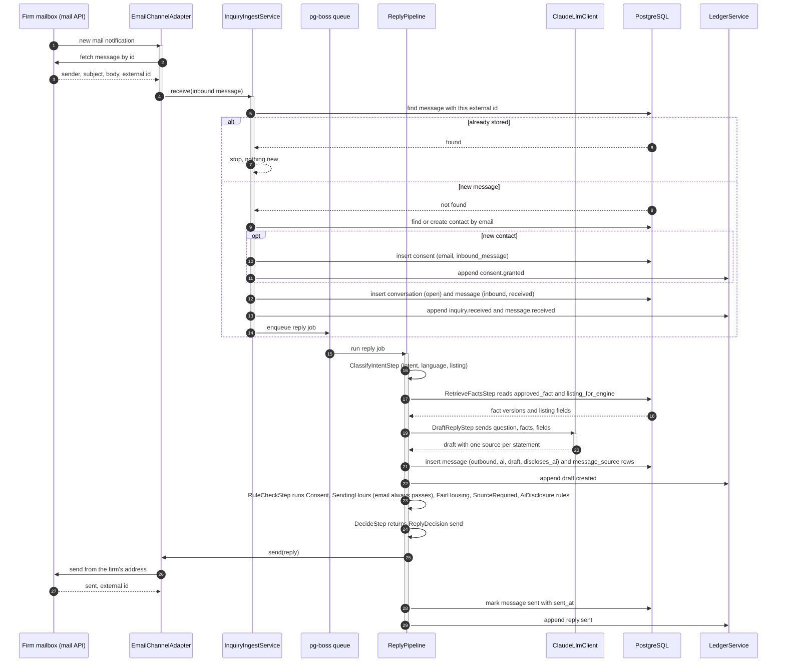

**How to read this.** Steps 1 to 4 are capture, and the `alt` block is the idempotency check. The second half is the worker running the pipeline. Each `ReplyStep` is drawn as an arrow from `ReplyPipeline` to itself because the steps live inside it. The time from `inquiry.received` to `reply.sent` is the response time the guarantee measures.

**Ledger events written:**

- `consent.granted` (only for a new contact)
- `inquiry.received`
- `message.received`
- `draft.created`
- `reply.sent`

------------------------------------------------------------------------

## Flow 2. A rule fails or the AI is unsure: the review queue

This is flow 1 when `RuleCheckStep` finds a problem (for example a statement with no source, or a fair-housing concern), or when the AI marks itself unsure. `DecideStep` returns "queue" instead of "send". `ReviewQueueService` opens a review item that points at the draft, and a `Notifier` (chosen from the broker's `app_user.notify_via`; here `SmsNotifier`) sends the broker a short message with the draft and three codes: 1 Send, 2 Edit, 3 I'll call. The broker's reply goes to `ReplyCodeParser`, which picks the matching `ReviewResolutionHandler`. Each handler is a **strategy**, meaning one interchangeable way of finishing the same job.

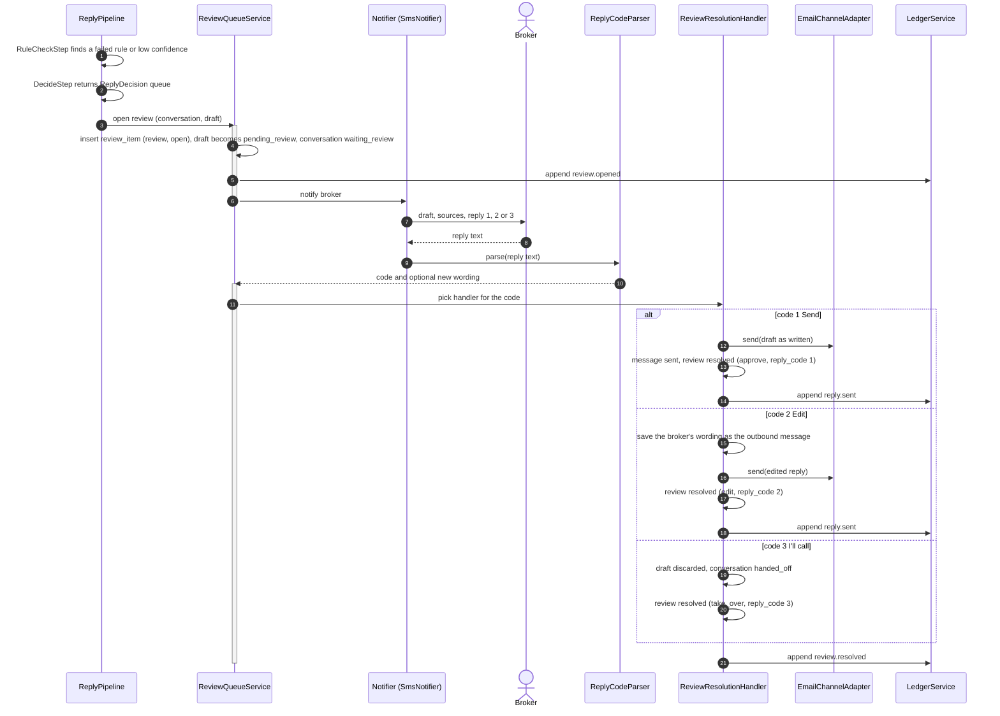

**How to read this.** Everything above the broker's reply is the same for every case. The `alt` block shows the three handlers: `ApproveHandler`, `EditHandler` and `TakeOverHandler`. The database itself checks that code 1 goes with approve, 2 with edit and 3 with take over. A broker can also resolve the same item in the web app or by voice note; only `resolved_via` changes. The other two kinds of item take the same resolve path without codes: a Question is answered (typed or spoken) by `AnswerHandler`, which sends the finished reply and proposes the answer as a draft fact, and an FYI is dismissed by `DismissHandler`.

**Ledger events written:**

- `review.opened`
- `reply.sent` (codes 1 and 2 only; also for an answered Question)
- `review.resolved` (also for an answered Question or a dismissed FYI, with the resolution in its payload)

------------------------------------------------------------------------

## Flow 3. Teaching by voice note

The broker taps the voice-note button and says, for example, "Seaside Towers now allows one dog under 25 pounds." `VoiceNoteService` stores the audio and asks a `Transcriber` (a speech-to-text service) for the words. The AI model turns the transcript into a proposed fact wording, and `FactService` saves it as a new **fact version** with status `draft`. Nothing changes for customers until the broker approves it. On approval, the old approved version is retired and the new one approved in one transaction, because the database allows only one approved version per fact and language. From then on the engine can cite it.

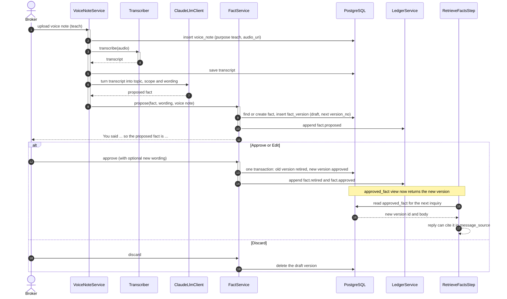

**How to read this.** The top half turns sound into a draft. The `alt` block is the broker's choice on the Fact sheet screen. A draft can never be cited: the database rejects a `message_source` row that points at a version that is not approved. `fact.retired` is written only when an older approved version existed.

**Ledger events written:**

- `fact.proposed`
- `fact.retired` (when replacing an older version)
- `fact.approved`

------------------------------------------------------------------------

## Flow 4. Booking a tour and handing off

When the customer wants to see a home, `TourService` asks the `CalendarProvider` (here `GoogleCalendarProvider`) for free times of an agent who covers the listing and offers three. When the customer picks one, it creates the calendar event and the `tour` row. `HandoffService` then offers the conversation to a licensed person with a short summary and a **clock**: an expiry time by which they must accept. `HandoffStateMachine` allows only these moves: offered to accepted, offered to expired, offered to declined. If the clock runs out, a scheduled job marks the hand-off expired and a new hand-off is offered to the next person.

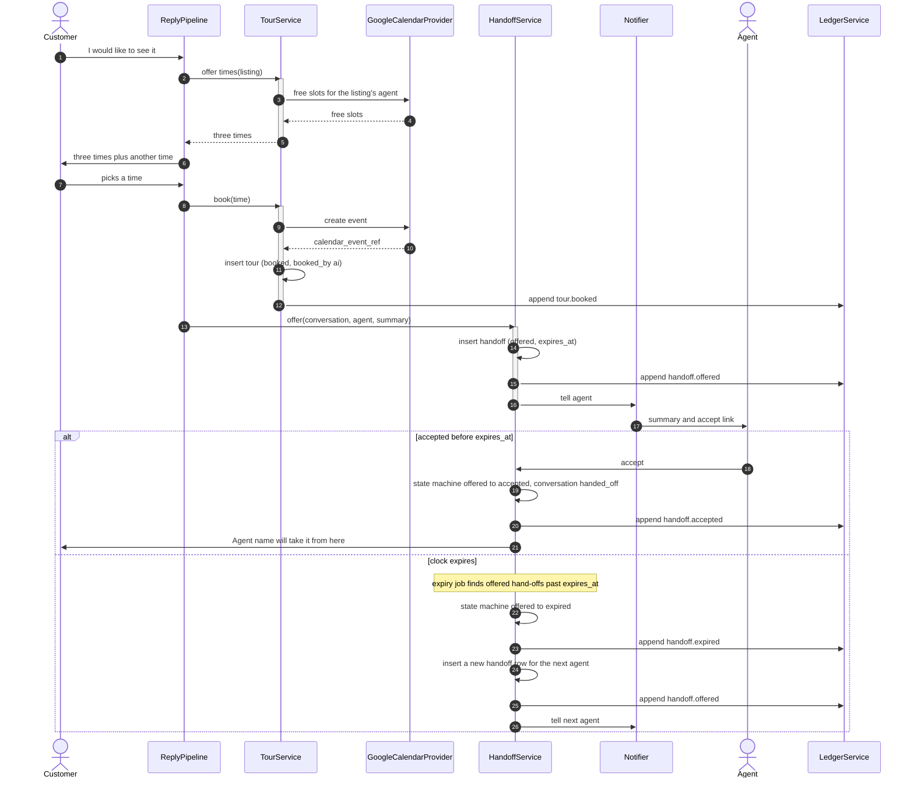

**How to read this.** The top third is the tour picker on the customer chat. The middle is the offer with its clock. The `alt` block shows both endings. A re-offer is a new `handoff` row, never an edit of the old one, so the history of who missed the clock is kept.

**Ledger events written:**

- `tour.booked`
- `handoff.offered` (once per offer, so twice after an expiry)
- `handoff.accepted` or `handoff.expired`

------------------------------------------------------------------------

## Flow 5. Consent: captured, checked, revoked

A renter fills in the web form and ticks the box that allows texts. `ConsentService` stores how and when consent was given, with the exact form wording as evidence. Before any text goes out, `ConsentRule` asks `ConsentService` whether that contact has active consent for SMS. If the renter later replies STOP, the consent row is revoked and every later text is blocked. `SmsChannelAdapter` is a later-phase adapter; it is drawn here because STOP arrives by text.

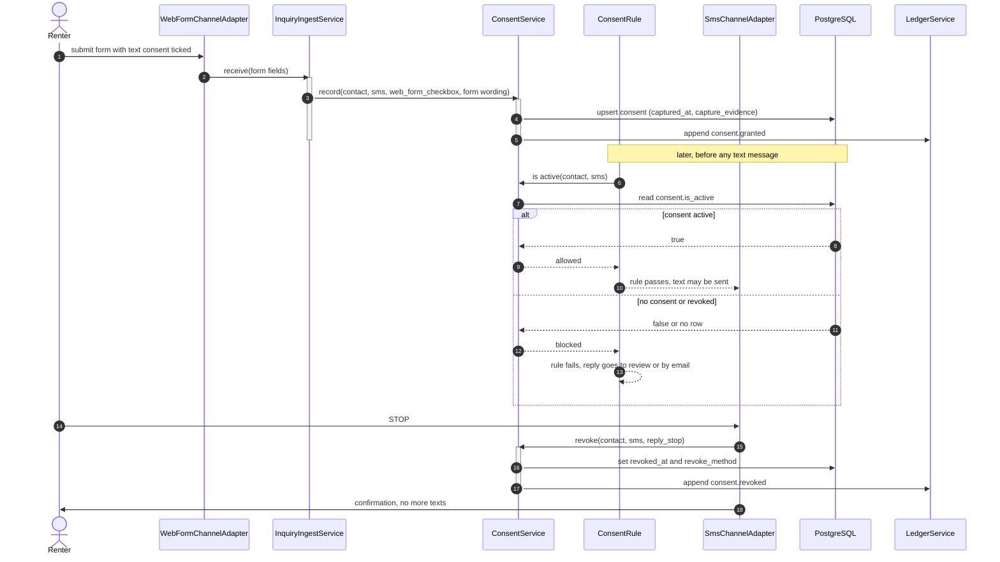

**How to read this.** There are three moments: capture at the top, the check in the middle (`alt`), and revocation at the bottom. Consent is not the only gate for a text: `SendingHoursRule` also holds it until the texting window opens in the recipient's local time: the contact's time zone, or the firm's when unknown (the database function `is_in_text_window`). There is one consent row per contact and channel kind, so a later re-grant updates that same row. The ledger keeps the full history. Revoking consent also stops every drip the person is in on that channel, in the same transaction (flow 14).

**Ledger events written:**

- `consent.granted`
- `consent.revoked`

------------------------------------------------------------------------

## Flow 6. The daily heartbeat

Once a day `HeartbeatService` sends a test inquiry through every channel that has the heartbeat switched on, from a test address outside the firm. Each test carries a unique **test token** (a random string) so the system can recognise it. The inquiry goes through the normal path, but its conversation is marked `is_test` so it never counts in reports or the guarantee. After a deadline the service checks whether the test arrived and was answered. A failure alerts the broker straight away and appears in the next morning brief.

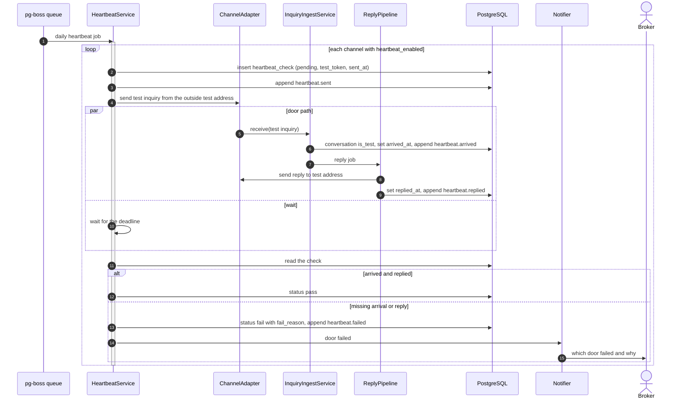

**How to read this.** The `loop` runs once per channel. The `par` block shows the test travelling through the real path while the service waits. The `alt` block is the verdict. Ledger writes go through `LedgerService`; they are drawn against the database here to keep the diagram to eight participants.

**Ledger events written:**

- `heartbeat.sent`
- `heartbeat.arrived`
- `heartbeat.replied`
- `heartbeat.failed` (only on failure)

------------------------------------------------------------------------

## Flow 7. A Replay run over a firm's past inquiries

**Replay** is the sales demo. Before a firm buys, `ReplayService` reads 30 to 90 days of the firm's past inquiries from its mailbox and form log, sees when (or whether) the firm replied, and runs each inquiry through the engine to show what Wynsley would have sent and how fast. An inquiry counts as **after hours** when it arrived outside the firm's office hours; the database function `is_after_hours(firm.office_hours, firm.timezone, received_at)` decides this, the same way for every report. Nothing is sent to anyone. The results go into `replay_run` and `replay_item`, which feed the Replay report screen.

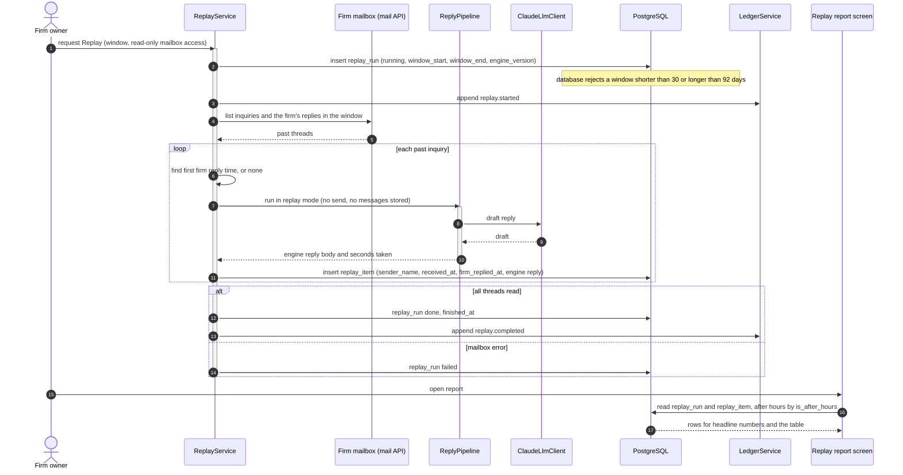

**How to read this.** The `loop` is the heart of Replay: one past inquiry, one engine draft, one row. `firm_replied_at` left empty means the firm never replied. `sender_name` is who asked, as shown on the original message; the address is not stored. Replay writes no `conversation` or `message` rows, so it can never send anything by mistake.

**Ledger events written:**

- `replay.started` when the run is created
- `replay.completed` when every thread has been read (a failed run writes no completion event; its status is in `replay_run`)

The per-inquiry results stay in `replay_run` and `replay_item`, not in the ledger.

------------------------------------------------------------------------

## Flow 8. Silent week (shadow mode)

During the **silent week** (also called **shadow mode**), the firm's channels are set to `mode = shadow`. Inquiries are captured and drafted exactly as in flow 1, but `DecideStep` never sends. The conversation and its messages carry `is_shadow = true`, and the firm's own staff keep replying as they do today. At the end of the week the broker can compare the drafts with what really happened.

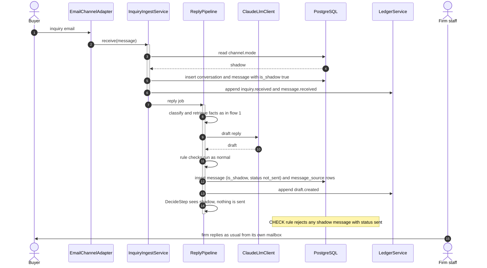

**How to read this.** Compare it with flow 1: the top half is the same, and the arrow that would send is missing. The database enforces this twice: a shadow message can never have status `sent`, and a message's shadow flag must match its conversation's. Shadow conversations are left out of response-time figures.

**Ledger events written:**

- `inquiry.received`
- `message.received`
- `draft.created`

------------------------------------------------------------------------

## Flow 9. Listing sync from an MLS feed

An **MLS** (Multiple Listing Service) is the shared database of homes for sale or rent in an area. A scheduled job asks `ListingSyncService` to sync each `mls_source`. The service uses a `ListingSourceAdapter` (here `SparkListingAdapter`, an assumption until BeachesMLS confirms the feed route) to fetch records changed since the last sync. Each record is split: private fields (owner phone, lockbox location, showing instructions) go to `listing_private`, and the rest goes to `listing`. Rows are **upserted**, which means inserted if new and updated if they already exist, matched on the source and its `ListingKey`. Listings that left the market get `removed_at`; a purge job deletes them within 12 hours, as BeachesMLS rule 20.2.5 requires. That is inside the 48 hours the data agreement allows for data that drops out of the feed (paragraph 3). The 12 hours are BeachesMLS's deadline, not our schedule: the sync runs hourly, and every run checks the full active-listing list, so a dropped listing disappears on the next run. By our own rule, read from 20.2.5's IDX displays, the 12-hour clock covers what a visitor sees: the database row, the listing page, the site's cache and CDN, and the sitemap. A dropped listing's page says the listing is no longer available. Each firm's website listing search and listing pages read this same copy (one sync, two uses), through their own view, still to build.

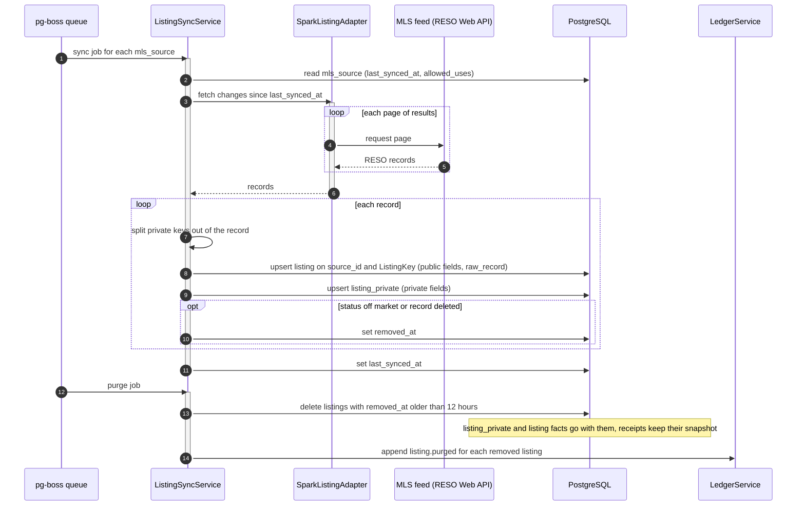

**How to read this.** The first half is the sync, the second the purge. If a private key were ever left in `raw_record`, the database would reject the row, so a split mistake fails loudly instead of leaking. The engine never reads `listing` private data: it reads the `listing_for_engine` view, which also hides removed listings and feeds not licensed for answering inquiries.

**Ledger events written:**

- `listing.purged`
- `mls.source_deleted` (only when a whole feed is removed, not in a normal sync)

------------------------------------------------------------------------

## Flow 10. Reports: the morning brief and the weekly letter

Every report is built from the ledger and the tables around it, never typed by hand. `ReportGenerator` is a **template method**: a base class that fixes the steps (gather numbers, write text, save, send) while each subclass fills in its own version of a step. Each night `GuaranteeService` computes the day's response-time result. Each morning `MorningBriefGenerator` writes the five-line brief. Each week `WeeklyLetterGenerator` writes the letter, and the seller logs and owner notes are made alongside it. The letter's after-hours count uses the same `is_after_hours` test against the firm's office hours as Replay.

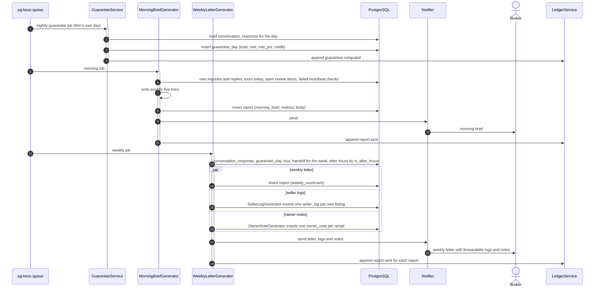

**How to read this.** The three blocks run at different times: nightly, each morning, each week. The `par` block shows the three weekly report kinds built side by side from the same numbers. The weekly letter is stored with kind `weekly_scorecard`.

**Ledger events written:**

- `guarantee.computed`
- `report.sent` (one per report sent)

------------------------------------------------------------------------

## Flow 11. A request from the frontend

The broker opens the queue screen on a phone. The Next.js frontend calls the `api` process with the broker's session token. `FirmGuard` (a NestJS **guard**, code that runs before a request handler and can refuse it) checks the token and reads the firm from it into `FirmContext`. `TenantTransaction` opens a database transaction and sets `app.firm_id` for that transaction only. From then on row-level security hides every other firm's rows, so even a bug in a query cannot read or write another firm's data.

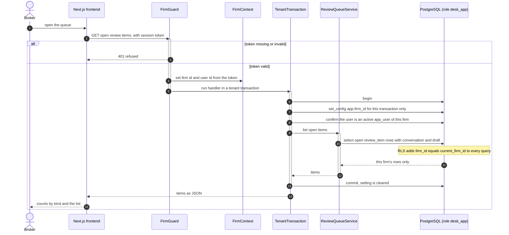

**How to read this.** The `alt` block is authentication. Inside the valid branch, everything happens in one transaction, and the firm setting disappears when it commits, so it cannot leak to the next request on the same pooled connection. The firm must come from the token because, until `app.firm_id` is set, RLS shows no rows at all, not even the user's own `app_user` row.

**Ledger events written:**

- None for a read. A write made through the same path (for example resolving a review item) writes its own events, as in flow 2.

------------------------------------------------------------------------

## Flow 12. A website check fails and alerts

Website care runs on a schedule. `CareRunner` takes each site whose monitoring is on and runs every due `CareCheck`: uptime often, speed, security updates and backups daily. Each result is added to `site_check` as a new row; results are **append-only**, like the ledger, so a check is never edited. Here the uptime check finds the firm's home page down, tries once more, and then records the failure, appends it to the ledger and alerts Madhav, who runs website care. The broker sees it in the next morning brief and in the monthly report.

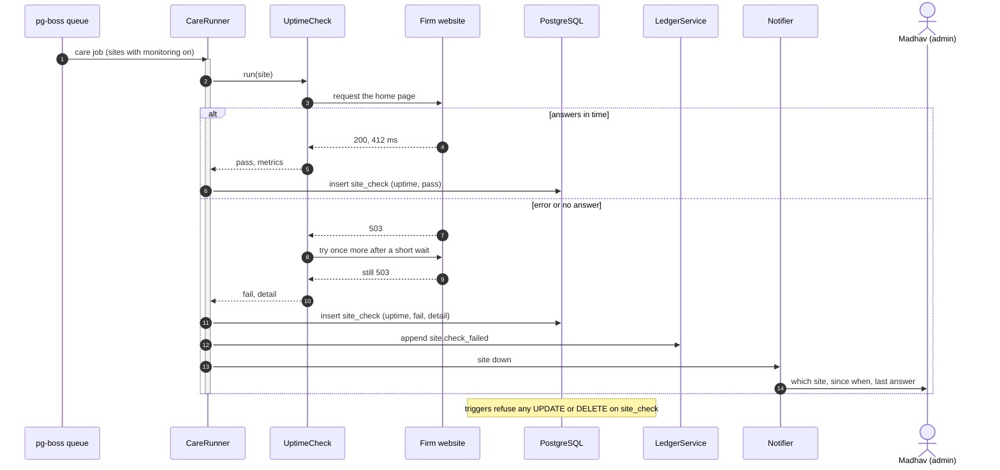

**How to read this.** The `alt` block is the verdict. Both branches add a row; nothing is ever overwritten, so the monthly report can show when a site went down and when it came back. One retry keeps a single slow answer from paging anyone. Speed, security and backup checks follow the same path through `SpeedCheck`, `SecurityCheck` and `BackupCheck`.

**Ledger events written:**

- `site.check_failed` (only on failure; passing results live in `site_check`)

------------------------------------------------------------------------

## Flow 13. Publishing an area page or Google post, with approval

Local SEO content is drafted by AI and approved by Madhav. `AreaPageService` asks `ContentDraftService` for a draft, which writes only from the firm's profile, its approved facts and public listing fields, with a source for every claim. Before anyone sees the draft, `ComplianceService` checks it for the brokerage name and fair-housing wording. Madhav reviews it; only an approved page can be published, and the database refuses anything else. A Google Business Profile post takes the same path through `GbpPostService`.

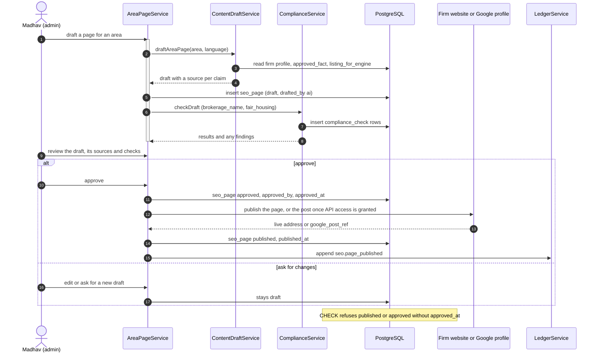

**How to read this.** The top half makes and checks a draft; the `alt` block is Madhav's decision. Approval checks the wording for publishing; it cannot introduce a fact, because the draft was written only from facts the broker had already approved. Until Google grants API access to the profile (about 60 days after it is verified), Madhav posts by hand as a manager and marks the post published, so `google_post_ref` stays empty.

**Ledger events written:**

- `compliance.check_failed` (only if a check fails)
- `seo.page_published` (or `gbp.post_published` for a post)

------------------------------------------------------------------------

## Flow 14. A drip that stops on opt-out

A renter asked about a home and ticked the box that allows texts, so she was enrolled in a follow-up drip. `DripRunner` sends each due step through the normal channel adapter, in the brokerage's name and inside the texting window in her own time zone, after checking her consent is still active. When she replies STOP, `ConsentService` revokes her text consent, and a **database trigger** stops every active text drip she is in, in the same transaction. Nothing more can be sent to her: the database also refuses to start or restart a drip without active consent.

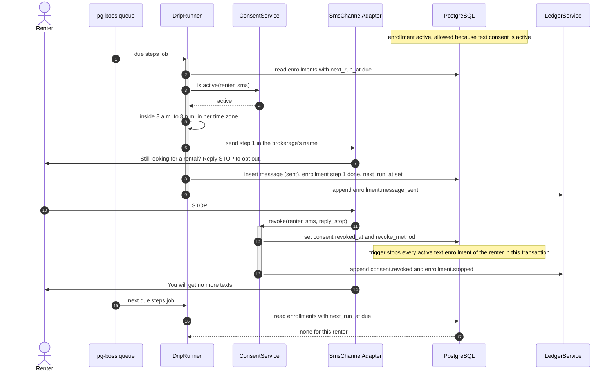

**How to read this.** The top half is one ordinary step; the bottom half is the opt-out. The stop does not depend on the app remembering: the trigger sets the drip to `stopped` with reason `consent_revoked` and clears its next run. An unsubscribe link in a drip email works the same way through email consent. A reply that is not STOP also stops the drip, through `CampaignLedgerSubscriber` (reason `replied`). From 25 Nov 2026 (FCC 26-67), one opt-out from a marketing call or text stops all marketing calls and texts from that sender, so for a marketing opt-out the app revokes every channel. Opt-outs must already be honoured within 10 business days; here it happens in the same transaction.

**Ledger events written:**

- `enrollment.message_sent` (one per message sent)
- `consent.revoked`
- `enrollment.stopped` (with the reason in its payload)

------------------------------------------------------------------------

## Flow 15. The monthly report

On the first day of each month, in the firm's own time zone, `MonthlyReportGenerator` builds the report the firm's owner gets. Like every report it is a **template method** (flow 10): the steps are fixed and only the numbers differ. The numbers come from the ledger and the stored results, never typed by hand: inquiries and reply times from `conversation_response`, cost per lead from the spend the firm entered divided by that month's inquiries from each source, then the pipeline, tours, site checks, compliance results (including fair housing) and opt-outs honoured.

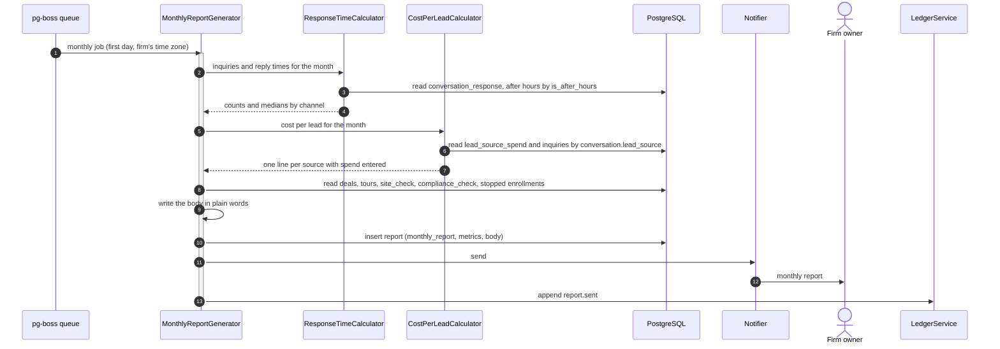

**How to read this.** Each arrow into `PostgreSQL` is one group of numbers. Cost per lead appears only for sources with spend entered; a source with spend but no inquiries shows its spend and no cost per lead. The same report is the firm's before-and-after record, so it keeps the month's compliance results, not only the marketing numbers.

**Ledger events written:**

- `report.sent`

------------------------------------------------------------------------

## Flow 16. A property-management sync through IntegrationsModule

Rentals support connects to the firm's own property-management software; it never holds or moves rent. On a schedule, `PmsSyncService` reads what changed since the last sync through the right `PropertyManagementAdapter`, chosen by `PmsAdapterRegistry` from the vendor's name. The adapter reads its API key from the secrets store by the reference the `integration` row keeps; the key itself never reaches the database. Each property is matched on its own id in the firm's software, so a repeated sync updates the same row, and its owners and tenants become roles in the CRM.

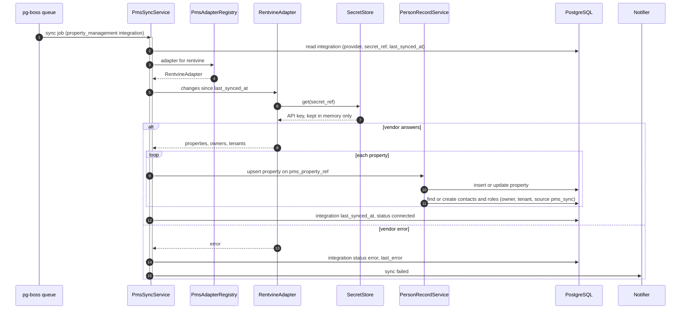

**How to read this.** The `loop` is the heart of the sync: one property, one upsert, its people linked by role. A repeated or overlapping sync cannot create a copy, because `pms_property_ref` is unique per firm. When a resident asks about rent, the assistant sends the adapter's `paymentLink` to the vendor's own payment page. A maintenance request becomes a work order in the vendor's software through `createWorkOrder`.

**Ledger events written:**

- None. The sync's state lives on the `integration` row (`status`, `last_synced_at`, `last_error`).

------------------------------------------------------------------------

## Flow 17. AI onboarding: from website and listings to a set-up firm

Setting a firm up should take about an hour. Madhav starts it with the firm's website and its firm type. `OnboardingService` reads the shared `firm_template` for that type, the firm's public pages through `PageFetcher` and its listings through `ListingReader`, and asks `ContentDraftService` for a drafted profile (areas, services, team, routing, tone), settings and candidate facts. **Who approves what:** Madhav, the founder, reviews the drafted profile and settings on one screen before anything reaches the firm. Every fact the AI will state to customers still goes to the broker as a draft fact version, through the same approval as every other fact. There is no second approval path.

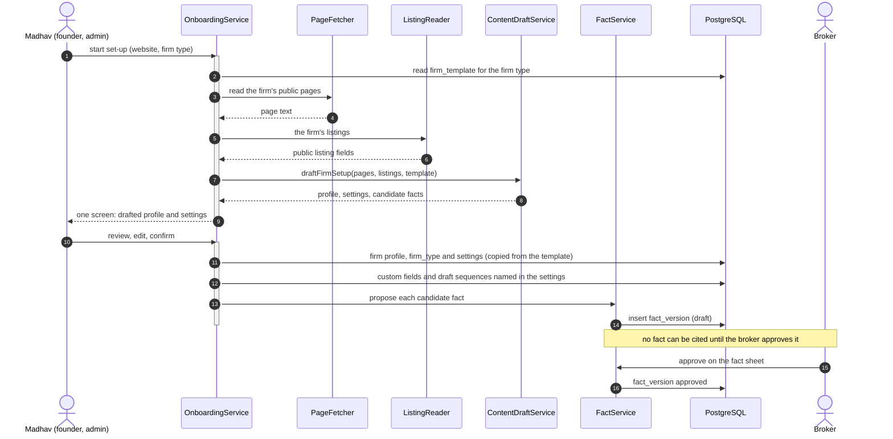

**How to read this.** The first block reads and drafts; nothing is written to the firm until Madhav confirms. The second block saves only what he reviewed: the profile and the settings copied from the template, which the firm then tunes. Facts take the existing path: `fact.proposed` now, `fact.approved` when the broker approves each one on the fact sheet. The step that reads the public website never sees the firm's mailbox; past emails, when used later, arrive as an export.

**Ledger events written:**

- `fact.proposed` (one per drafted fact)
- `fact.approved` (when the broker approves each one)
