# 04. Entity-relationship diagrams

This document draws the database of Wynsley exactly as it is defined in `schema.sql`: 42 tables, the 83 foreign keys between them, three views and three database roles (two that connect, one that only owns a view). It starts with two overviews, the AI desk's 24 tables and the 18 tables the rest of the first offer adds, then zooms into ten areas with their key columns, and ends with every relationship, the rules the database enforces by itself and a one-line purpose for every table.

## Summary

- Every table except `firm` and `firm_template` carries a `firm_id`. Row-level security (a database rule that hides rows from other firms) is switched on and forced for 41 of the 42 tables. The exception, `firm_template`, holds the shared starting templates by firm type: it belongs to no firm, both firm roles may read it, and only the schema owner may change it.
- Child tables point at parents with **composite foreign keys** on `(firm_id, id)`: a reference made of two columns, so a row can never point at another firm's row, even for a database superuser.
- The ledger table is called `event`. It can only be added to.
- Listing columns that come from the RESO standard (the shared naming standard for US listing data) keep their exact mixed-case names, such as `ListingKey` and `ListPrice`. In SQL they are written in quotes; the diagrams show them without quotes.

## How to read these diagrams

An **entity-relationship (ER) diagram** shows tables as boxes and foreign keys as lines. A **foreign key (FK)** is a column that must match the id of a row in another table. The symbols at each end of a line give the **cardinality**, meaning how many rows can be on that side:

| Symbol at the end of a line   | Meaning      |
|-------------------------------|--------------|
| `||` (two bars)               | exactly one  |
| `|o` (bar and circle)         | zero or one  |
| `o{` (circle and crow's foot) | zero or many |

The parent side is "exactly one" when the foreign key column is required (`not null`) and "zero or one" when it may be empty. Column markers in the detailed diagrams: **PK** is the primary key (the row's own id), **FK** is a foreign key, **UK** marks a column that is part of a unique rule (no two rows may share the same value, often together with `firm_id`).

------------------------------------------------------------------------

## 1. Overview

### 1a. The desk: 24 tables

```mermaid
erDiagram
    firm ||--o{ app_user : employs
    firm ||--o{ contact : knows
    firm ||--o{ channel : owns
    firm ||--o{ mls_source : licenses
    firm ||--o{ building : records
    firm ||--o{ fact : knows
    firm ||--o{ replay_run : runs
    firm ||--o{ guarantee_day : scored
    firm ||--o{ report : receives
    firm ||--o{ event : logs

    contact ||--o{ consent : gives
    contact ||--o{ conversation : starts
    contact ||--o{ tour : attends
    channel ||--o{ conversation : carries
    channel ||--o{ heartbeat_check : tested_by

    mls_source ||--o{ listing : supplies
    building |o--o{ listing : contains
    listing ||--o| listing_private : hides
    app_user |o--o{ building : verifies

    listing |o--o{ fact : about
    building |o--o{ fact : about
    fact ||--o{ fact_version : versions
    app_user ||--o{ voice_note : records
    voice_note |o--o{ fact_version : proposes
    app_user |o--o{ fact_version : proposes
    app_user |o--o{ fact_version : approves

    listing |o--o{ conversation : concerns
    conversation ||--o{ message : contains
    app_user |o--o{ message : writes
    message ||--o{ message_source : cites
    fact_version |o--o{ message_source : source
    listing |o--o{ message_source : source

    conversation ||--o{ review_item : queues
    message |o--o{ review_item : drafts
    app_user |o--o{ review_item : assigned
    app_user |o--o{ review_item : resolves
    voice_note |o--o{ review_item : resolves

    conversation ||--o{ tour : books
    listing |o--o{ tour : shown
    app_user |o--o{ tour : leads
    conversation ||--o{ handoff : offers
    app_user ||--o{ handoff : receives

    conversation |o--o{ event : logged
    conversation |o--o{ heartbeat_check : test
    replay_run ||--o{ replay_item : contains
    listing |o--o{ report : about
    app_user |o--o{ report : addressed
```

**How to read this.** Each line is one foreign key in `schema.sql`, so two lines between the same pair (for example `app_user` and `fact_version`) are two different columns. `firm` connects directly only to the tables that have a plain foreign key to it; the others (such as `consent`, `listing` or `message`) reach their firm through the composite key to their parent. The one "zero or one" child end, `listing` to `listing_private`, exists because `listing_private` uses the listing's id as its own primary key.

### 1b. The rest of the first offer: 18 tables

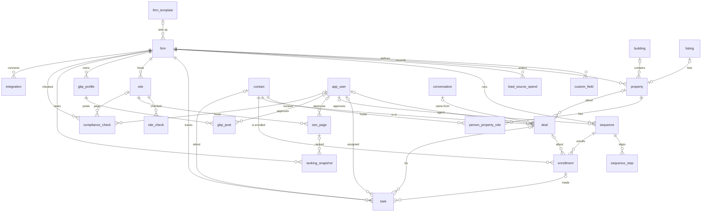

**How to read this.** These are the 36 foreign keys the first offer adds. Six desk tables appear again because the new ones hang off them: `firm`, `contact`, `listing`, `building`, `app_user` and `conversation`. `firm_template` is the only parent outside a firm: a firm names the template it was set up from. Two links matter that are not foreign keys: revoking a `consent` row stops that person's drips (a trigger), and spend is matched to inquiries by source name.

------------------------------------------------------------------------

## 2. Who and doors

The firm, its staff, the people who contact it, their consent, and each door (channel) with its daily test.

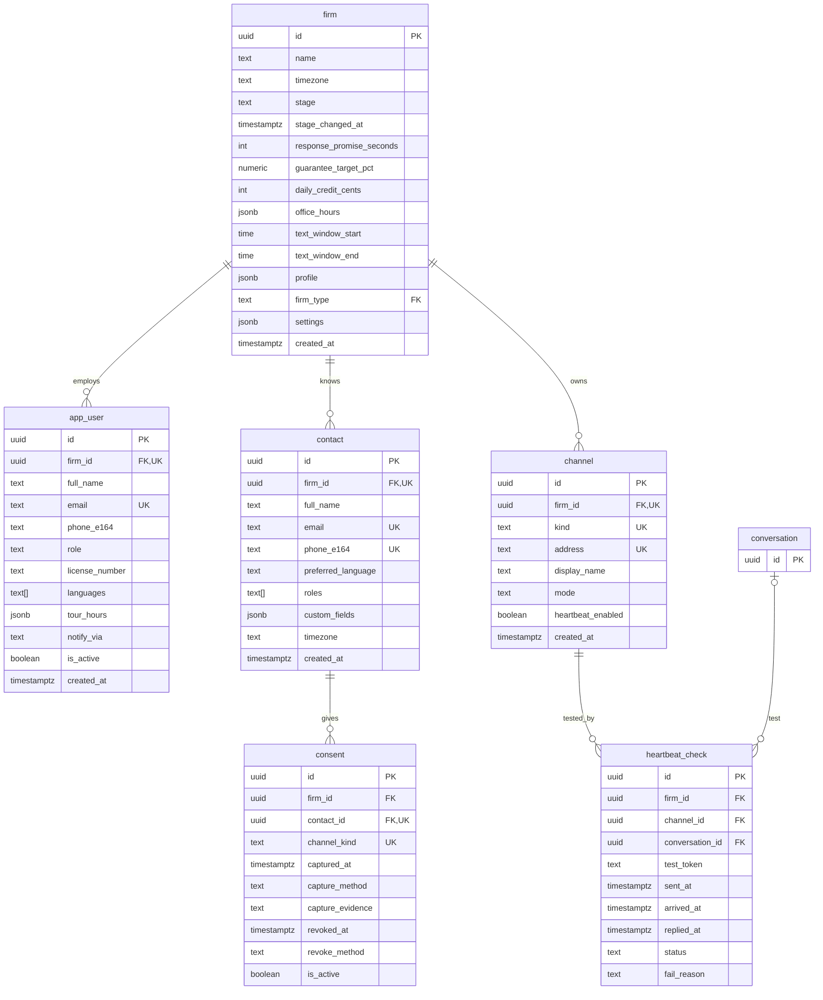

**How to read this.** `conversation` is shown with only its id because it belongs to the next area. The UK markers mean: one `app_user` email per firm; one `contact` per email and per phone number in a firm (email compared in lower case, and only when present); one `consent` row per contact and channel kind; one `channel` per kind and address in a firm. `consent.is_active` is computed by the database from `revoked_at`. `firm.stage_changed_at` is set by a trigger whenever `stage` changes. `app_user.tour_hours` holds weekly tour availability: day keys `mon` to `sun`, each a list of start and end times (`"HH:MM"`) in the firm's time zone; empty (null) means the person is not offered for tours. `firm.office_hours` has the same shape and holds the firm's opening times; a missing day means closed, and the default is Monday to Friday, 09:00 to 18:00. `firm.text_window_start` and `text_window_end` (default 08:00 and 20:00, start before end) are the texting window, read in the recipient's local time: `contact.timezone` (an IANA name such as `America/New_York`, from the address or phone area code), or the firm's time zone when it is null. Checks keep the window inside 08:00–20:00, so a firm may narrow it but never widen it. `app_user.notify_via` is `email` (the default) or `sms`: how the staff member is notified. `firm.profile` holds the registered name, areas, services, routing and tone the AI writes from; `firm.firm_type` names the shared template the firm was set up from, and `firm.settings` holds that template's settings as copied, then tuned (section 11). `contact.custom_fields` holds the values of the firm's own contact fields (section 7). Revoking a `consent` row also stops that contact's drips on that channel (section 8).

------------------------------------------------------------------------

## 3. Conversations and human steps

Threads, every message and draft, where each stated fact came from, and the three human steps: review, tour and hand-off.

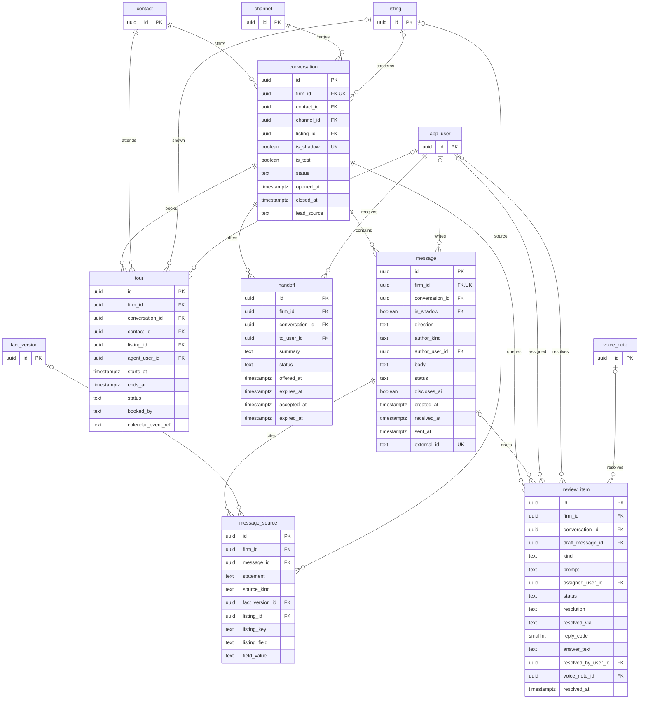

**How to read this.** `message` points at its conversation with three columns, `(firm_id, conversation_id, is_shadow)`, which is why `is_shadow` is marked FK: a silent-week message cannot sit in a live conversation, or the reverse. A `message_source` cites either a fact version or a listing field, never both; for a listing field it also keeps `listing_key`, the field name and the value, so the receipt survives when the listing is deleted. `message.external_id` is the channel's own message id (for email, the Message-ID header); a partial unique index allows it only once per firm, so the same email arriving twice is stored once. `review_item` has two links to `app_user`: who it is assigned to and who resolved it. Its `kind` (`review`, `question` or `fyi`) fixes which `resolution` it may have: approve, edit or take_over for a review, answer for a question, dismiss for an FYI. `answer_text` is the typed answer to a question. `conversation.lead_source` is the source the inquiry was tagged with when it arrived (lower case, digits and `_`, such as `zillow`); cost per lead counts inquiries by it.

------------------------------------------------------------------------

## 4. Knowledge

What the firm has taught the desk: facts, their versions, and the voice notes that proposed them.

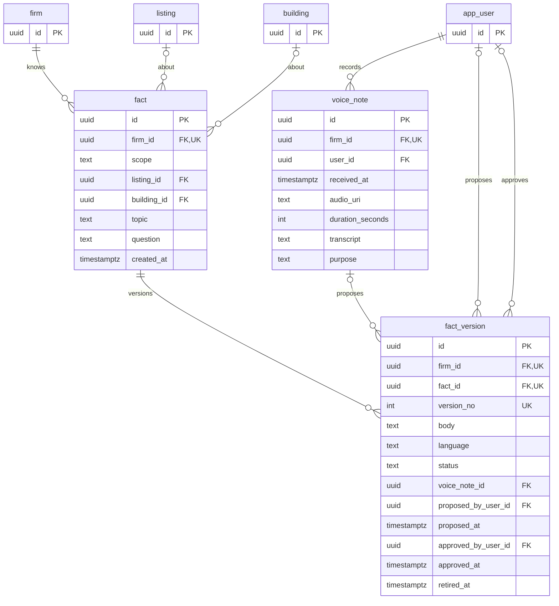

**How to read this.** A fact's `scope` is `firm`, `listing` or `building`, and a CHECK rule makes exactly the matching id present (none, `listing_id`, or `building_id`). `fact.question` is the customer question the fact answers. `fact_version.language` is `en` (the default) or `es`. Version numbers are unique within a fact, and a partial unique index allows at most one `approved` version per fact and language at a time, so an English and a Spanish wording can both be live. Facts drafted by AI onboarding arrive here as draft versions too; the broker's approval is the only path for a fact the AI will state. `voice_note.purpose` is `teach` or `resolve_review`.

------------------------------------------------------------------------

## 5. Listings

Listing feeds, the public listing record, its private fields, and the building book.

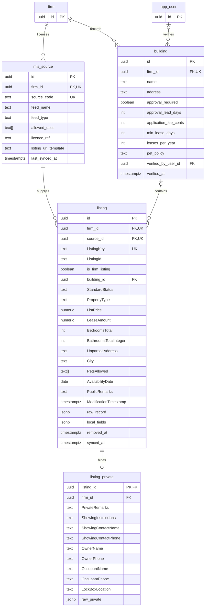

**How to read this.** `listing` shows its key columns only; it also has `PropertySubType`, `LeaseAmountFrequency`, `LivingArea`, `UnitNumber`, `StateOrProvince`, `PostalCode`, `AssociationFee`, `AssociationFeeFrequency`, `ListAgentFullName` and `ListOfficeName`. A listing is identified by its feed plus `ListingKey`. `mls_source.listing_url_template` is the optional link pattern for a listing's public page; when set it must contain `{ListingId}` or `{ListingKey}`. Each listing has at most one `listing_private` row, and the answering engine's database role cannot read that table at all.

------------------------------------------------------------------------

## 6. Proof and sales

The ledger, the daily guarantee result, sent reports, and Replay.

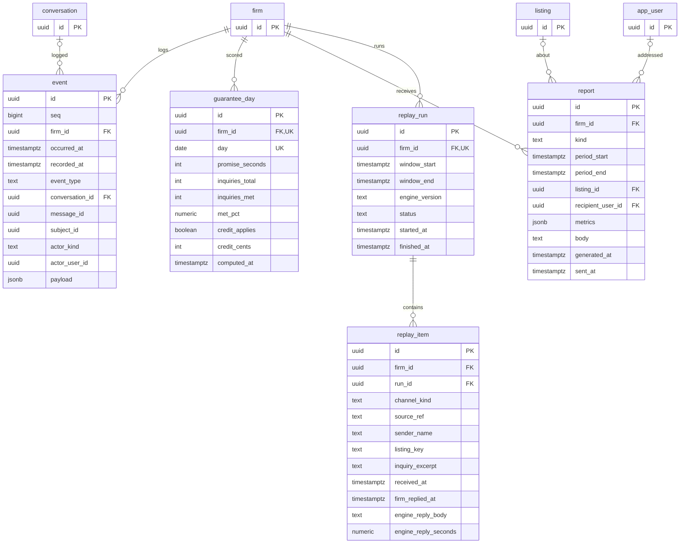

**How to read this.** `event.message_id`, `subject_id` and `actor_user_id` are deliberately not foreign keys: the ledger must outlive the rows it describes. `seq` is a number the database assigns in order, so events can be sorted even when two share a time. There is one `guarantee_day` per firm per day. `replay_item` copies `listing_key` as text instead of linking to `listing`, because Replay runs before a firm's listings are loaded. `replay_item.sender_name` is who asked, as shown on the original message; the sender's address is deliberately not stored. `report.kind` now includes `monthly_report`.

------------------------------------------------------------------------

## 7. CRM: people, properties, deals, tasks, custom fields

One record per person across buying, selling, renting and owning, and the pipeline built on it.

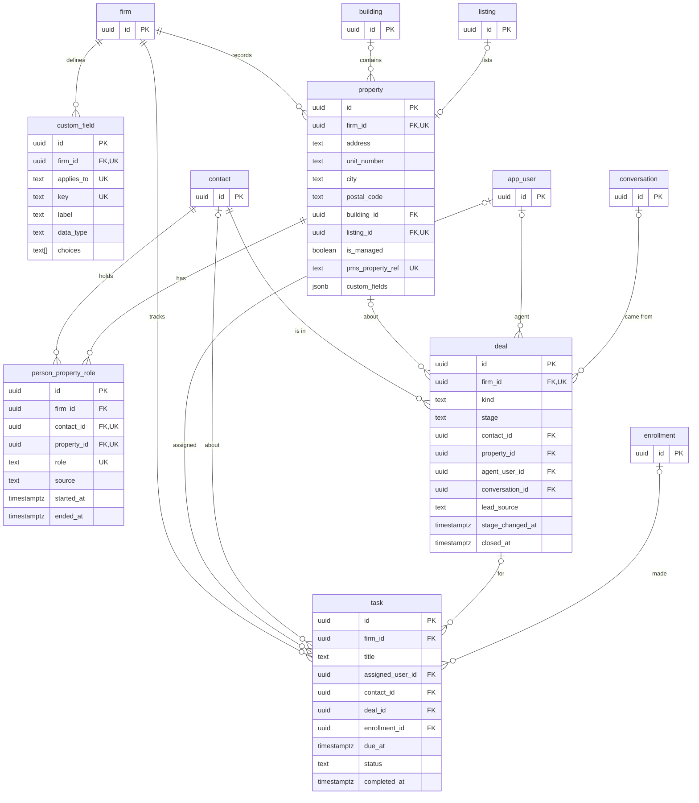

**How to read this.** `person_property_role.role` is one of `owner`, `tenant`, `landlord`, `seller`, `buyer_interest` and `renter_interest`; its UK markers mean one current row per person, property and role (a partial unique index that skips ended rows). `property.listing_id` is unique, and emptied when its listing is purged; `pms_property_ref` is unique per firm, so a repeated sync updates one row. `deal.kind` is `sale`, `lease` or `management`; `closed_at` is set exactly when the stage is `won` or `lost`, and a trigger keeps `stage_changed_at` current. The values of `custom_field` definitions live in `contact.custom_fields` and `property.custom_fields`; triggers reject an undefined key or a wrong type.

------------------------------------------------------------------------

## 8. Campaigns: drips and who is in them

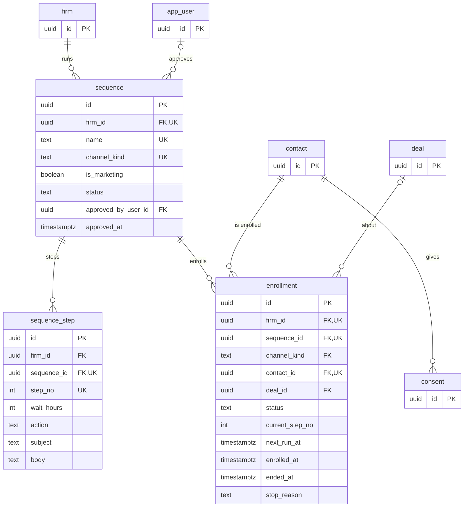

**How to read this.** `enrollment` points at its sequence with three columns, `(firm_id, sequence_id, channel_kind)`, which is why `channel_kind` is marked FK: a drip's channel always equals its sequence's. `consent` is drawn because it governs every enrollment, through two triggers rather than a line: an enrollment can be active only while the contact's consent for its channel is active, and revoking that consent stops it in the same transaction. The UK markers on `enrollment` mean one active enrollment per person per sequence. A sequence can leave `draft` only with `approved_at`.

------------------------------------------------------------------------

## 9. Website care and compliance

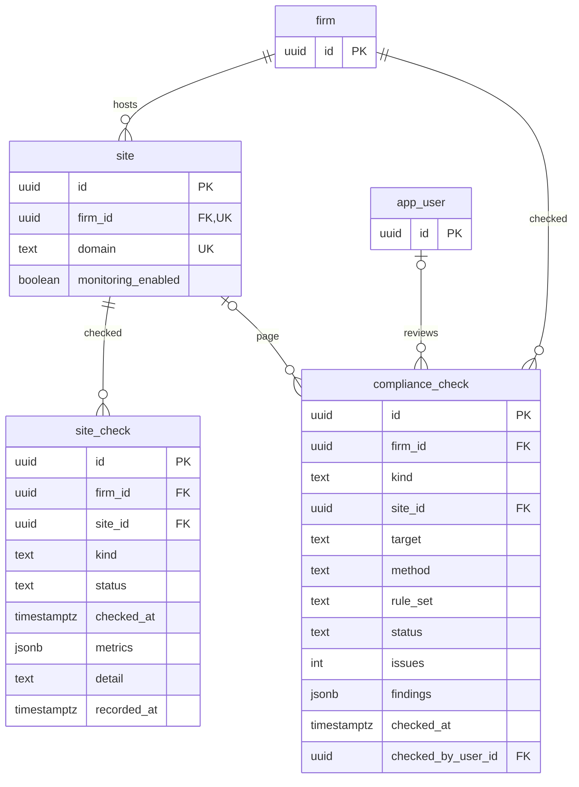

**How to read this.** `site_check` and `compliance_check` are append-only, like the ledger: triggers refuse every update and delete, and their foreign keys are all restrict, because "set null" would be an update. `site_check.kind` is uptime, speed, security or backup; a warn or fail must have a `detail`. `compliance_check.kind` is `accessibility`, `idx_display`, `brokerage_name` or `fair_housing`; `site_id` is empty when the target is not a web page (for example AI replies); a `human` review names its reviewer, and `pass` means zero issues.

------------------------------------------------------------------------

## 10. Local SEO

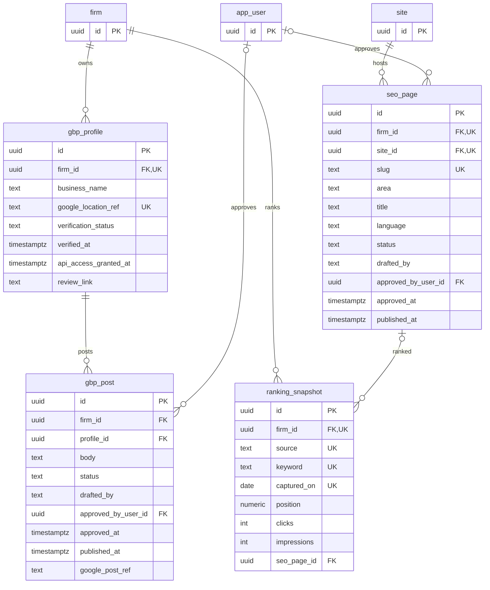

**How to read this.** An area page (`seo_page`) and a Google post (`gbp_post`) share one life cycle: draft, approved, published, retired. Database checks refuse anything but a draft without `approved_at`, and `published` without `published_at`. A post is 1 to 1,500 characters. `gbp_profile.verified_at` starts Google's wait before API access; until `api_access_granted_at` is set, posts are made by hand and `google_post_ref` stays empty. There is one ranking snapshot per firm, source, keyword and day.

------------------------------------------------------------------------

## 11. Set-up, integrations and spend

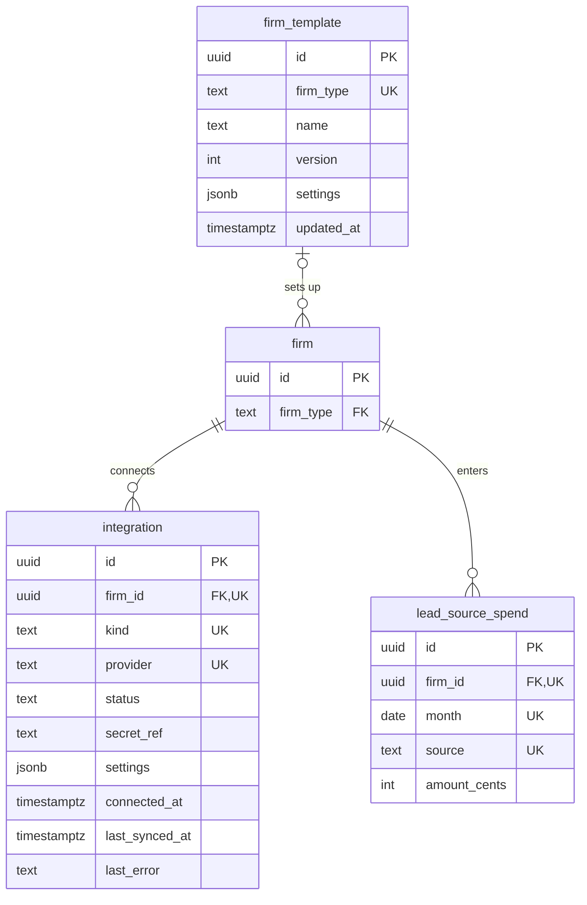

**How to read this.** `firm_template` has no `firm_id`: it is global, one row per firm type (`sells`, `sells_rents`, `sells_rents_manages`), readable by both firm roles and written only by the schema owner. Setting a firm up copies the template's settings into `firm.settings`. `integration.secret_ref` is only the name of a secret (for example `secrets/<firm>/rentvine`); checks reject a value shaped like a key and any setting whose name suggests a secret. `lead_source_spend` is entered by the firm, one row per month (the first day) and source; its `source` matches `conversation.lead_source` by value, which is how cost per lead counts inquiries.

------------------------------------------------------------------------

## 12. Every relationship

"On delete" says what the database does to the child row when the parent row is deleted. **Cascade** deletes the child too. **Set null** keeps the child and empties the link (only that one column, even though the key also includes `firm_id`). **Restrict** refuses to delete the parent while children exist.

| \# | Parent | Child (column) | Cardinality (parent to child) | On delete |
|----|----|----|----|----|
| 1 | `firm` | `app_user` (`firm_id`) | one to zero or many | cascade |
| 2 | `firm` | `contact` (`firm_id`) | one to zero or many | cascade |
| 3 | `firm` | `channel` (`firm_id`) | one to zero or many | cascade |
| 4 | `firm` | `mls_source` (`firm_id`) | one to zero or many | cascade |
| 5 | `firm` | `building` (`firm_id`) | one to zero or many | cascade |
| 6 | `firm` | `fact` (`firm_id`) | one to zero or many | cascade |
| 7 | `firm` | `replay_run` (`firm_id`) | one to zero or many | cascade |
| 8 | `firm` | `guarantee_day` (`firm_id`) | one to zero or many, one per day | cascade |
| 9 | `firm` | `report` (`firm_id`) | one to zero or many | cascade |
| 10 | `firm` | `event` (`firm_id`) | one to zero or many | restrict |
| 11 | `contact` | `consent` (`contact_id`) | one to zero or many, one per channel kind | cascade |
| 12 | `contact` | `conversation` (`contact_id`) | one to zero or many | cascade |
| 13 | `contact` | `tour` (`contact_id`) | one to zero or many | cascade |
| 14 | `channel` | `conversation` (`channel_id`) | one to zero or many | restrict |
| 15 | `channel` | `heartbeat_check` (`channel_id`) | one to zero or many | cascade |
| 16 | `app_user` | `building` (`verified_by_user_id`) | zero or one to zero or many | set null |
| 17 | `mls_source` | `listing` (`source_id`) | one to zero or many | cascade |
| 18 | `building` | `listing` (`building_id`) | zero or one to zero or many | set null |
| 19 | `listing` | `listing_private` (`listing_id`) | one to zero or one | cascade |
| 20 | `app_user` | `voice_note` (`user_id`) | one to zero or many | restrict |
| 21 | `listing` | `fact` (`listing_id`) | zero or one to zero or many | cascade |
| 22 | `building` | `fact` (`building_id`) | zero or one to zero or many | cascade |
| 23 | `fact` | `fact_version` (`fact_id`) | one to zero or many | cascade |
| 24 | `voice_note` | `fact_version` (`voice_note_id`) | zero or one to zero or many | set null |
| 25 | `app_user` | `fact_version` (`proposed_by_user_id`) | zero or one to zero or many | set null |
| 26 | `app_user` | `fact_version` (`approved_by_user_id`) | zero or one to zero or many | set null |
| 27 | `listing` | `conversation` (`listing_id`) | zero or one to zero or many | set null |
| 28 | `conversation` | `message` (`conversation_id`, `is_shadow`) | one to zero or many | cascade |
| 29 | `app_user` | `message` (`author_user_id`) | zero or one to zero or many | set null |
| 30 | `message` | `message_source` (`message_id`) | one to zero or many | cascade |
| 31 | `fact_version` | `message_source` (`fact_version_id`) | zero or one to zero or many | set null |
| 32 | `listing` | `message_source` (`listing_id`) | zero or one to zero or many | set null |
| 33 | `conversation` | `review_item` (`conversation_id`) | one to zero or many | cascade |
| 34 | `message` | `review_item` (`draft_message_id`) | zero or one to zero or many | set null |
| 35 | `app_user` | `review_item` (`assigned_user_id`) | zero or one to zero or many | set null |
| 36 | `app_user` | `review_item` (`resolved_by_user_id`) | zero or one to zero or many | set null |
| 37 | `voice_note` | `review_item` (`voice_note_id`) | zero or one to zero or many | set null |
| 38 | `conversation` | `tour` (`conversation_id`) | one to zero or many | cascade |
| 39 | `listing` | `tour` (`listing_id`) | zero or one to zero or many | set null |
| 40 | `app_user` | `tour` (`agent_user_id`) | zero or one to zero or many | set null |
| 41 | `conversation` | `handoff` (`conversation_id`) | one to zero or many | cascade |
| 42 | `app_user` | `handoff` (`to_user_id`) | one to zero or many | restrict |
| 43 | `conversation` | `event` (`conversation_id`) | zero or one to zero or many | restrict |
| 44 | `conversation` | `heartbeat_check` (`conversation_id`) | zero or one to zero or many | set null |
| 45 | `replay_run` | `replay_item` (`run_id`) | one to zero or many | cascade |
| 46 | `listing` | `report` (`listing_id`) | zero or one to zero or many | set null |
| 47 | `app_user` | `report` (`recipient_user_id`) | zero or one to zero or many | set null |
| 48 | `firm_template` | `firm` (`firm_type`) | zero or one to zero or many | restrict |
| 49 | `firm` | `custom_field` (`firm_id`) | one to zero or many | cascade |
| 50 | `firm` | `property` (`firm_id`) | one to zero or many | cascade |
| 51 | `building` | `property` (`building_id`) | zero or one to zero or many | set null |
| 52 | `listing` | `property` (`listing_id`) | zero or one to zero or one | set null |
| 53 | `contact` | `person_property_role` (`contact_id`) | one to zero or many | cascade |
| 54 | `property` | `person_property_role` (`property_id`) | one to zero or many | cascade |
| 55 | `contact` | `deal` (`contact_id`) | one to zero or many | cascade |
| 56 | `property` | `deal` (`property_id`) | zero or one to zero or many | set null |
| 57 | `app_user` | `deal` (`agent_user_id`) | zero or one to zero or many | set null |
| 58 | `conversation` | `deal` (`conversation_id`) | zero or one to zero or many | set null |
| 59 | `firm` | `lead_source_spend` (`firm_id`) | one to zero or many, one per month and source | cascade |
| 60 | `firm` | `sequence` (`firm_id`) | one to zero or many | cascade |
| 61 | `app_user` | `sequence` (`approved_by_user_id`) | zero or one to zero or many | set null |
| 62 | `sequence` | `sequence_step` (`sequence_id`) | one to zero or many | cascade |
| 63 | `sequence` | `enrollment` (`sequence_id`, `channel_kind`) | one to zero or many | cascade |
| 64 | `contact` | `enrollment` (`contact_id`) | one to zero or many | cascade |
| 65 | `deal` | `enrollment` (`deal_id`) | zero or one to zero or many | set null |
| 66 | `firm` | `task` (`firm_id`) | one to zero or many | cascade |
| 67 | `app_user` | `task` (`assigned_user_id`) | zero or one to zero or many | set null |
| 68 | `contact` | `task` (`contact_id`) | zero or one to zero or many | cascade |
| 69 | `deal` | `task` (`deal_id`) | zero or one to zero or many | cascade |
| 70 | `enrollment` | `task` (`enrollment_id`) | zero or one to zero or many | set null |
| 71 | `firm` | `site` (`firm_id`) | one to zero or many | cascade |
| 72 | `site` | `site_check` (`site_id`) | one to zero or many | restrict |
| 73 | `site` | `seo_page` (`site_id`) | one to zero or many | cascade |
| 74 | `app_user` | `seo_page` (`approved_by_user_id`) | zero or one to zero or many | set null |
| 75 | `firm` | `gbp_profile` (`firm_id`) | one to zero or many | cascade |
| 76 | `gbp_profile` | `gbp_post` (`profile_id`) | one to zero or many | cascade |
| 77 | `app_user` | `gbp_post` (`approved_by_user_id`) | zero or one to zero or many | set null |
| 78 | `firm` | `ranking_snapshot` (`firm_id`) | one to zero or many, one per source, keyword and day | cascade |
| 79 | `seo_page` | `ranking_snapshot` (`seo_page_id`) | zero or one to zero or many | set null |
| 80 | `firm` | `compliance_check` (`firm_id`) | one to zero or many | restrict |
| 81 | `site` | `compliance_check` (`site_id`) | zero or one to zero or many | restrict |
| 82 | `app_user` | `compliance_check` (`checked_by_user_id`) | zero or one to zero or many | restrict |
| 83 | `firm` | `integration` (`firm_id`) | one to zero or many, one per kind and provider | cascade |

Every foreign key also includes `firm_id`, so the parent must belong to the same firm, except the plain links to `firm` itself (numbers 1 to 10, 49, 50, 59, 60, 66, 71, 75, 78, 80 and 83) and number 48, from the global `firm_template`.

Consequences worth knowing:

- Deleting a listing feed (`mls_source`) removes its listings, their private rows and listing facts in one statement, while conversations, tours and receipts keep their rows with the listing link emptied. Properties keep their rows too, with `listing_id` emptied (number 52), so the people linked to a home outlive its listing.
- A conversation that has ledger events cannot be deleted (number 43), and so neither can its contact (number 12 would cascade into it). Removing one person's data needs a redaction procedure.
- A firm that has ledger events cannot be deleted (number 10). Offboarding a firm also needs its own procedure.
- Check results protect what they describe, like the ledger: a site, a firm or a user with check results cannot be deleted (numbers 72, 80, 81 and 82). "Set null" is impossible on an append-only table, because it would be an update.
- A starting template that a firm was set up from cannot be deleted (number 48).
- Revoking consent stops drips through a trigger, not a foreign key, so there is no line from `consent` to `enrollment`.

------------------------------------------------------------------------

## 13. Views and database roles

A **view** is a saved query that can be read like a table. `approved_fact` and `conversation_response` are `security_invoker`, meaning they run with the reader's permissions, so row-level security applies to the reader. `listing_for_engine` instead runs with the permissions of its owner, the role `desk_listing_reader`. That lets `desk_engine` read listings through the view without any permission on the `listing` table. Row-level security still applies, to the owner role, using the reader's `app.firm_id`, so each firm sees only its own listings, and with no firm set the view is empty.

| View | What it returns | Used by |
|----|----|----|
| `listing_for_engine` | 31 columns: the public listing columns plus the feed's `source_code`, ending with `listing_url` (the feed's `listing_url_template` with `{ListingId}` or `{ListingKey}` filled in, or null when the feed has no template), only for listings not removed and only from feeds whose `allowed_uses` include `answer_inquiries` | `RetrieveFactsStep`, `ListingReader` |
| A website listing view (to build) | The public listing columns only, only for listings not removed and only from feeds licensed for website (IDX) display. Never gated on `answer_inquiries`, and the engine keeps reading only `listing_for_engine`, so turning on the website never turns on AI answers. Not in the schema yet, like the purge job. | `ListingReader`, for each firm's website listing search and listing pages |
| `approved_fact` | One row per fact and language with its approved version: version id, scope, topic, question, language, version number, body, approval time | `RetrieveFactsStep`, Fact sheet screen |
| `conversation_response` | Per real conversation: first `inquiry.received`, first `reply.sent`, and the seconds between them. Shadow and test conversations are left out | `GuaranteeService`, report generators |

The schema also defines two functions. `is_after_hours(hours jsonb, tz text, ts timestamptz)` returns true when the time `ts` falls outside the weekly hours `hours` in time zone `tz` (a slot's start counts as open, its end as closed). It reads no table, so it can be used anywhere. Every "after hours" number (Replay report and its `after_hours` filter, weekly letter, the customer chat's after-hours message) calls it with `firm.office_hours` and `firm.timezone`. `is_in_text_window(contact, ts)` returns true when `ts` falls inside the firm's texting window in the recipient's local time, `coalesce(contact.timezone, firm.timezone)`; it reads `contact` and `firm`, so row-level security applies, and another firm's contact gives no answer (null), which means "do not send". Every sender of texts uses it.

A **database role** is an identity with its own permissions. The first two are used by running code; the third never connects.

| Role | Used by | Can do | Cannot do |
|----|----|----|----|
| `desk_app` | The `api` and `worker` processes | Read, insert, update and delete every table except as noted, and read the three views | Update, delete or truncate `event`, `site_check` or `compliance_check`; insert, update or delete `firm_template` (it may only read it) |
| `desk_engine` | The answering engine | Read the three views and `mls_source`, `building`, `fact`, `fact_version`, `firm`, `contact`, `consent`, `conversation`, `message`, `channel`, `event`, `property`, `person_property_role`, `firm_template`. Insert into `message`, `message_source`, `review_item`, `event`, `tour`, `handoff` | Anything on `listing` or `listing_private` (listings are read only through `listing_for_engine`). Any other new table: deals, tasks, spend, drips, sites, checks, content, integrations. Update or delete anything |
| `desk_listing_reader` | Nothing at run time: it owns `listing_for_engine` | Read `listing` and `mls_source` (row-level security applies) | Log in; anything else |

The engine therefore sees listings only as the view shows them: no removed listings, no feeds not licensed for answering, no private fields, and only its own firm's rows. Of the first offer's tables it reads only who holds which role at a property, so it can tell an owner or tenant from a new lead, and the starting templates. The tests check that `desk_engine` gets "permission denied" on `listing`, `deal` and `integration`, and sees none of another firm's listings or roles.

One table sits outside row-level security on purpose: `firm_template`, which belongs to no firm. Its protection is the grants: both firm roles may read it, and only the schema owner (the role that runs migrations) may write it.

------------------------------------------------------------------------

## 14. Rules the database enforces

These hold even if the application code has a bug.

1.  **Row-level security.** Every tenant table (41 of 42) has the policy `firm_id = current_firm_id()` (for `firm`, `id = current_firm_id()`), for both reading and writing, and it is forced, so it applies to the table owner too. `current_firm_id()` reads the session setting `app.firm_id`. With no firm set, every tenant table looks empty. The global `firm_template` is protected by grants instead: read-only to both firm roles.
2.  **Append-only ledger and check results.** Triggers on `event`, `site_check` and `compliance_check` reject every UPDATE, DELETE and TRUNCATE, even for a superuser. A **trigger** is a function the database runs automatically when a row changes. On top of that, `desk_app` has no update, delete or truncate permission on any of the three.
3.  **AI disclosure.** A trigger on `message` rejects the first outbound AI message in a conversation unless `discloses_ai` is true.
4.  **Approved facts only.** A trigger on `message_source` rejects a fact citation unless its `fact_version` has status `approved` at that moment.
5.  **Shadow never sends.** A CHECK rule (a condition every row must meet) on `message` forbids `is_shadow = true` with status `sent`. The composite foreign key on `(firm_id, conversation_id, is_shadow)` makes a message's shadow flag match its conversation's.
6.  **No private fields in public data.** CHECK rules on `listing` reject a `raw_record` that contains any of eleven private keys (such as `PrivateRemarks`, `OwnerPhone`, `LockBoxLocation`) and a `local_fields` that contains any of six.
7.  **Idempotent ingestion.** A partial unique index `message_external_id_uq` on `message (firm_id, external_id)`, applied only when `external_id` is set, rejects a second message with the same channel id in the same firm. A **partial unique index** enforces uniqueness only on rows that match its condition. The same id in another firm is allowed.
8.  **Stage change time.** A trigger `firm_stage_changed` sets `firm.stage_changed_at` to the current time whenever `stage` changes to a different value. The application also appends a `firm.stage_changed` event to the ledger.
9.  **Closed list of event types.** A CHECK rule limits `event.event_type` to 35 names, including `firm.stage_changed`, `replay.started`, `replay.completed`, `listing.synced` and `listing.purged`, and the seven the first offer adds: `deal.stage_changed`, `enrollment.message_sent`, `enrollment.stopped`, `site.check_failed`, `compliance.check_failed`, `seo.page_published` and `gbp.post_published`.
10. **Review kind and resolution go together.** CHECK rules on `review_item` allow approve, edit or take_over only on a `review`, answer only on a `question`, and dismiss only on an `fyi`. An answer must have `answer_text` or `voice_note_id` (typed or spoken), and `answer_text` may be set only with answer. `reply_code` (1, 2, 3) may be set only with approve, edit or take_over.
11. **A drip stops on opt-out.** A trigger on `consent` stops every active enrollment of that contact on that channel in the same transaction that revokes the consent. A trigger on `enrollment` lets one be active only while that consent is active, and lets a new one start only in an active, approved sequence. The composite foreign key keeps an enrollment's channel equal to its sequence's, and a partial unique index allows one active enrollment per person per sequence.
12. **Nothing goes out unapproved.** CHECK rules on `sequence`, `seo_page` and `gbp_post` refuse any status but `draft` without `approved_at`; a published page or post must have `published_at`.
13. **Deals.** `kind` is `sale`, `lease` or `management`; `stage` comes from one closed list; `closed_at` is set exactly when the stage is `won` or `lost`. A trigger sets `stage_changed_at` whenever the stage changes, and the application appends `deal.stage_changed`.
14. **Roles at a property.** `person_property_role.role` is one of six values, and a partial unique index allows one current row per person, property and role.
15. **Custom field values.** Triggers on `contact` and `property` reject a `custom_fields` key the firm has not defined for that table, or a value of the wrong type (text, number, date as `YYYY-MM-DD`, yes/no, or one of the listed choices).
16. **No secrets in integrations.** `secret_ref` must look like a reference name (`secrets/...`, lower case), never a key, and `settings` may not hold any key whose name suggests a secret, in any letter case, at any depth.
17. **No duplicate properties.** One property per id in the firm's property-management software, and one per listing.
18. **Spend and sources.** A spend row's `month` is the first day of a month, its amount is zero or more, and there is one per firm, month and source. Sources on spend, conversations and deals share one spelling rule (lower case, digits and `_`), so spend always matches inquiry tags.

Other CHECK rules worth knowing: an inbound message is always authored by the contact; a message is `sent` exactly when `sent_at` is set; a review resolved by reply code must have code 1 with approve, 2 with edit, 3 with take over; a firm's `text_window_start` must be before its `text_window_end`, no earlier than 08:00, and its `text_window_end` no later than 20:00; a contact's `timezone`, when set, must look like an IANA zone name; an `mls_source.listing_url_template`, when set, must contain `{ListingId}` or `{ListingKey}`; `app_user.notify_via` is `email` or `sms`; a hand-off summary is at most 600 characters and cannot be accepted after its expiry; a Replay window is 30 to 92 days; a consent can be revoked only after it was captured; a fact version's `language` is `en` or `es`; a site check that warns or fails says why; a compliance `pass` has no issues and a `human` review names its reviewer; a GBP post is 1 to 1,500 characters; a verified profile has a verification time; a ranking position is at least 1; a task is `done` exactly when `completed_at` is set; `firm.profile` and `firm.settings` are JSON objects, and `firm.firm_type` must name an existing template.

------------------------------------------------------------------------

## 15. Data dictionary

| Table | Purpose |
|----|----|
| `firm` | The customer: one brokerage or property manager, with its time zone, office hours, texting window, stage (and when it last changed), guarantee terms, profile (registered name, areas, services, routing, tone), the starting template it was set up from and the settings copied from it. |
| `app_user` | A staff member who uses the desk, with role, languages, licence number, weekly tour hours and how they are notified (email or text). |
| `contact` | One person who contacts the firm, unique by email and by phone within the firm, with their own time zone when known and the values of the firm's own contact fields. |
| `consent` | Whether a contact allows messages on one channel kind, how and when it was given, and any revocation. |
| `channel` | One door into the firm (mailbox, web form, text number, chat), with its live, shadow or off mode. |
| `heartbeat_check` | One daily test of a channel: sent, arrived, replied, pass or fail. |
| `mls_source` | One listing feed a firm is licensed for, what the licence allows, and the optional link pattern for a listing's public page. |
| `listing` | The public listing record under RESO field names, plus the raw record with private keys removed. |
| `listing_private` | The private fields of a listing, which the answering engine cannot read. |
| `building` | The building book: approval rules, fees, lease limits and pet policy for one building. |
| `voice_note` | Audio sent by a staff member to teach the desk or resolve a review, with its transcript. |
| `fact` | One thing the firm knows, on one topic, for the firm, one listing or one building, and the customer question it answers. |
| `fact_version` | One wording of a fact in English or Spanish, moving from draft to approved to retired. |
| `conversation` | One thread with a contact on a channel, possibly about one listing, tagged with the lead source the inquiry came from. |
| `message` | Every inbound message, outbound reply and draft, with the channel's own message id (unique per firm). |
| `message_source` | Each factual statement in a message and the fact version or listing field it came from. |
| `review_item` | One item in the review queue (FYI, Question or Review) and how it was resolved: approved, edited, taken over, answered (with the answer) or dismissed. |
| `tour` | A booked tour on an agent's calendar. |
| `handoff` | A conversation offered to a licensed person, with an expiry time. |
| `event` | The append-only ledger of every step. |
| `guarantee_day` | The response-time result and any credit for one firm on one day. |
| `report` | A generated report (morning brief, weekly scorecard, seller log, owner note, monthly report) and when it was sent. |
| `replay_run` | One Replay over 30 to 90 days of a firm's past inquiries. |
| `replay_item` | One past inquiry in a Replay: who asked, what the firm did and what the engine would have sent. |
| `firm_template` | One shared starting configuration per firm type (sells; sells and rents; sells, rents and manages). Global: no `firm_id`, read-only to the firm roles. |
| `custom_field` | One of the firm's own fields for contacts or properties: its key, label, type and, for a choice, the choices. |
| `property` | A real-world home or unit, linked to its listing and building when known, with its id in the firm's property-management software. |
| `person_property_role` | Who is what at a property (owner, tenant, landlord, seller, buyer or renter interest), where we learned it, and when it ended. |
| `deal` | One piece of business with one person: sale, lease or management, its stage, property, agent, source and when it closed. |
| `lead_source_spend` | What the firm spent on one lead source in one month, entered by the firm; feeds cost per lead. |
| `sequence` | A drip of email or text messages, approved by a person before it sends. |
| `sequence_step` | One step of a drip: wait, then send a message or create a task. |
| `enrollment` | One person working through one drip on one channel, and why it stopped. |
| `task` | A to-do for a person, from the CRM, the AI or a drip step. |
| `site` | A website we look after, with monitoring on or off. |
| `site_check` | One result of one uptime, speed, security or backup check. Append-only. |
| `seo_page` | An area landing page: drafted by AI, approved by a person, then published. |
| `gbp_profile` | The firm's Google Business Profile: verification, API access and the review link. |
| `gbp_post` | One Google Business Profile post, with the same approval rule as an area page. |
| `ranking_snapshot` | Where the firm ranks for one search on one day, from one source. |
| `compliance_check` | One result of one accessibility, MLS display, brokerage-name or fair-housing check, automated or by a person. Append-only. |
| `integration` | One connection to a system the firm already uses, holding a secret's name, never the secret. |
