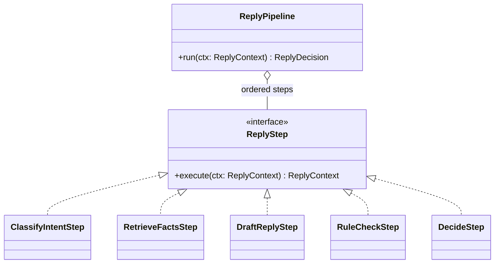
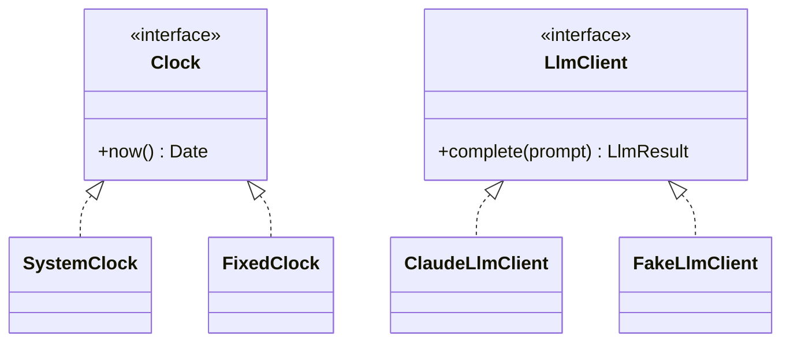
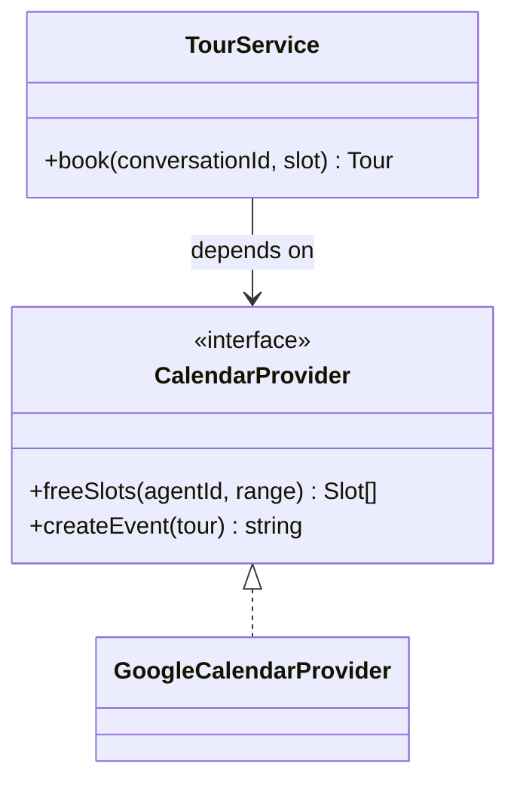
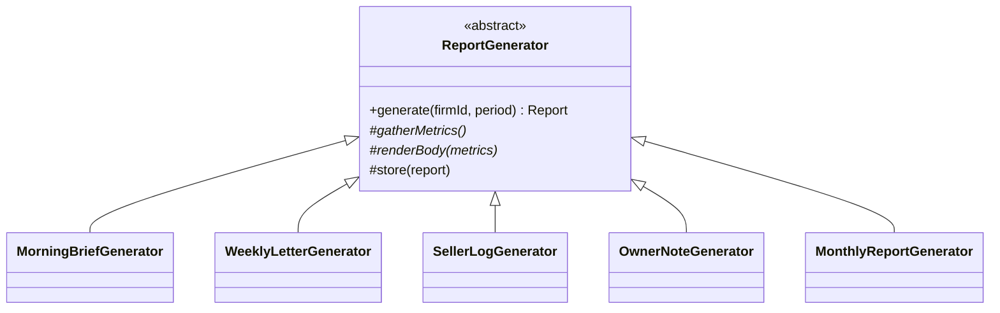
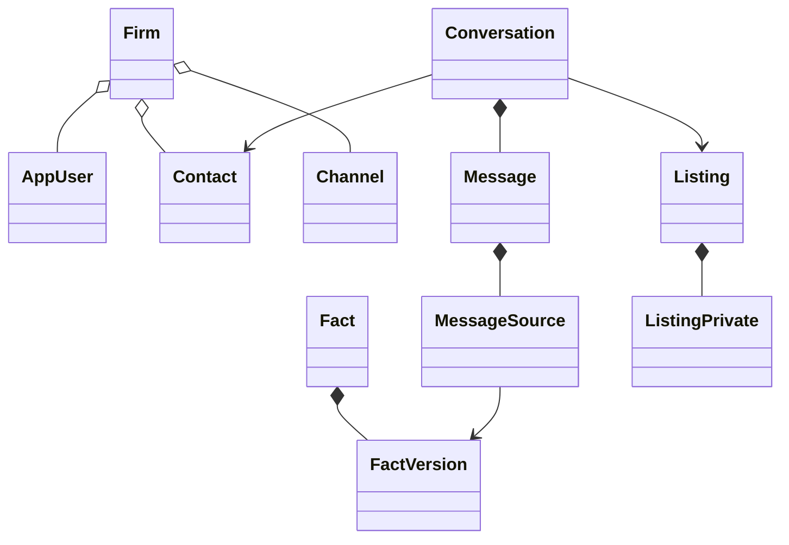

# 05. Engineering principles

This document sets the rules for how the Wynsley backend code is written. It explains the SOLID principles, composition and inheritance, and the three kinds of object relationship, each with examples from this codebase, then covers module boundaries, errors and retries, logging, testing, naming, folder layout and the pull-request checklist.

## 1. SOLID

SOLID is five rules for object-oriented code that keep classes small, replaceable and easy to test.

### 1.1 Single responsibility

**A class should have one reason to change.**

`ReplyPipeline` only runs steps in order. Each `ReplyStep` does one job: `ClassifyIntentStep` labels the inquiry, `DraftReplyStep` writes the draft, `RuleCheckStep` runs the rules, `DecideStep` picks send, queue or keep. A new fair-housing rule changes only `FairHousingRule`; a new model changes only the `LlmClient` implementation.



**How to read this.** The pipeline holds a list of steps (hollow diamond) and knows only the `ReplyStep` interface. Each dotted arrow means "implements". Every step reads and adds to one shared `ReplyContext`.

**This would break it:** a `ReplyService` that classifies, drafts, checks consent, sends the email and writes the ledger in one 400-line method. Any change to sending would risk the drafting logic.

### 1.2 Open/closed

**Code should be open to new behaviour but closed to editing what already works.**

New channels are added by writing a new `ChannelAdapter` and registering it in `ChannelAdapterRegistry`. `InquiryIngestService` does not change when `SmsChannelAdapter` arrives. The same holds for a new `ReplyRule` (add a class, add it to the rule list) or a new `ListingSourceAdapter` for another MLS.

**This would break it:** a `switch (channel.kind)` inside `InquiryIngestService` with a case per channel. Every new channel would mean editing and re-testing the ingest code.

### 1.3 Liskov substitution

**Any implementation of an interface must work wherever the interface is expected, with no surprises.**

`FixedClock` can stand in for `SystemClock`, and a fake `LlmClient` for `ClaudeLlmClient`, because each keeps the same promises: `now()` returns a time; `complete()` returns text or throws one of the declared errors. Every `ReportGenerator` subclass returns a finished `Report` from `generate()`.



**How to read this.** Code that asks for a `Clock` or an `LlmClient` cannot tell which implementation it got. The real ones are used in production; `FixedClock` and the fake model client are used in tests.

**This would break it:** a `ManualListingAdapter.fetchChanges()` that throws "not supported" when `ListingSyncService` calls it. Callers would then need to check which adapter they had. It should return an empty list instead.

### 1.4 Interface segregation

**Do not force a class to depend on methods it does not use.**

`ChannelAdapter` has only `receive` and `send`. Channel health is not part of it: `HeartbeatService` sends its test through the adapter and checks arrival through the ledger. `Notifier` has one method, `notify`, so `ReviewQueueService` does not see anything about email templates or phone numbers. Read-only callers such as `EngineModule` get `ListingReader`, not the whole `ListingSyncService`.

**This would break it:** one `ListingService` with `sync`, `purgeRemoved`, `readPublic` and `readPrivate`. The engine would then hold a method that reads private fields, even if it never calls it. The database draws the same line: `desk_engine` has no permission on the `listing` table and reads listings only through the `listing_for_engine` view.

### 1.5 Dependency inversion

**High-level code should depend on interfaces, and the low-level details should implement them.**

`TourService` depends on `CalendarProvider`, not on Google's library. `GoogleCalendarProvider` implements it. `DraftReplyStep` depends on `LlmClient`, not on the Claude SDK. Repositories work the same way: `ConversationRepository` is an interface; the PostgreSQL class implements it.



**How to read this.** The solid arrow means `TourService` uses the interface. The Google class points up to the interface, so the dependency runs from the detail to the abstraction, never the other way.

**This would break it:** `TourService` calling `new google.calendar(...)` directly. Tests would need a real Google account, and adding Microsoft calendars would mean rewriting the service.

## 2. Composition over inheritance

**Inheritance** means a class extends a parent and reuses its code. **Composition** means a class is built from other objects it holds and calls.

- **Inheritance, only for the `ReportGenerator` family.** All five reports follow the same steps: gather numbers, write the body, store the `Report`, send it. The abstract class fixes that order (the **Template Method** pattern) and each subclass fills in its own parts.
- **Composition everywhere else.** `ReplyPipeline` is built from `ReplyStep`s and `RuleCheckStep` from `ReplyRule`s, so a firm can have rules added, removed or reordered without a class hierarchy. Aggregates such as `Conversation` are composed of their `Message`s.



**How to read this.** The solid arrows with hollow heads mean "extends". `generate` is written once in the parent and calls the starred methods, which each subclass must write. Inheritance stops at one level.

Why: the reports truly share one fixed sequence, so inheritance removes repetition safely. The reply path changes often and per firm, so it must be assembled, not inherited.

## 3. Association, aggregation and composition

- **Association:** one object refers to another, and both live independently. `Conversation` refers to `Contact`, `Channel` and `Listing`; `Tour` refers to `Listing` and `AppUser`; `Handoff` refers to `AppUser`; `MessageSource` refers to a `FactVersion` or a `Listing`.
- **Aggregation:** a whole groups parts that can also exist alone. `Firm` groups `AppUser`s, `Contact`s, `Channel`s and `MlsSource`s.
- **Composition:** the part cannot exist without the whole and is deleted with it. `Conversation` owns its `Message`s; a `Message` owns its `MessageSource`s; a `Fact` owns its `FactVersion`s; a `ReplayRun` owns its `ReplayItem`s; a `Listing` owns its `ListingPrivate`.



**How to read this.** A hollow diamond is aggregation, a filled diamond is composition, and a plain arrow is association. In code, a composed part is only created and saved through its owner's repository (for example, messages through `ConversationRepository`).

## 4. Module boundaries and dependency injection

Each NestJS module exports only its public services and interfaces. The rule from the high-level design applies:

- Modules talk only through exported interfaces or services, never another module's repositories or entities.
- Nothing outside `EngineModule` depends on its steps, rules or `LlmClient`; others call `ReplyPipeline`, or `ContentDraftService` for pages, posts, drip wording and onboarding drafts.
- Every module may write to the ledger, only through `LedgerService.append`.
- `TenancyModule` and `LedgerModule` depend on nothing. No cycles.

**Dependency injection in NestJS:** a class lists what it needs in its constructor, and NestJS creates and passes in those objects (called providers) when the app starts. Interfaces are bound to classes with a token, for example `{ provide: LLM_CLIENT, useClass: ClaudeLlmClient }`, so a test swaps in a fake by changing one line.

## 5. Error handling, retries, idempotency and logging

### Errors

- Throw typed errors from the domain (for example `ConsentMissingError`, `FactNotApprovedError`); map them to HTTP responses in one exception filter in the `api`.
- Outside services raise two kinds: **retryable** (timeouts, rate limits, 5xx responses) and **permanent** (bad request, revoked mailbox access). Adapters translate vendor errors into these two.
- A database rule violation (RLS, ledger trigger, disclosure trigger) is a bug, never retried; it fails the job and alerts us.

### Retries

- Every outside call runs inside its own pg-boss job, never inside an HTTP request.
- Retryable failures use exponential back-off (each wait longer than the last) with a capped number of attempts.
- The inquiry is saved before any reply work. When retries run out, the job opens a `ReviewItem` and notifies staff, so the inquiry is never lost.

### Idempotency

**Idempotent** means running the same thing twice has the same effect as running it once.

- Ingest jobs are keyed on the channel's own message ID, stored in `message.external_id`; a second arrival finds the existing row and stops. The database backs this up with a partial unique index on `message (firm_id, external_id)`, so even two deliveries racing each other store one message: the loser gets a unique violation and returns the existing row.
- Sending writes the `sent` status and the `reply.sent` event in the same transaction, and the send job checks the status first, so a retried job does not send twice.
- Job keys are built from IDs (for example `reply:<conversationId>:<messageId>`), so enqueuing twice creates one job.

### Logging without personal data

- Log IDs (`firmId`, `conversationId`, `jobId`), event types, durations and error kinds.
- Never log message bodies, names, emails, phone numbers, addresses, transcripts or prompts.
- A log helper accepts only an allow-listed set of fields; anything else is dropped.
- The ledger, not the logs, is the record of what was said.

## 6. Testing

| Kind | What it covers | How |
|----|----|----|
| Unit | One class at a time: each `ReplyStep`, each `ReplyRule`, `ReplyCodeParser`, `HandoffStateMachine`, each `ReportGenerator`, `ResponseTimeCalculator` | Fakes for every interface: `FixedClock` for time, a fake `LlmClient` that returns set replies, in-memory repositories, a fake `ChannelAdapter`, `CalendarProvider` and `Notifier` that record calls |
| Integration | A module against a real PostgreSQL, through its repositories and `TenantTransaction` | A disposable PostgreSQL in Docker, the real `schema.sql` and seed data for two firms; each test runs in a transaction that is rolled back |
| Database checks | The rules the database enforces | The 171 checks in `tests.sql`: firm isolation on every tenant table, ledger and check results cannot be edited, engine cannot read private fields and reads listings only through its view, duplicate channel message IDs rejected, stage-change times kept by trigger, AI disclosure, only approved facts cited, silent-week drafts never sent, drips stopped when consent is revoked, the texting window kept inside 8 a.m.–8 p.m. in the recipient's time zone, nothing published or sent without approval, custom field values checked, no secrets in integrations, starting templates read-only to firm roles, response times, guarantee, Replay, the monthly report and cost per lead. They run in CI on every change to the schema |

Rules:

- Every interface has a fake, kept next to it in a `testing/` folder.
- Every bug fix comes with a test that failed before the fix.
- Every integration test also checks that the other firm's data is untouched.
- Unit tests never call the network or read the real clock.

## 7. Naming, folder layout and pull-request checklist

### Naming

- Classes in PascalCase, named for what they are: `...Service`, `...Adapter`, `...Step`, `...Rule`, `...Handler`, `...Generator`, `...Repository`.
- Interfaces carry no `I` prefix (`ChannelAdapter`, not `IChannelAdapter`).
- Files in kebab-case, one class per file: `fair-housing.rule.ts`, `reply-pipeline.ts`.
- Domain classes match the table names: `FactVersion` for `fact_version`.
- Ledger event types use the closed list in the schema, in `noun.verb` form: `reply.sent`, `handoff.accepted`.

### Folder layout for one NestJS module

``` code
backend/src/engine/
  engine.module.ts          wiring and exports
  reply-pipeline.ts         exported entry point
  reply-context.ts
  reply-decision.ts
  steps/                    one file per ReplyStep
  rules/                    one file per ReplyRule
  llm/
    llm-client.ts           interface and injection token
    claude-llm-client.ts
  testing/
    fake-llm-client.ts
  *.spec.ts                 unit tests beside the code
```

Repositories live in a `persistence/` folder inside the module that owns the aggregate. Only `*.module.ts` decides what is exported.

### Pull-request checklist

- [ ] The change stays inside its module, or uses only another module's exported interface.
- [ ] No new import of another module's repository, entity or internal class.
- [ ] New outside calls go through an interface and run in a job with retries.
- [ ] Database work runs inside `TenantTransaction`; no query bypasses the firm setting.
- [ ] Every state change that matters to a receipt appends a ledger event.
- [ ] No personal data in logs.
- [ ] Unit tests with fakes; an integration test if a repository or SQL changed; `tests.sql` still passes.
- [ ] Customer-facing text exists in English and Spanish.
- [ ] Lint, type check and build pass.
