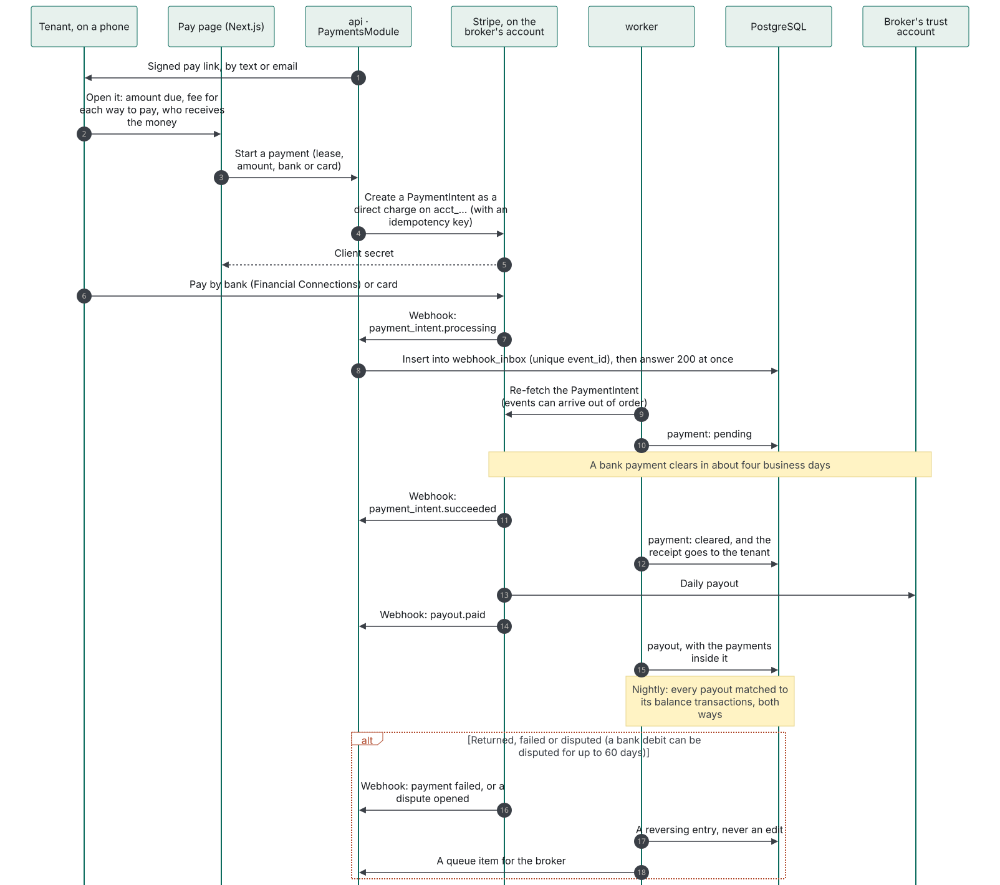
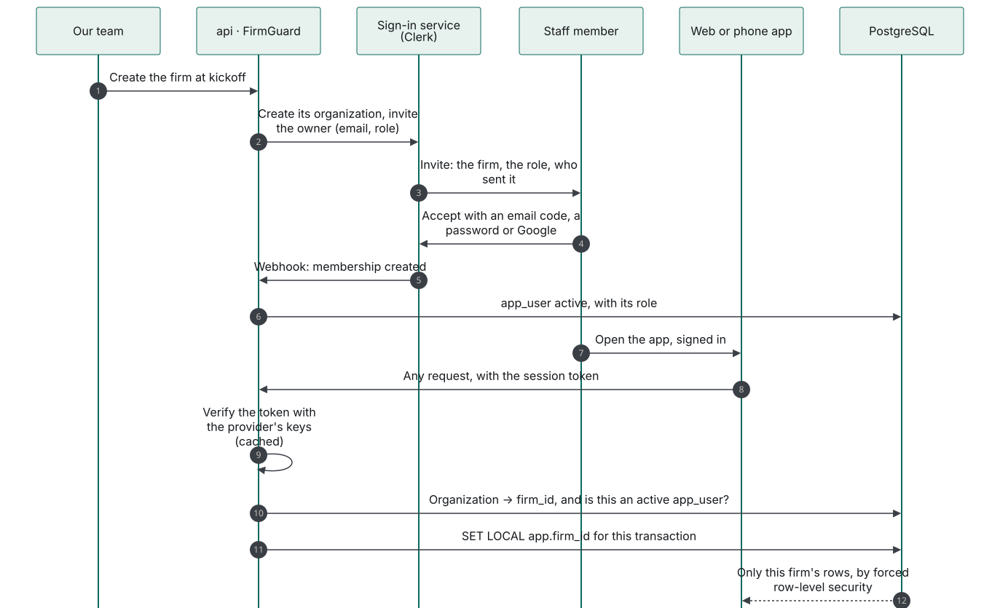

# 23 Nov update: rentals, payments, sign-in and two apps

This update changes the plan in five ways. Where the five documents below still say rent is paid only on the property software's own page, that now holds only for firms that keep their property software. The passages it replaces: the high-level design's summary (module 6), goals, non-goals, section 9 ("Rent money") and section 10 ("Never hold rent money"); the low-level design's `IntegrationsModule` (2.15) and `PmsSyncService.sync` (5.10); the resident pay route in the REST API outline; and sequence flow 16. Everything else in them stands.

### 1. What changed

| Decision | Was, on 14 Nov | Now, on 23 Nov |
|----|----|----|
| **Rentals** | Connect to the firm's property software; never replace it | CRM and PMS (property-management software) in one product, in stages: connect first; then our own rentals tools, first for firms without a PMS; moving firms off their PMS last |
| **Rent** | Reminders deep-link to the PMS's own payment page | A direct charge on the broker's own Stripe account, paid out to its trust account. Wynsley starts and records each payment and never holds the money |
| **Apps** | Next.js apps, designed for the phone first | Two codebases on one API: Next.js for the web and an Expo phone app (iPhone first, then Android), sharing one typed client generated from the API's OpenAPI description |
| **Sign-in** | A session token; provider not chosen | A managed provider (Clerk recommended), invitation only, one organization per firm, mapped to `firm_id` by `FirmGuard` |
| **MLS** | A sync for the desk, at least every 12 hours | One hourly sync feeds the desk and the firm's website; the 12-hour deadline covers what visitors see |

### 2. Modules, new and changed

- `RentalsModule` (new): units (the existing `property` rows), leases and renewals, repair requests and their routing to the firm's own people, and owner updates. It uses `CrmModule` for people, properties and roles, the notifier for messages, and `LedgerModule` for every step.
- `PaymentsModule` (new): the broker's Stripe account (onboarding and status), signed pay links, payments as direct charges, the Connect webhook endpoint with `webhook_inbox`, the payment record, payouts and the nightly match. It is the only module that writes money rows, and it uses `TenancyModule` and `LedgerModule`.
- `IntegrationsModule` (changed): property-software adapters are read-only by default, with an export as the fallback. `createWorkOrder` and `paymentLink` are used only for firms that keep their PMS, and nothing sold depends on them.
- `TenancyModule` (changed): `FirmGuard` verifies the sign-in provider's session token, maps its organization to `firm_id`, checks for an active `app_user`, and only then sets `app.firm_id`.

### 3. Online rent, start to finish

Every webhook is stored once (unique `event_id`) and processed by the worker, which re-fetches the object from Stripe. Money rows are never updated: a return or a dispute posts a reversing entry.

### 4. From an invite to row-level security

There is no public sign-up. Customers never sign in: tenants pay from signed links, and agents can act from an alert's signed link or reply code.

### 5. Planned tables

Planned, not yet in `schema.sql`. `firm`, `property`, `contact` and `person_property_role` exist today, and a lease's tenants are the people with the tenant role on its property. Every new table carries `firm_id` under forced row-level security, and child rows point at parents by (`firm_id`, `id`), as today. `webhook_inbox` stands alone: one row per Stripe event, unique by `event_id`.

### 6. Stripe set-up

- **Connect, with direct charges.** The broker's own Stripe account takes the charge, and payouts go to its trust account. Destination charges and separate transfers are avoided, because they land the money in our balance first.
- **Account settings.** Stripe carries the losses (`controller.losses.payments = stripe`) and collects the account's requirements (`requirement_collection = stripe`). Capabilities: `card_payments` and `us_bank_account_ach_payments`.
- **Fees.** If the trust account must receive the full rent, Wynsley pays Stripe's fees (`fees.payer = application`) and bills the broker's operating account. This is set when an account is created, so it is decided before the first live account.
- **Bank payments.** Financial Connections verifies the tenant's bank, and the page shows the authorization wording for the bank (ACH) debit.
- **Webhooks.** One Connect endpoint. Each event goes into `webhook_inbox` and is answered at once; a pg-boss job processes it, re-fetches the object, and maps `acct_…` to `firm_id` before writing.
- **The record.** Amounts in cents (`BIGINT`); append-only rows with reversing entries; an effective date kept apart from the posted time; "late" worked out in `America/New_York`; a month locked once the broker signs it.
- **Nightly.** Each payout is matched to its balance transactions, and Stripe's charges to our payments, both ways. A mismatch raises an alert.
- **Payouts.** Daily, to the trust account.

### 7. Test mode first: about a week

- A Stripe sandbox exists as soon as the company's Stripe account is created. Madhav puts the test keys in `.env` himself; keys never go into chat or code.
- A test connected account stands in for A&A; test onboarding accepts the code 000-000.
- Bank tests use routing number 110000000: account 000123456789 succeeds, 000222222227 fails for insufficient funds, and 000555555559 is disputed. The card 4000 0000 0000 0259 tests a card dispute.
- Done when a test tenant pays by bank and by card from the pay page; each event lands once in `webhook_inbox`; the record moves from pending to cleared; a failure and a dispute post reversing entries and reach the queue; and a payout matches its payments.
- Going live waits for the company, its EIN and bank account, Stripe's platform review and the attorney's four answers.

### 8. What rent costs to move, at Stripe's list prices

| Item | Cost |
|----|----|
| A bank (ACH) payment | 0.8%, capped at \$5 |
| A card payment | 2.9% + 30¢ |
| If Wynsley pays the fees | Also \$2 per active account a month, and 0.25% + 25¢ per payout |
| 50 homes at \$2,457 a month, all by bank | About \$250 a month if the fee comes out of each payment; about \$560 if Wynsley carries the fees |
| 150 homes, all by bank | About \$750 a month, or about \$1,670 |

Rainforest, Adyen and Finix are cheaper rails to price later.

### 9. Risks and open questions

- **The attorney's four questions:** when online rent counts as received for the three-business-day deposit rule, since a bank payment settles in about four business days and then pays out; whether the trust account must receive the full rent; how returns and chargebacks that debit the trust account are handled; and whether the design stays outside Florida's money-transmitter law (560.103).
- **Stripe's written OK,** during its platform review, for rent paid out to brokers' trust accounts.
- **Security deposits stay out.** Florida wants them in a separate account at a Florida financial institution (83.49).
- **Property-software access varies.** AppFolio's partner API needs an application and a security review, and its database API is read-only on Plus and read-write on Max; Buildium's open API needs its Premium plan. So read-only sync, with exports as the fallback, is the default.

The five documents of the 14 Nov system design stand, except where this page says otherwise. [Back to the System Design](README.md).
